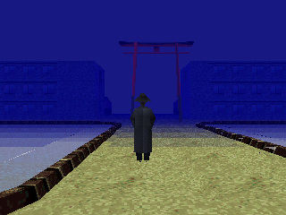
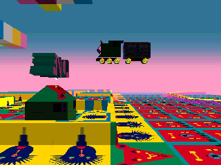
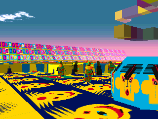
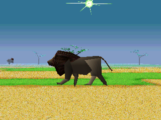
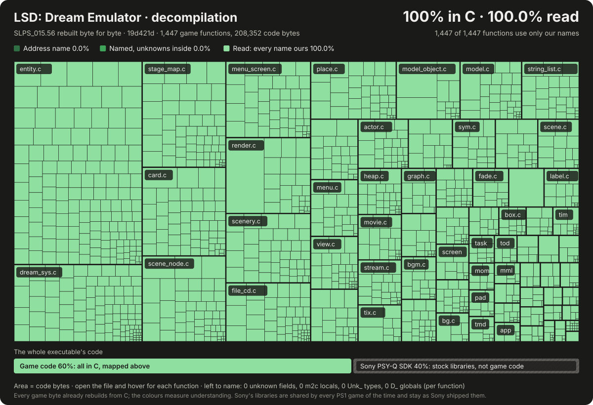

# lsd-decomp

A matching decompilation of **LSD: Dream Emulator** (PlayStation, Asmik Ace, 1998), retail release SLPS-01556.

<p>




</p>

Every function of the game is C that rebuilds the retail executable byte for byte. The point is to understand how the game works: the dream graph, links, special days, the Grey Man, texture sets and the random seed. Each finding is written for players, with the function and address that prove it.

## At a glance

- **1,447 of 1,447 game functions in C**, compiled by GCC 2.6.3 and ASPSX 2.21 at -O2 -G8; `make check` compares the sha1 of the result with the retail `SLPS_015.56`.
- **1,903 names of our own**, each with its evidence in `config/symbol_addrs.txt`. An audit rated all 4,159 names we gave (functions, globals, struct fields and types): 192 checked in game, 3,899 proven by the code, 68 guesses that say what is unproven ([config/name_levels.tsv](config/name_levels.tsv)).
- **68 source files** laid out the way the original programmers most likely had them, in link order between Sony's objects ([docs/layout.md](docs/layout.md) gives the evidence for each boundary), with one header per file in `include/game/`.
- **Shiftable**: every pointer into the executable is a symbol, so code can be added before `main` and the game still runs. `tools/rawscan.py` relinks the build at another address and finds 0 fixed addresses, and a build with 0x100 extra bytes before `main` played the same dream as the retail one in an emulator.
- **Every function read**: no function body uses a placeholder name any more (a few struct slots that no code touches keep theirs). What the game never uses is named as such (`unused4C`, `App_EmptySlot48`), with the proof that nothing reads or calls it.
- **56 findings and 4 community myths checked** in [docs/discoveries.md](docs/discoveries.md): 35 of the 60 entries checked in an emulator, 12 partly, 13 read in the code only.

## Progress

[](docs/progress/treemap.svg)

Every game byte already rebuilds from C, so the map measures understanding instead: a function is "read" when every name in its body is ours, with no `unk_` field, m2c local, `Unk_` type or `D_` global left. All 1,447 are. The last 43 were mostly dead code: fields the game writes and never reads, empty functions in class slots nothing calls, and three functions nothing references. Their names say so instead of inventing a purpose ([docs/naming.md](docs/naming.md)). Open the map to hover each function; `docs/progress/progress.json` holds the same data.

The bar under the map is the whole executable. The other 40 % of its code is Sony's PSY-Q SDK (graphics, sound, CD, memory card and C library routines), the stock libraries every PS1 game of the time linked. Its 626 functions are recognised as Sony's library code and linked as Sony shipped them: they are not part of LSD. Two files first taken for game code turned out to be Sony's sound library and moved there.

## Highlights from the findings

- [The secret video reel](docs/discoveries.md#-the-secret-video-reel-four-graph-points-and-11-minutes-of-film): a face drawn on the graph makes it blink green, then 20 special-day videos play back to back for 11 minutes 13 seconds.
- [The Grey Man flips your graph and wipes your memories](docs/discoveries.md#-the-grey-man-flips-your-graph-and-wipes-your-memories): his mood sits past the edge of the graph, so touching him throws your day to the opposite corner.
- [SELECT + TRIANGLE in the pause erases your game](docs/discoveries.md#-select--triangle-in-the-pause-erases-your-game): the game's only hidden button input, with no warning.
- [The first dream of a new year starts from the wrong data](docs/discoveries.md#-the-first-dream-of-a-new-year-starts-from-the-wrong-data): a bug picks the start place from part of a score instead of day 365.
- [A red day fills the Maze of Questions with rainbow penguins](docs/discoveries.md#-a-red-day-fills-the-maze-of-questions-with-rainbow-penguins): one penguin becomes nine, and 1 in 5 lone penguins is a giant.
- [A Clockwork Machines track that can never play](docs/discoveries.md#-a-clockwork-machines-track-that-can-never-play): the dice can pick it, but the game plays the next track instead.

## Where to read

| Page | What it holds |
| --- | --- |
| [docs/discoveries.md](docs/discoveries.md) | The findings, for players first, with the proof folded under each one |
| [docs/mysteries.md](docs/mysteries.md) | The 15 questions the project set out to answer: 13 answered, 2 still partly open |
| [docs/design-intent.md](docs/design-intent.md) | What the code says about what the creators meant, set against their own words, with how sure each reading is |
| [docs/engine/](docs/engine/README.md) | How each system works, for a programmer opening the code: boot and objects, files and the CD, rendering, sound and video, menus and saves, the dream system, links, stages, characters, randomness |
| [docs/naming.md](docs/naming.md) | Naming conventions and the glossary |
| [docs/layout.md](docs/layout.md) | The 68 source files in link order, with the evidence for each boundary |
| [docs/community-knowledge.md](docs/community-knowledge.md) | What players and earlier projects knew before |

## Building

You need Linux x86-64 with `make`, `git`, `curl`, a C compiler (`gcc`), Python 3 with `venv`, `binutils-mipsel-linux-gnu` and stable Rust (for `mipsmatch`), about 1.1 GB of disk, plus your own dump of the game disc. In-game checks also need a Japanese PS1 BIOS (SCPH-7000). No game or BIOS file is provided here.

```sh
git config core.hooksPath tools/hooks
tools/setup.sh                  # pinned toolchain into tools/ and .venv/
ln -s /path/to/your.bin disks/SLPS-01556.bin
printf 'FILE "SLPS-01556.bin" BINARY\n  TRACK 01 MODE2/2352\n    INDEX 01 00:00:00\n' > disks/SLPS-01556.cue
make check-disk                 # extracts the disc, checks SLPS_015.56
make split && make check        # splits the executable, builds it from src/, compares the sha1
```

If setup warns that the pinned PCSX-Redux build is gone from its download site, the build still works: only the in-game checks below need the emulator.

`make check-disk` must print `extract/SLPS_015.56: OK` and `make check` must print `build/SLPS_015.56: OK`. Only the executable has to match: fan translation patches leave it untouched.

To boot the game headless in PCSX-Redux and capture the title screen:

```sh
ln -s /path/to/your/bios.bin disks/bios.bin
LSD_EMU_SHOTS=3600 LSD_EMU_FRAMES=3600 tools/emu/run.sh
```

## How it was made

The C, the names, the docs and the emulator checks were written by AI agents, mostly Claude Opus 5.5 and Claude Haiku 5.5 (a few naming and search passes by Grok 4.7 and GLM 5.3). A change was kept only when `make check` still matched.

## Legal

Fan project, not affiliated with Asmik Ace or Osamu Sato. It ships no game asset: no executable, no disc data, no audio, no dump of the game's text or images. The source keeps only the file names and debug messages the code refers to, and you need your own copy of the game to build anything. The only game images are the small emulator screenshots that illustrate the findings. Nothing built from it is distributed. A takedown request from the rights holder will be honored.

## Credits

Address map cross-checked against FirecatFG's lsddecomp; file formats documented by Figglewatts' libLSD and LSDView; game knowledge from the compu-lsd, dreamemulator.fandom.com and LSD Revamped wikis.

Built with splat, maspsx, m2c, decomp-permuter, asm-differ, mipsmatch, objdiff, mkpsxiso, old-gcc and PCSX-Redux; Sony's library functions were identified with lab313ru's psx_psyq_signatures. `include/include_asm.h`, `macro.inc`, `labels.inc` and `gte_macros.inc` are splat's generated files (MIT, Copyright (c) 2021 Ethan Roseman).
