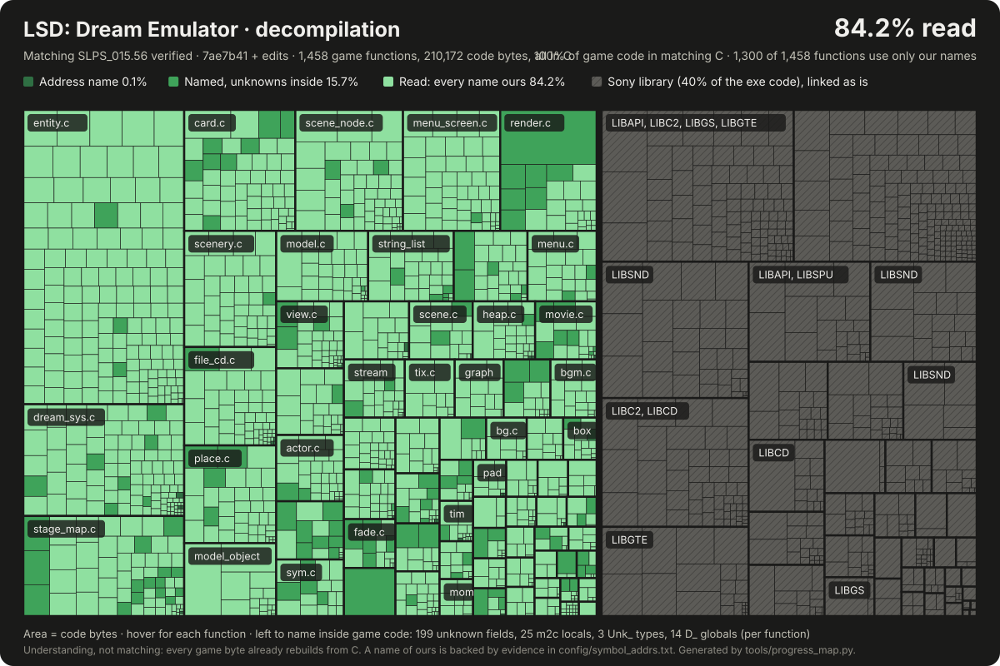

# lsd-decomp

A matching decompilation of LSD: Dream Emulator (PlayStation, Asmik Ace, 1998), retail release SLPS-01556.

The goal is to understand how the game works: the dream graph, links, special days, the Grey Man, texture sets and the random seed. Every finding is written down with the function and address that prove it ([docs/discoveries.md](docs/discoveries.md)), against a list of open questions ([docs/mysteries.md](docs/mysteries.md)).

## Status

All 1,458 game functions are C that rebuilds the retail executable byte for byte (`make check` compares its sha1); the 613 functions of Sony's PSY-Q libraries are linked as assembly. Built with GCC 2.6.3 and ASPSX 2.21 at -O2 -G8. The C reads like source: one header per file in `include/game/` with its types and prototypes, our own PSY-Q headers in `include/psyq/`, and 1,902 names of our own, each with its evidence in `config/symbol_addrs.txt`; the 13 functions still named by address are 6 empty vtable slots, 5 empty functions nothing references and 2 setters of fields nothing reads. The code is laid out in the 70 source files the original programmers most likely had, named by what they hold, in link order between the Sony objects ([docs/layout.md](docs/layout.md) gives the evidence for each boundary).

The build is also shiftable: every address in it is a symbol, so code can be added or removed and the game still runs (`tools/rawscan.py` relinks it at another address and finds 0 fixed addresses; a build with 0x100 extra bytes before `main` plays the same dream as the retail one in an emulator).

[](docs/progress/treemap.svg)

Since every game byte already rebuilds from C, the map measures understanding: a function is "read" when every name in its body is ours, with no `unk_` field, m2c local, `Unk_` type or `D_` global left. `tools/progress_map.py` redraws it after a green `make check` and writes the per-function data to `docs/progress/progress.json`.

How each system works, for someone opening the code for the first time (boot and the object model, files and the CD, rendering, sound and video, menus and saves, the dream system, links, stages and places, characters, randomness), is in [docs/engine/](docs/engine/README.md), with a reading order from `main`.

The findings page holds 60 player-readable findings, most checked in an emulator, and a section of community myths checked against the code.

## Requirements

- Linux x86-64 with `make`, `git`, `curl`, Python 3 with `venv`, `binutils-mipsel-linux-gnu` and stable Rust (for `mipsmatch`).
- Your own dump of the game disc, and of a Japanese PS1 BIOS for in-game checks. No game or BIOS file is provided here.

## Setup

```sh
git config core.hooksPath tools/hooks
tools/setup.sh                  # pinned toolchain into tools/ and .venv/
ln -s /path/to/your.bin disks/SLPS-01556.bin
printf 'FILE "SLPS-01556.bin" BINARY\n  TRACK 01 MODE2/2352\n    INDEX 01 00:00:00\n' > disks/SLPS-01556.cue
make check-disk                 # extracts the disc, checks SLPS_015.56
make split && make check        # splits the executable, builds it from src/, compares the sha1
ln -s /path/to/your/bios.bin disks/bios.bin
LSD_EMU_SHOTS=3600 LSD_EMU_FRAMES=3600 tools/emu/run.sh   # boots headless in PCSX-Redux, captures the title screen
```

`make check-disk` must print `extract/SLPS_015.56: OK`. Only the executable has to match: fan translation patches leave it untouched.

## Legal

Fan project, not affiliated with Asmik Ace or Osamu Sato. It ships no game asset (no executable, disc data, text or audio) and you need to own the game; the only game images are the small emulator screenshots that illustrate the findings. Nothing built from it is distributed. A takedown request from the rights holder will be honored.

## Credits

Address map cross-checked against FirecatFG's lsddecomp; file formats documented by Figglewatts' libLSD and LSDView; game knowledge from the compu-lsd, dreamemulator.fandom.com and LSD Revamped wikis.
