# Discoveries

What reading the game's code taught us about LSD: Dream Emulator. Each finding below says in plain words what happens when you play, then keeps the proof (functions, addresses, tables, how it was checked) folded under "Technical details". Open questions live in [mysteries.md](mysteries.md).

Status of each finding:

- 🎮 Checked in the game: we ran the game in an emulator, changed or watched its memory, and saw the predicted result on screen or in memory.
- 🎮 Partly checked: part of it was seen in the emulator, the rest is read in the code.
- 📖 Read in the code only: the code says so, nobody has seen it happen yet.

The screenshots come from the game running in an emulator, sometimes with memory values written in to reach a state quickly; each finding says when.

## The findings at a glance

Days and years
- [The day counter and the hidden year](#the-day-counter-and-the-hidden-year): after day 365 you are back on day 1 and a hidden year counter goes up.
- [The first dream of a new year starts from the wrong data](#the-first-dream-of-a-new-year-starts-from-the-wrong-data): a bug picks the start place from part of a score instead of day 365.

The ending
- [The ending plays when a year closes, not on day 365](#the-ending-plays-when-a-year-closes-not-on-day-365): the video comes right after the dream of day 365, when the counter goes back to day 1.

The dream graph
- [The secret video reel: four graph points and 11 minutes of film](#the-secret-video-reel-four-graph-points-and-11-minutes-of-film): a face drawn on the graph makes it blink green, then plays 20 special-day videos back to back.
- [How a day becomes a point on the graph](#how-a-day-becomes-a-point-on-the-graph): an average of the moods of where you walked and what you touched.
- [The graph screen only shows your last 100 days](#the-graph-screen-only-shows-your-last-100-days): a full year-long graph never appears on screen.
- [How the graph picks where tomorrow starts](#how-the-graph-picks-where-tomorrow-starts): 51 graph points lead nowhere, and 93 others wake you in the right place but on another square.

How long a dream lasts
- [The start place sets the length of the dream](#the-start-place-sets-the-length-of-the-dream): from 1 to 10 minutes, fixed the moment you fall asleep.

Special days
- [The 42 special days](#the-42-special-days): 13 fixed days plus a weekly run that stops at day 204.
- [What a special day shows](#what-a-special-day-shows): a video 1 time in 3, a still picture 2 times in 3.

Flashbacks
- [How flashback memories are kept](#how-flashback-memories-are-kept): 1 chance in 3 per moment, 10 slots, and the tenth is never replaced.
- [What unlocks Flashback in the menu](#what-unlocks-flashback-in-the-menu): a score above 9,999,999, mostly from the navigation goals, which are the fixed links.
- [What erases the flashbacks](#what-erases-the-flashbacks): touching the Grey Man wipes them all, every time.

The Grey Man
- [The Grey Man flips your graph and wipes your memories](#the-grey-man-flips-your-graph-and-wipes-your-memories): his mood sits past the edge of the graph, so touching him throws your day to the opposite corner.
- [When the Grey Man can appear](#when-the-grey-man-can-appear): even days only, 1 chance in 12 at a spot left empty that day.
- [Who can meet the Grey Man, and where](#who-can-meet-the-grey-man-and-where): he only replaces odd-day characters, and six places never get him.

Characters and events
- [A red day fills a Happy Town street with gunmen](#a-red-day-fills-a-happy-town-street-with-gunmen): one gunman becomes nine, and the question mark in the sky goes away.
- [The hidden rules that decide which characters appear](#the-hidden-rules-that-decide-which-characters-appear): day cycles, your mood so far, and groups that show up only once.
- [The character record: mood, points, waking up and leaving](#the-character-record-mood-points-waking-up-and-leaving): 130 character types, and the five that end the dream on a video.
- [Signals from characters and objects](#signals-from-characters-and-objects): touching, forced links, forced endings and event videos.

Textures
- [Glitch textures: a texture set that failed to load](#glitch-textures-a-texture-set-that-failed-to-load): the place is drawn with leftovers, and the dream ends 30 seconds later.
- [The 40-day texture cycle](#the-40-day-texture-cycle): the later in a 40-day cycle, the more texture sets a place can wear.

Links between places
- [Fixed links are the navigation goals, and one can never be completed](#fixed-links-are-the-navigation-goals-and-one-can-never-be-completed): 29 of the 30 goals can be reached, so the big bonus never pays out.
- [Where a random link sends you](#where-a-random-link-sends-you): the place after yours comes up twice as often as the others.
- [Fixed links do not change with visits, but some depend on who showed up](#fixed-links-do-not-change-with-visits-but-some-depend-on-who-showed-up): no visit counter; four characters switch on extra links.

Music
- [A Clockwork Machines track that can never play](#a-clockwork-machines-track-that-can-never-play): the dice can pick it, but the game plays the next track instead.
- [A switch to pin the music that nobody pulls](#a-switch-to-pin-the-music-that-nobody-pulls): a leftover way to force one sound bank and one track.

Memory card
- [Everything the game remembers fits in one block](#everything-the-game-remembers-fits-in-one-block): 1,792 bytes, starting with the letters J01, with the SHAKE option and the video reel flag.
- [How the memory card save works](#how-the-memory-card-save-works): the day number goes into the save title, and a new game saves to a new file.

Randomness
- [The dice of the game](#the-dice-of-the-game): a fixed number sequence that is almost never reseeded; "type A and B days" are just odd and even days.

Hidden and unused content
- [SELECT + TRIANGLE in the pause erases your game](#select--triangle-in-the-pause-erases-your-game): the game's only hidden button input, with no warning; no cheat code exists.
- [The dog that never loads](#the-dog-that-never-loads): a dog model sits on the disc, but the loader stops before it.
- [What the game never asks for](#what-the-game-never-asks-for): three files on the disc and one menu slot, and no debug menu found.

Myths checked
- [Myth: a hidden ending if the graph is full](#myth-a-hidden-ending-if-the-graph-is-full): false.
- [Myth: no Grey Man after day 365](#myth-no-grey-man-after-day-365): false, he came back in year two.
- [Myth: over 500 music tracks](#myth-over-500-music-tracks): false, 462 at most, and some of them are silence.

## Days and years

### The day counter and the hidden year

The game counts your days. The number you see is the internal counter plus one, so the first day shows as day 1. When day 365 ends, the counter goes back to day 1 and a hidden year counter goes up by one. The game never shows the year, but it is saved, it plays [the ending video](#the-ending-plays-when-a-year-closes-not-on-day-365) when it goes up, and it changes how the next dream starts (see the next finding).

Status: 🎮 checked in the game.

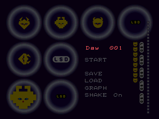
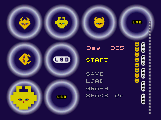

Technical details

Day counter: +0x180 counts from 0; `DreamSys_AdvanceDay` @0x8005A304 increments it and at 365 sets it to 0 and increments the year at +0x17C. Code that needs the day number calls `DreamSys_GetDayNumber` @0x8005A2E4 (vtable 0x1A0), which returns day+1 and the year. `DreamSys_StartDay` @0x8005A368 saves the day at +0x88C when a dream starts and `DreamSys_EndDay` @0x8005A41C restores it before advancing.

- Proof: `DreamSys_AdvanceDay` @0x8005A304 (matched C), `DreamSys_GetDayNumber` @0x8005A2E4, `DreamSys_StartDay` @0x8005A368, `DreamSys_EndDay` @0x8005A41C.
- In game: yes. Poked day 364 (and +0x88C) during a dream and forced the timer; after that dream ended the RAM read year 1, day 0.
- Question: [8](mysteries.md#days-textures-randomness). Found 2026-10-15.

### The first dream of a new year starts from the wrong data

Each dream starts from the graph point of the day before. On the first day of a new year, yesterday is day 365, but the game reads the wrong two bytes: part of the touch score (see [the flashback unlock](#what-unlocks-flashback-in-the-menu)) instead of day 365's point. So the first dream of year 2 and later can start somewhere unrelated to how day 365 went. Only the very first day of a new game is handled on purpose: it always starts from the middle of the graph.

Status: 🎮 checked in the game.

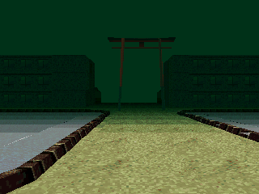

Technical details

First dream of a new year: the start point comes from the wrong bytes. `DreamSys_GetPreviousPoint` @0x8005B1F4 (vtable 0x1EC, mode 1) reads yesterday's graph point at +0x190 + (day-1)*2; on day 0 with year >= 1 it reads +0x18E, the upper half of the instance score at +0x18C, instead of day 364's point. Only year 0 day 0 is special-cased to (0,0).

- Proof: `DreamSys_GetPreviousPoint` @0x8005B1F4 (asm: `lb 0x190(day*2-2)`), caller `DreamSys_ChooseStart` @0x8005A508.
- In game: yes. Set the instance score to 0x01FD0000 (bytes 0x18E, 0x18F = -3, 1) and wrapped the year; the next dream started on stage 2 with time limit 7200 and its first logged chunk mood (-3, 1), as predicted from the table; day 364's point (0,0) would have given stage 0.
- Questions: [8](mysteries.md#days-textures-randomness), [2](mysteries.md#graph-and-dream-start). Found 2026-10-15.

## The ending

### The ending plays when a year closes, not on day 365

The ending video (the erupting Mount Fuji and a countdown) does not play during day 365. It plays right after that dream ends, at the moment the day counter goes back to day 1 and the hidden year counter goes up. Then the menu comes back on "Day 001". The game checks for "day 1 and a year above 0", so the video should come back at the end of every later year too. Nothing else in the game asks for the ending video.

Status: 🎮 checked in the game (the end of year 1; later years are read in the code only).

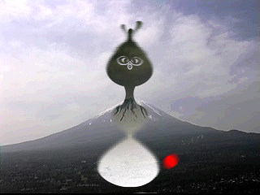

Technical details

The scene class (vtable `0x8006D3C8`, built by `func_80025F7C` from `main` @0x800118DC) runs its loop in `func_8003B110`: slot 0x50 logos, then forever slot 0x54 opening video, slot 0x58 title; when the title returns 2, slot 0x60 runs the dream (`func_80026698`), and if that returns non-zero slot 0x64 `func_80026900` plays the video returned by `func_800491FC` (file table base `func_80048D48` + 0x3E04 = `ETC\ENDING.STR` @0x80085808, video index 7). `func_80026698` returns 1 when `DreamSys_GetDayNumber` @0x8005A2E4 (vtable 0x1A0) returns 1 and writes a non-zero year. After a normal end, `DreamSys_EndDay` @0x8005A41C calls `DreamSys_AdvanceDay` @0x8005A304, which wraps 364 to 0 and adds a year. No other code reads the ending entry.

- Proof: `func_8003B110` @0x8003B110, `func_80026698` @0x80026698, `func_80026900` @0x80026900, `func_800491FC` @0x800491FC, `DreamSys_GetDayNumber` @0x8005A2E4, vtable 0x8006D3C8 (slot 0x64 = 0x80026900, the only pointer to it).
- In game: yes. Interpreter run (`work/hunt3/run3.log`): day +0x180 = 364 at vsync 2300, dream started (StartDay at 3126), timer +0x24 = 3590 of 3600 at 4000. Breakpoints: `DreamSys_EndDay` type 0 at 4366, then `func_80026900` at 4378 with year 1, day 0; the video ran until the title at 6360, which showed "Day 001". Forced: day and timer.
- Not checked: the end of year 2 and later. By the same test, a dream that does not advance the day (a flashback) started on day 1 of year 1 or later should replay the ending; not run. The pause code's type 1 quit would do the same, but no input reaches it ([the erase combo](#select--triangle-in-the-pause-erases-your-game)).
- Questions: [14](mysteries.md#events-and-hidden-content), [8](mysteries.md#days-textures-randomness). Found 2026-10-15.

## The dream graph

### The secret video reel: four graph points and 11 minutes of film

The graph hides a face. If, among the days the graph screen shows (your last 100), your day points have landed at least once on each of four exact cells, the game plays a secret. The four cells are the centre, the cell just above it to the left, the cell just above it to the right, and the cell three steps below the centre: two eyes, a nose and a mouth. The order and the dates do not matter.

When the graph screen comes up after the title, those four cells turn green one after the other. Then, instead of the menu, a long film starts by itself: the special-day videos back to back (pigeons on a window sill, a sheep, a radio tower and more), 20 of the 24, about 11 minutes by the game's own count. You can only see it once per game: a flag is set and saved with the game, and only a new game, or [the erase combo](#select--triangle-in-the-pause-erases-your-game), clears it.

Status: 🎮 checked in the game, with the graph points written in (the film was watched for several minutes, not to its end).

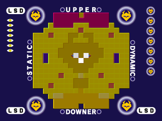
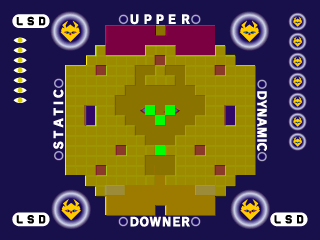

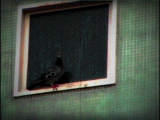

Technical details

The graph screen draw `func_80058404` @0x80058404 gets the save block (DreamSys vtable 0x1B0, DreamSys + 0x178: +0x4 year, +0x8 day, +0x18 graph) and stores `func_800585B4` @0x800585B4 in +0x238. `func_800585B4` (now C, `src/game/80058078.c`) returns 0 at once when byte +0x467 of the save block is set. That byte is DreamSys +0x5DF: the hunters' notes give both offsets, and they are the same byte (0x178 + 0x467 = 0x5DF). Otherwise, for each of the 4 targets of `D_80087BD4` (s8 pairs as (x, y): (-1, 1), (1, 1), (0, 0), (0, -3)) it compares the stored s16 point of the last n days, n = min(day, 100) in year 0 and 100 from year 1 on, walking back from yesterday and wrapping to index 0x16C. It writes the position of a matching day into the 4-byte buffer at +0x240 and returns 0 as soon as one target has no match. When all four match it sets +0x467 = 1, +0x23C = 0 and returns 1.

- Blink: `func_80058694` @0x80058694, while +0x238 is set and the screen timer +0x1C is at least 31, paints the next of the four matched points every 24 frames with `D_8008ABBC` = (0, 255, 0). The newest point is normally red `D_8008ABB4` and older ones fade from white `D_8008ABB8` (`func_80058228`).
- Exit: `func_80058390` returns 2 instead of the screen's normal result when +0x238 is set. The title routine `func_80026410` @0x80026410 runs the graph before the menu when the game is not on its first day (and the video flag of the scene settings is on); a 2 calls `func_8002658C` @0x8002658C, which asks `func_800493E4(&len, 0, 10)` @0x800493E4 for the path `FILM\SPDAY01A.STR` (`Cine_GetSpecialDayPaths(0)`) and a length: the sum of the 20 entries of `g_videoTable` @0x80086170 from index 14 (categories 0 to 9, both videos each) plus 10 frames per join, 10,122 frames, 674.8 s at 15 frames per second. The video player (`func_8003B854`, slots 0x6C, 0x12C, 0x44) plays that path for that length; `SPDAY01A.STR` to `SPDAY10B.STR` are contiguous on the disc (LBA 127656 to 229085), so the stream runs on through the ten categories' A and B videos in order.
- Once per game: +0x5DF lies inside the 0x700-byte block the memory card saves ([the save block](#everything-the-game-remembers-fits-in-one-block)), and only `DreamSys_InitNewGame` @0x8005A258 clears it (`arg0->unk5DF = 0`), which a new game and the erase combo both call. Saving then reloading a game that has seen the reel was not run.
- Proof: `func_80058404`, `func_800585B4`, `func_80058694`, `func_80058390`, `func_80026410`, `func_8002658C`, `func_800493E4`, `DreamSys_InitNewGame`; tables `D_80087BD4`, `D_8008ABBC`, `g_videoTable`.
- In game: yes, two independent runs (dynarec, `work/shots/drive.lua`). Run A: +0x180 = 4 (day 5), +0x190 to +0x197 = the four points, +0x5DF = 0 at vsync 2100, CIRCLE at 2200 opened the graph; the cells were white at 2520 and turned green one at a time (one at 2600, three at 2700, four at 2800, 100 pure-green pixels per cell); at 3200 a full-screen video played with no input. A second run with captures every 700 vsyncs up to 13,400 showed the film going through different clips (inverted city crowd, machinery, TV static, the pigeons of the day-7 video, a sheep with a timecode, a pagoda, a radio tower). Control run: same day with points (2, 2), (3, 3), (4, 4), (5, 5), no green, and the graph left to the menu (Day 005) on its own. Run B (`work/hunt4/B-run6.log`): day 10, the four points then six others; +0x5DF went from 0 to 1 between vsync 2300 and 2400, the four cells turned green between 2560 and 2900, and a video ran from about 3600 and was still running at 4500. Forced: the day and the graph points only.
- Not checked: the end of the film (its 11 minutes are the game's own count, not timed), which frames come from which file, and the flag surviving a save and load.
- Question: [4](mysteries.md#graph-and-dream-start). Found 2026-10-15.

### How a day becomes a point on the graph

Every area of a dream carries a mood, a point on the graph from -9 to 9 on each axis, and so do the characters and objects you touch. At the end of a normal day, the game averages the moods of the areas you walked through and adds a third of the last one; it does the same for what you touched, then takes the middle of the two. If you touched nothing, only the areas count. A result past 9 does not stop at the edge: it jumps to the opposite edge, -9, and a result below -9 jumps to 9. That jump is how [the Grey Man flips your graph](#the-grey-man-flips-your-graph-and-wipes-your-memories). Only a normal day end stores a point, and days watched in flashback mode leave none. The graph screen shows [your last 100 days](#the-graph-screen-only-shows-your-last-100-days).

Status: 🎮 checked in the game (the whole sum, the third of the last one and the jump included, during the Grey Man test).

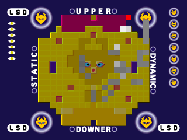

Technical details

Graph point of a day: `Mood_Log` @0x8005B5B8 (vtable 0x208) keeps two accumulators, chunks at +0x144 and entities at +0x154, each {last point, sum x, sum y, count}. `Mood_CalcAxis` @0x8005B66C makes each axis `sum / count + last / 3` (C division, truncated), and a result above 9 becomes -9 and below -9 becomes 9 (a flip to the edge, not a modulo). `DreamSys_ComputeDayPoint` @0x8005B420 averages the chunk and entity results per axis, using the chunk result twice when no entity was logged (+0x160 = 0). `DreamSys_EndDay` @0x8005A41C stores it in the graph at +0x190 + day*2, only on a normal end (argument 0) outside flashback mode, then advances the day. The graph screen `func_80058404` draws the last 100 days at 10 units per step.

- Proof: `Mood_Log` @0x8005B5B8, `Mood_CalcAxis` @0x8005B66C (both matched C), `Mood_Resolve` @0x8005B5F0, `DreamSys_ComputeDayPoint` @0x8005B420, `DreamSys_EndDay` @0x8005A41C, `func_80058404` @0x80058404.
- In game: yes. The forced end wrote day 364's point from a chunk-only accumulator ((0,0), count 1); the new dream's chunk accumulator held (-3,1). The Grey Man run then exercised every term: chunks {last (-3, 1), sum (-3, 1), n 1} gave (-3 + -1, 1 + 0) = (-4, 1); entities {last (-10, -10), sum (-10, -10), n 1} gave -10 + -3 = -13, flipped to 9 on both axes; the stored point was the truncated mean (2, 5). Logs `work/hunt3/gm.log` to `gm3.log`.
- Question: [1](mysteries.md#graph-and-dream-start). Found 2026-10-15.

### The graph screen only shows your last 100 days

The graph screen draws one point per day, but only for your last 100 days. On day 150 the first 50 days are gone from the picture, and from the second year on it always shows exactly 100. The newest point is red and the older ones fade from white to dark grey. A full year-long graph never appears on screen.

Status: 🎮 checked in the game, with the graph points written in.

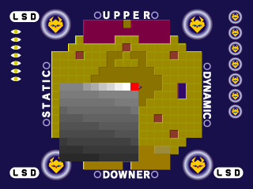
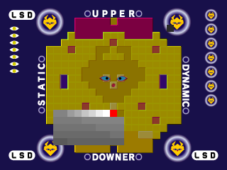

Technical details

`func_80058404` @0x80058404 draws n = min(day, 100) points in year 0 and 100 from year 1 on, walking back from yesterday's index and wrapping from 0 to 0x16C (day 365). `func_80058228` creates exactly 100 point sprites: the first is red, the next six fade by 20 per step from white, the rest by 1.

- Proof: `func_80058404`, `func_80058228`.
- In game: yes (dynarec, runs 3 and 4 of `work/hunt4/`): days 1 to 50 written at (8, 8), the top-right cell, then a 10 x 10 block in the lower left. With +0x180 = 150 the top-right cell is empty; with 99 a dark grey point sits in it. Forced: the day and the graph points.
- Found 2026-10-15; it also rules out [the "full graph" ending](#myth-a-hidden-ending-if-the-graph-is-full).

### How the graph picks where tomorrow starts

Tomorrow's dream starts in the first area, in the game's own list order, whose mood is exactly yesterday's point. Day 1 starts from the middle of the graph and so always opens in the same place. Of the 361 points of the graph, 51 match no area at all: most sit in the four corners, plus two odd holes near the middle. After a day that lands on one of them, the dream always starts in the same place (number 1 in the game's list) at one of its 3 spawn points, and the game counts it as a random link, which lowers the [flashback score](#what-unlocks-flashback-in-the-menu).

Each place is a grid of map squares, each with its own mood. Filler squares (sea edges, empty corners) carry the mood (9, 0), which the game uses as "no mood here": 106 squares in 8 places. But (9, 0) is also a real graph point, so a day that ends there matches the first filler square in the list, an empty square of place 1, and you then wake up at one of place 1's arrival points. The game can only drop you on a square that has an arrival point: 93 of the 310 points that match a square name one without, so you wake up in the right place, but on another of its squares.

Status: 🎮 partly checked in the game (the fallback to place 1 was not triggered; the filler squares and the 93 off-square starts are read in the code and data only).

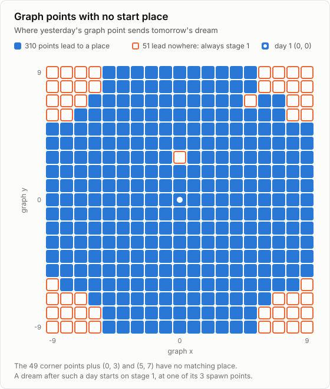

Technical details

Start chunk choice: `Stage_FindChunkByMood` @0x8004950C scans stages 0 to 13 and their chunks row by row and returns the first chunk whose s16 mood equals yesterday's point. `Spawn_PickFromMood` @0x8005C28C then takes the stage's spawn point that names that chunk (else chunk % count). With no match it returns -1, and `Spawn_PickRandom` @0x8005BB30 turns -1 into stage 1 (`negu`), with a random spawn among its 3: always stage 1, not a random zone. 51 of the 361 points have no chunk: 49 in the four corners, all with abs(x) >= 6 and abs(y) >= 6 (13 in the top-left corner, 12 in each other one; the corners are cut along a rough diagonal, not as full 4 x 4 squares, see the chart), plus (0,3) and (5,7). (0,0) lands on stage 0, chunk (0,3). That fallback also increments the dynamic-link counter.

The {9, 0} sentinel: the grids `D_80086590[stage]` (s16 mood per square, row-major, low byte x, high byte y; sizes at `D_800861D4`) hold (9, 0) on 106 squares: stage 1 (1), 2 (1), 3 (74), 4 (3), 5 (3), 11 (10), 12 (13), 13 (1). They are filler pieces: in stage 4 the squares of column 5 rows 0, 2 and 4, whose files are the small 8,580 and 6,740-byte ones; in stage 3 the 4,944-byte edge pieces (chunk file of square (col, row) = `M{row*cols+col:03d}.LBD`, checked on all 14 stages; lsddecomp's `StageGrid.c` shows the same values). `Stage_FindChunkByMood` has no special case, so the point (9, 0) matches stage 1, square (0, 1), key 0x100. `Spawn_PickFromMood` then looks for an arrival record (`D_800885B8[stage]`, 6-byte records keyed by row << 8 | col, counts `D_800885F0`) naming that square; none does, so it takes record `key % count` = 256 % 3 = 1, square (1, 0) of stage 1. The same happens for 93 of the 310 matched points (count printed by an inline script over the same tables): the place is exact, the square is not always. The chunk mood logger has no filter either (`func_8005AFDC`, event 5 → vtable 0x1F4 → `Mood_Log`), so walking into a (9, 0) square would count (9, 0) toward the day; whether any filler square can be walked into was not checked.

- Proof: `Stage_FindChunkByMood` @0x8004950C, `Spawn_PickFromMood` @0x8005C28C, `Spawn_PickRandom` @0x8005BB30, tables 0x80086590, 0x800861D4, 0x800885B8, 0x800885F0; coverage computed by `work/hunt/moodmap.py`. The same script shows stage 3 is the first match for 180 of the 310 covered points. Square-to-file check: `work/hunt4/A/mml.py`.
- In game: partly. Day 1 (point (0,0)) and the poked point (-3,1) both landed on the predicted stage; the stage-1 fallback was not triggered.
- Chart: `work/findings/charts.py`, which checks its list of 51 points against the executable (`--check`).
- Question: [2](mysteries.md#graph-and-dream-start). Found 2026-10-15.

## How long a dream lasts

### The start place sets the length of the dream

How long you get to wander is decided the moment you fall asleep, by the place the dream starts in: from 1 minute to 10. Walking through links never adds or removes time; only in flashback mode does a link restart the clock. These are the game's own figures; in the emulator the clock ran slower than real seconds, so the real length on a console may be longer.

Status: 🎮 checked in the game (the limit, not the real-time speed of the clock).

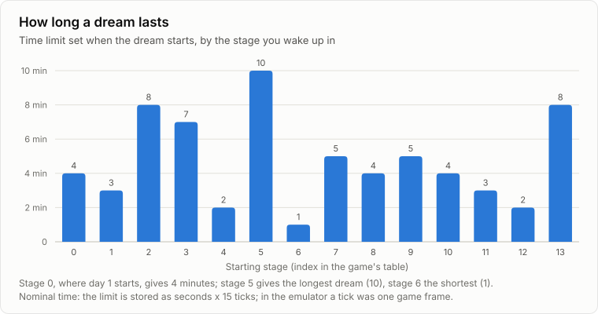

Technical details

Dream length is fixed when the dream starts, from the starting stage: `Spawn_PickFromMood` @0x8005C28C reads the s16 seconds table `g_stageTimeLimits` @0x80087F14 (stages 0 to 13: 240, 180, 480, 420, 120, 600, 60, 300, 240, 300, 240, 180, 120, 480) and `DreamSys_SwapTimeLimit` @0x80059328 (vtable 0x104) stores seconds x 15 at +0x134. `DreamSys_TickTimer` @0x80058D94 (vtable 0x98) adds 1 to the timer at +0x24 on each message 2 and ends the dream once the count before the increment reaches the limit; `DreamSys_GetElapsedSeconds` @0x80059360 converts ticks back with /15. Links do not touch the limit; `DreamSys_ExecuteLink` @0x8005A928 zeroes the timer on a link only in flashback mode (+0x68 set).

- Proof: `DreamSys_ChooseStart` @0x8005A508, `Spawn_PickFromMood` @0x8005C28C, `DreamSys_SwapTimeLimit` @0x80059328 (matched C), `DreamSys_TickTimer` @0x80058D94, `DreamSys_GetElapsedSeconds` @0x80059360, `DreamSys_ExecuteLink` @0x8005A928, table 0x80087F14.
- In game: yes. Day 1 started on stage 0 with limit 3600 (240 x 15) and the year-1 dream on stage 2 with 7200 (480 x 15). In the emulator the timer gained 50 to 76 ticks per 600 vsyncs, so a tick is a game frame, not 1/15 s of real time; hardware rate not measured.
- Question: [11](mysteries.md#days-textures-randomness). Found 2026-10-15.

## Special days

### The 42 special days

The game keeps a list of 42 special days. 13 are fixed dates spread over the year, and 29 form a weekly run: every 7th day from day 7 to day 126, then, one day late, from 134 to 204. Day 126 is in both groups, so the list holds 41 different days and its second entry for 126 can never be reached. After day 204 only the fixed dates remain. On a special day the game skips the normal choice of a start place, and the day's mood log starts from the middle of the graph.

Status: 📖 read in the code only (the content a special day shows is checked, see the next finding).

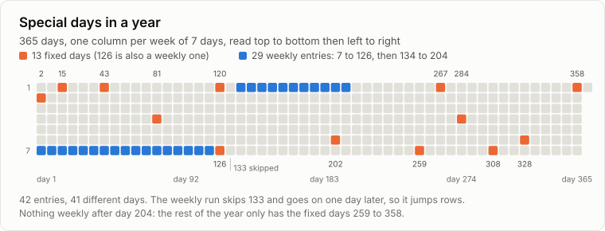

Technical details

Special days: `DreamSys_StartDay` @0x8005A368 calls `Day_FindSpecial @0x8005C438(+0x168, day number)`, which searches the 42 s16 days of `g_specialDays` @0x80088CCC. On a match it writes {index % 12, rand() % 6} at +0x168, the dream gets mood (0,0) from `D_8008ABF4` and no spawn is chosen. Day 126 is listed twice (indexes 5 and 30), so index 30 is unreachable.

Table order: indexes 0 to 12 are 2, 15, 43, 81, 120, 126, 202, 259, 267, 284, 308, 328, 358; indexes 13 to 30 are 7 to 126 in steps of 7; indexes 31 to 41 are 134 to 204 in steps of 7 (133 is not listed). Read from the executable by `work/findings/charts.py --check`.

- Proof: `Day_FindSpecial` @0x8005C438, `DreamSys_StartDay` @0x8005A368, `DreamSys_ResetMoodAccumulators` @0x8005B2F4, table 0x80088CCC.
- In game: no.
- Question: [7](mysteries.md#days-textures-randomness). Found 2026-10-15.

### What a special day shows

Each special day belongs to one of 12 categories, and each category has 6 pieces: 2 videos and 4 still pictures, 72 files in all on the disc. When a special day comes, the game rolls a 6-sided die: 1 or 2 plays a video, 3 to 6 shows a still picture. So a special day is a video 1 time in 3 and a picture 2 times in 3. Since there are 42 entries and only 12 categories, several days share the same category. The video also needs one more condition that is not understood yet.

Status: 🎮 checked in the game (both the video and the picture branch).

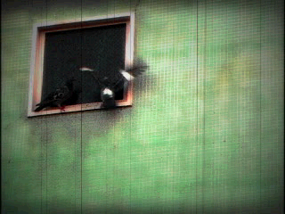

Technical details

Special-day content: `Scene_PlayCinematic` @0x8002677C reads {category, variant} through `DreamSys_GetCinematic` @0x8005A4E8 (vtable 0x1BC, the 4 bytes at +0x168) and `Cine_GetPath` @0x80049334 resolves them. For a category >= 0 the path is the table at 0x800858CC (`D_80081A04` + 0x3EC8, `Cine_GetSpecialDayPaths` @0x800492D0), 0xA8 bytes per category = 6 paths of 0x1C bytes: variants 0 and 1 are `FILM\SPDAYnnA.STR` and `B.STR`, played by `func_8003B854` with video id category x 2 + 14 + variant (s16 table `g_videoTable` @0x80086170); variants 2 to 5 get id -1 and show `IMG1\` or `IMG2\SPDAYnnC` to `F.TIM` through `func_8003BE94`. With `rand() % 6` a special day is a video 1 time in 3 and a still picture 2 times in 3. The 42 days are 13 fixed ones (2, 15, 43, 81, 120, 126, 202, 259, 267, 284, 308, 328, 358, indexes 0 to 12) then a weekly run (indexes 13 to 41): every 7th day from 7 to 126, then from 134 to 204; `index % 12` names the category, so categories share days. The video branch also needs the scene's `+0x20->+0x8` flag (unknown); the 72 files exist on the disc.

- Proof: `Scene_PlayCinematic` @0x8002677C, `Cine_GetPath` @0x80049334 (matched C), `Cine_GetSpecialDayPaths` @0x800492D0 (matched C), `DreamSys_GetCinematic` @0x8005A4E8, `Day_FindSpecial` @0x8005C438, tables 0x800858CC, 0x80086170, 0x80088CCC.
- In game: yes. PCSX-Redux interpreter with Lua breakpoints (`work/hunt2/bp.lua`): poked day 6 at `DreamSys_StartDay` @0x8005A368, `Day_FindSpecial` got day number 7, `Cine_GetPath` got category 1 variant 1 and an STR video with a timecode played (capture at vsync 3600); with the rand state forced to 1 at the same call, variant 2 came out and a still diary picture showed (vsync 3200).
- Question: [7](mysteries.md#days-textures-randomness). Found 2026-10-15.

## Flashbacks

### How flashback memories are kept

Now and then the game keeps a memory of the moment: when you touch something, and when a dream runs out of time, it rolls a 3-sided die and keeps the moment on a 1. A memory holds the place, where you stood, which way you faced and the day. Up to 10 are kept. Once all 10 slots are full, a new memory replaces one of the first nine, picked from the timer, so the tenth memory stays forever. In flashback mode each memory plays for 20 seconds before the next, and those days add no point to the graph.

Status: 📖 read in the code only.

Technical details

Flashback list: count at +0x46C, entries of 0x24 bytes from +0x470 (10 at most, ending at +0x5D8). `DreamSys_MaybeSaveFlashback` @0x8005B81C (vtable 0x218) saves one with probability 1/3 (`rand() % 3 == 0`) when the player object at +0x4C exists; it runs when the day timer expires (`DreamSys_TickTimer` @0x80058D94) and on entity message 9 (`DreamSys_OnEntityEvent` @0x8005B03C). `DreamSys_AddFlashback` @0x8005B74C (0x214) appends {stage, position, rotation, length 0x10, day} while fewer than 10 are kept, else overwrites entry `timer % 9`: once full, the 10th entry is never replaced. Flashback mode is +0x68, set by `DreamSys_SetFlashbackMode` @0x800590E8 (vtable 0xF0) from the menu (`func_8004D9D4` case 1). Playback: `DreamSys_LoadNextFlashback` @0x8005A63C (0x1CC) loads entry +0x87C (stage, position, its day into +0x180), `func_80058968` gives it 0x10 + 4 = 20 seconds and moves to the next; in that mode the day end stores no graph point.

- Proof: `DreamSys_MaybeSaveFlashback` @0x8005B81C, `DreamSys_AddFlashback` @0x8005B74C, `DreamSys_LoadNextFlashback` @0x8005A63C, `func_80058968` @0x80058968, `DreamSys_SetFlashbackMode` @0x800590E8 (matched C), `func_8004D9D4` @0x8004D9D4.
- In game: no (the Grey Man run saw one memory saved on a touch, the count going from 3 to 4, without checking the die).
- Question: [6](mysteries.md#grey-man-and-flashback). Found 2026-10-15.

### What unlocks Flashback in the menu

Flashback appears in the menu once two things are true: at least one memory is kept, and your score is above 9,999,999. The score is recomputed at the end of each normal day from two parts. The first: 1,000,000 for each hidden "navigation" goal you completed, minus 11,024 for every random link you took. The second: points from touching characters and objects, up to 50,000,000. The navigation goals are [the fixed links between places](#fixed-links-are-the-navigation-goals-and-one-can-never-be-completed): the first time you take each one, its goal is done. There are 30 goals and a 50,000,000 bonus for all 30, but one goal can never be completed, so that bonus never pays out and the navigation part stops at 29,000,000. So 10 navigation goals with no random link are enough on their own.

Status: 🎮 checked in the game, with the values written in: a score of 10,000,000 and one kept memory made FLASHBACK appear between START and SAVE. The navigation goals are read in the code only.

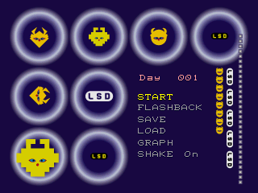

Technical details

Flashback unlock: the menu item is enabled by `Menu_UpdateFlashbackItem` @0x8004D678 only when the save block's +0xC (DreamSys +0x184, unlock score) is above 9,999,999 and +0x2F4 (+0x46C, flashbacks kept) is not 0. `DreamSys_CalcUnlockScore` @0x8005B6E0 (vtable 0x210, run by `DreamSys_EndDay` @0x8005A41C on a normal day end) sets +0x184 = +0x188 + +0x18C. +0x188 comes from `Nav_CalcScore` @0x8005BA7C: 1,000,000 per non-zero byte among the 30 navigation flags (+0x5E0 via `g_navFlags` @0x8008ACB4), 50,000,000 once all 30 are set (only above 29,999,999), minus 11,024 per dynamic link (+0x600), floored at 0. +0x18C, the instance score, is clamped to 0..50,000,000 and grows on entity message 9 by the entity's vtable 0x150 value (`DreamSys_OnEntityEvent` @0x8005B03C). So 10 navigation challenges with no dynamic link unlock it; each dynamic link costs 11,024. The flags are set only by `func_8005C150` @0x8005C150 when its sixth argument is not 0, from the two static link tables, whose union lacks flag 13: +0x188 stops at 29,000,000 and the unlock score at 79,000,000 (see [the fixed links](#fixed-links-are-the-navigation-goals-and-one-can-never-be-completed)).

- Proof: `Menu_UpdateFlashbackItem` @0x8004D678, `DreamSys_CalcUnlockScore` @0x8005B6E0, `Nav_CalcScore` @0x8005BA7C (all matched C), `DreamSys_OnEntityEvent` @0x8005B03C, `DreamSys_EndDay` @0x8005A41C, `func_8005C150` @0x8005C150.
- In game: yes, forced. On a fresh day 1 +0x184 and +0x46C read 0 and the item is absent. Writing +0x184 = 10,000,000, +0x46C = 1 and zeroing entry +0x470 at vsync 2100 made the menu show FLASHBACK between START and SAVE (capture at 2460; with a flashback kept, the title skips the graph and opens the menu). Script `work/shots/drive.lua`, log `work/shots/manifest.md`. The navigation flags were not exercised (no fixed link was taken in the emulator).
- Question: [6](mysteries.md#grey-man-and-flashback). Found 2026-10-15.

### What erases the flashbacks

The Grey Man does. One piece of code empties the whole memory list, and only he runs it: when he touches you, he vanishes in a white flash and every kept memory is gone. There is no die roll, so every touch erases them all. The same touch also [flips your graph](#the-grey-man-flips-your-graph-and-wipes-your-memories).

Status: 🎮 checked in the game, with the Grey Man forced to appear.

Technical details

Erasing flashbacks: `DreamSys_ClearFlashbacks` @0x8005B8FC (vtable 0x21C) sets +0x46C to 0 and has one caller, `Behavior_EraseFlashbacks` @0x80064618, the handler of entity type 98 (16-byte record {handler, parameters} at 0x8008A4D0, the handler at +0xC of record 98 from `D_80089EA4`). Type 98 is the Grey Man: `func_8005C650` creates the spy object with `func_8005CFDC(i + 0x62, ...)`, so the `SYMSPY.MOM` model and the eraser are the same character. A touch (`func_8005DE18`, slot 0x178 → slot 0x164 `func_8005DAAC`) sends message 9 and sets +0xF4. On its next run the handler sees +0xF4, starts the effect object `func_8005D108(obj, 0, 0, 10, 0)` (the white flash), sets state 7 on the object at +0x100, calls its own vtable 0x160, then clears the list. No code negates stored graph points: the "graph flip" is the wrap of `Mood_CalcAxis` @0x8005B66C on his mood (-10, -10).

- Proof: `DreamSys_ClearFlashbacks` @0x8005B8FC, `Behavior_EraseFlashbacks` @0x80064618, `func_8005C650`, `func_8005DAAC`, `func_8005DE18` (all matched C), record 0x8008A4D0.
- In game: yes, forced. Flashback count +0x46C = 3 written at vsync 3700; at 4399 the Grey Man touched the player, the handler ran with +0xF4 = 1 on an object of type 98 and `DreamSys_ClearFlashbacks` ran with the count at 4 (the touch had just saved one); at 4449 the count read 0. Logs `work/hunt3/gm.log`, `gm2.log`, `gm3.log`.
- Question: [5](mysteries.md#grey-man-and-flashback). Found 2026-10-15.

## The Grey Man

### The Grey Man flips your graph and wipes your memories

When you touch the Grey Man, three things happen at once. He vanishes in a white flash, every kept flashback memory is erased, and his mood is logged like any character you touch. His mood is (-10, -10), one step beyond the -9 edge of the graph. Then the "last thing touched" bonus pushes your "things touched" score further down. Past -9 the value jumps to +9, so if he is the only thing you touched, or most of what you touched was dark, that half of your day point jumps to the opposite corner. This is the graph flip players report. In the emulator, one touch moved the day's point from where it should have landed, (-6, -4), to (2, 5). If you never touch him, he leaves on his own after a fixed time: 3 minutes if his clock runs at the speed of the dream timer.

Status: 🎮 checked in the game, with the Grey Man forced to appear (his leaving on his own is read in the code only).

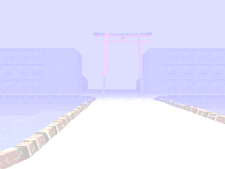
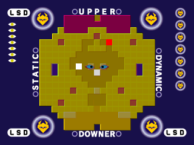

Technical details

The Grey Man is entity type 98: `func_8005C650` creates the spy object with `func_8005CFDC(i + 0x62, ...)`, and record 98 of the behaviour table (16 bytes from `D_80089EA4 + 16 * type`, handler at +0xC, so 0x8008A4D0) holds `Behavior_EraseFlashbacks` @0x80064618. Record 98: mood (-10, -10) at +0/+1, touch score 20 (x 1000, read by vtable 0x150 `func_8005D95C`), wake mode 0 (awake at spawn), sleep mode 180 (leaves after 180 x 15 ticks of his own counter +0x24), touch range 1, no link, no video. Touch: `func_8005DE18` (0x178) calls slot 0x164 `func_8005DAAC`, which sends message 9 and sets +0xF4. Message 9 (`DreamSys_OnEntityEvent` @0x8005B03C) logs the record's mood into the entity accumulator at DreamSys +0x154 (`func_8005B3F0` → `Mood_Log` @0x8005B5B8), adds 20,000 to +0x18C and may save a flashback. On its next run the handler sees +0xF4, starts the effect object `func_8005D108(obj, 0, 0, 10, 0)` (the white flash), sets state 7, calls slot 0x160 and `DreamSys_ClearFlashbacks` @0x8005B8FC. The day point is `Mood_CalcAxis` @0x8005B66C = sum / count + last / 3, wrapped to the other side past +/-9: with the Grey Man as the only entity, -10 + (-10 / 3 = -3) = -13 → +9 on both axes. The wrap happens whenever the mean of touched moods, the Grey Man included, is below -6 on an axis while he is the last one touched.

- Proof: `func_8005C650` (0x62 constant), record 0x8008A4C4, `Behavior_EraseFlashbacks` @0x80064618, `func_8005DAAC`, `func_8005DE18`, `DreamSys_OnEntityEvent` @0x8005B03C, `Mood_CalcAxis` @0x8005B66C, `DreamSys_ComputeDayPoint` @0x8005B420 (all matched C).
- In game: yes, forced. Interpreter, +0x180 = 3 (day number 4), +0x194/+0x195 = (-3, 1) so the dream starts on stage 2, rand state 0 at every `Sym_SpawnOrSpy` entry, flashback count +0x46C = 3 written at vsync 3700. At vsync 4399 he touched the player: message 9, the handler ran with +0xF4 = 1 on an object with type 98, and `DreamSys_ClearFlashbacks` ran with the count at 4 (the touch had just saved one); at 4449 the count read 0 and the instance score 20,000. The accumulators then read zones {last (-3, 1), sum (-3, 1), n 1} and entities {last (-10, -10), sum (-10, -10), n 1}. With the timer forced to the limit at 4700 the day ended and stored point (2, 5) for that day: zones give (-4, 1), entities wrap to (9, 9), mean (2, 5). Without the wrap it would have been (-6, -4). Flash captured at 4460, graph at 7100. Logs `work/hunt3/gm.log`, `gm2.log`, `gm3.log`.
- Question: [5](mysteries.md#grey-man-and-flashback). Found 2026-10-15.

### When the Grey Man can appear

Each spot where a character can stand has a day rule: always, odd days only, or even days only. When a spot stays empty because of its rule, the day number is even and you are not in the first place of the game's list, the game rolls a 12-sided die; on a 1, the Grey Man stands there instead. So he never shows up on odd days. Forcing the die in the emulator on day 4 brought him out, walking toward the player; when he reached the player the screen flashed white and [the memories were erased](#what-erases-the-flashbacks).

Status: 🎮 checked in the game, with the die forced.

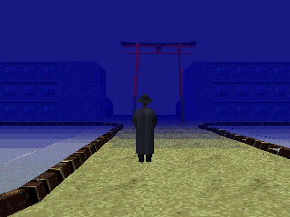

Technical details

Grey Man spawn: per entity spawn slot, `func_80054120` calls `Sym_SpawnOrSpy @0x8005C7D4(entity, slot, day number)` (day number from vtable 0x1A0 of the object that `func_800534C8` also passes as `D_8008AC00`). `Sym_CheckDayParity` @0x8005C9A4 returns `flag != (day % 2) + 1` for a non-zero flag: a slot's entity appears when its flag is 0, or 1 on odd day numbers, or 2 on even ones. When the flag blocks it, the stage index (`g_currentStage` @0x8008ABF8) is not 0, `rand() % 12 == 0` and the day number is even, `Sym_SpawnSpy` @0x8005CF34 spawns the model loaded from `ETC\SYMSPY.MOM` (`g_spyModel` @0x80088D28, loaded by `Sym_LoadModels` @0x8005C508). So only flag-1 slots on even days can hold him. The forced spawn in the emulator shows the Grey Man (hat, long coat), so `SYMSPY.MOM` is his model; he is entity type 98, whose handler erases the flashbacks (see [What erases the flashbacks](#what-erases-the-flashbacks)).

- Proof: `Sym_SpawnOrSpy` @0x8005C7D4 (asm: `andi s1,1` and the 0x2AAAAAAB divide by 12), `Sym_CheckDayParity` @0x8005C9A4, `func_8005C8AC` @0x8005C8AC, `Sym_LoadModels` @0x8005C508, `func_80054120` @0x80054120.
- In game: yes, forced. PCSX-Redux interpreter: +0x180 = 3 (day number 4, even), yesterday's point +0x194/+0x195 = (-3, 1) so the dream starts on stage 2, rand state 0 at every `Sym_SpawnOrSpy` entry (3 slots, vsyncs 3460 to 3481); the Grey Man walked toward the camera (capture at 4400) and the screen flashed white when he reached the player (4500). A later run with the same setup measured the flashback list cleared by that contact (`work/hunt3/gm.log`). Log `work/shots/manifest.md`.
- Question: [5](mysteries.md#grey-man-and-flashback). Found 2026-10-15.

### Who can meet the Grey Man, and where

The Grey Man only takes a spot that its own rule leaves empty. A spot marked "odd days only" is empty on even days, and since he also needs an even day, he only ever takes the place of odd-day characters. Some places have no such spot at all: stages 1, 3, 8, 10 and 12 have only "every day" spots, and stage 0 is excluded outright. He cannot appear in those six. He can appear in stages 2, 4, 5, 6, 7, 9, 11 and 13.

Status: 📖 read in the code only (the rule that lets him spawn was seen working on stage 2).

Technical details

`Sym_CheckDayParity` @0x8005C9A4 returns `flag != (day % 2) + 1` for a non-zero flag: flag 1 lets the slot's characters appear on odd day numbers only, flag 2 on even ones only. `Sym_SpawnOrSpy` @0x8005C7D4 rolls for the Grey Man only when that check fails, the stage is not 0 and the day number is even, so only flag-1 slots on even days can hold him. Slot tables: per stage, `D_80089A8C[stage]` points to 6-byte slots {s16 chunk key, s8 day flag, s8 groups[3]}, with the count in `D_80089AC4[stage]`. All slots have flag 0 in stages 1, 3, 8, 10 and 12. Dump: `work/hunt3/spawns.py`.

- Proof: `Sym_CheckDayParity` @0x8005C9A4, `Sym_SpawnOrSpy` @0x8005C7D4, `func_8005C8AC` @0x8005C8AC (matched C), tables 0x80089A8C and 0x80089AC4.
- In game: only the stage 2 case (`work/shots/manifest.md`, grey-man.png); the empty stages were not walked.
- Question: [5](mysteries.md#grey-man-and-flashback). Found 2026-10-15.

## Characters and events

### A red day fills a Happy Town street with gunmen

In Happy Town there is a street square where, on odd-numbered days, a single figure with a long gun stands and a big question mark floats in the sky. If the colour of your day so far is red when that square loads, the question mark is gone and eight more gunmen stand there, nine in all. Touching one flashes the screen red and sends you to another corner of Happy Town, a grey courtyard with a blue and white checkered floor.

The colour of your day comes from your graph point so far: the game cuts the graph into a 3 by 3 grid and gives each part one of 8 colours. Red is the bottom middle part: neither static nor dynamic, and downer. The easiest way in is to end a day on the point (2, 8), near the top of the graph. If the next day has an odd number, the dream starts on that very square, and the square's own mood plus the game's bonus for the last place visited pushes your point past the top edge. It flips to the bottom of the graph: red, and the gunmen come out.

Status: 🎮 checked in the game: only the day number and yesterday's point were written in; the red colour and the crowd came from the game itself.

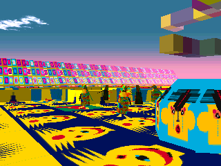
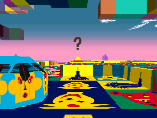
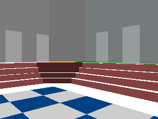

Technical details

Square: stage 4 (Happy Town), column 0 row 4 (key 0x400, `STG04\N1\M024.LBD`, mood (2, 8)). Its spawn slot 16 (day flag 1: odd day numbers only) lists groups 13 (type 51, rule always, place 81), 22 (type 54, model 1, place 84: the question mark) and 25 (type 113). `func_8005C930` swaps slot 16 for slot 21 when the stage is 4 and `GetDreamColor` (DreamSys vtable 0x200) returns 4; it compares the colour with the stage number, which happens to be 4. Slot 21 holds groups 13, 26 and 27; the last two are type 114 with rule 11 (`SPECIAL_COLORS[1]` = 4), 4 places each (129 to 136), and `func_8005CAB4` spawns a group at each listed place. Types 51 and 114 use the same model (model 0 of the square's MML) and the same record (touch range 6, link -5 → stage ~(-5) = 4 with +8 = 1, so they link as soon as the player is close); only the handler differs (`func_80060D80` vs `func_800650F4`, which picks random animations).

- Colour at the start: the chunk accumulator holds only (2, 8); `Mood_CalcAxis` gives x = 2 + 2 / 3 = 2 and y = 8 + 8 / 3 = 10 (integer division), flipped to -9; `func_8005B518` bands (2, -9) to [1][0] of `D_80087E14` = 4 (red in lsddecomp's colour enum). The link flash uses `D_8006EA90[4]` = (255, 0, 0).
- Proof: `func_8005C930`, `func_8005CAB4`, `func_8005CBC8`, `func_8005CD58`, `func_8005B518`, `Mood_CalcAxis` @0x8005B66C, spawn dump `work/hunt3/spawns.txt`.
- In game: yes, interpreter (`work/hunt4/A/q12.lua`, breakpoints on `Sym_SpawnOrSpy`, `func_8005CBC8`, `func_8005CDF8`, `func_8005B518`). Forced: +0x180 = 4 (day number 5) and yesterday's point +0x196 = (2, 8) at vsync 2100, nothing else. Log `work/hunt4/A/ht1.log`: colour point (2, -9) at 3420, type 51 at place 81, then type 114 at places 129 to 136; six of them in one frame while turning (run `ht-pan`). Control `ht-ctl.log`: the chunk accumulator forced to (0, 0) at every slot check (colour 7): types 51 and 54 only, and the question mark floats over the square. Touch (`ht-red.log`): walking forward from 4400 met a gunman, red screen from 4700 to 5000, then the grey checkered courtyard at 5100, still stage 4.
- Question: [12](mysteries.md#events-and-hidden-content). Found 2026-10-15.

### The hidden rules that decide which characters appear

Each place has a list of character groups, and each group has a rule checked when its spot loads. Some rules follow the day: every day, even or odd days, one day in three, or a 90-day cycle of three 30-day "months". Others follow your mood so far today: the group appears only if the colour of your day so far (one of 8 colours) matches. Some groups are marked "once": they can appear one time, then not again until the dream world is rebuilt (most likely each new dream). A group can stand at up to 4 places at once, and stage 4 has a spot where, in one mood colour, two such groups fill 8 places with the same character: that is the ["many gunmen" sighting, now seen in the game](#a-red-day-fills-a-happy-town-street-with-gunmen). The "many minotaurs" are not matched yet.

The colour table players know from lsddecomp as `SPECIAL_COLORS` is part of these rules: for 8 of them it names the colour your day must be in for a group to come out (yellow, red, cyan, white, black, green, blue, pink, one each). It has nothing to do with links.

A character's look comes from the map square it stands on, not from its type: each square's file carries one to three models, and a group only says "model 0, 1 or 2 of this square". So a "rare version" of a character is often the same model with another behaviour swapped in by a day or colour rule. The Happy Town gunman is one (types 51 and 114). Another: in stage 1, a creature that normally stands alone comes as three on a yellow day, walking, and sends you elsewhere in stage 1 as soon as you come near (seen in the spawn log, not on screen).

Status: 📖 read in the code only (one colour rule, the gunmen, is checked in the game).

Technical details

A slot lists up to 3 groups; `func_8005C9DC` tries each group in turn. Groups are 8-byte entries in `D_80089A44[stage]` (count `D_80089A7C[stage]`): {+0 done flag, +1 s8 rule, +2 model index, +3 entity type, +4 u8 places[4] ending at 0xFF}. `func_8005CBC8` reads the rule; a negative rule only passes while the done flag is clear, and the flags are cleared by `Sym_LoadModels` @0x8005C508, called from `func_80049684` (the world constructor that also loads `ETC\DREAMER.TMD`); that this runs once per dream is likely, not measured. Rules: 0 and 1 always; 2, 3 and 4 pass when the 30-day month `(day - 1) / 30 + 1` equals 1, 2 or 3 plus a multiple of 3 (`func_8005CDA8`; the 13th month, days 361 to 365, never passes); 5 day % 3 == 0; 6 day % 3 != 0; 8 and 9 day % 3 == 1 or 2; 20 even days; 21 odd days; 7 `func_8005630C` (bit 0 of `D_8008AC80`, picked by `func_80054758` from a 16-entry table; its meaning is unproven); 10 to 17 (`func_8005CD58`) compare `D_80088D16[rule]` (6, 4, 3, 7, 0, 2, 1, 5) with the current colour, DreamSys vtable 0x200 `func_8005B4E0` = `DreamSys_ComputeDayPoint` banded by `func_8005B518` (< -3, -3..3, >= 4) into the 3x3 table `D_80087E14` = {6,7,2 / 4,7,1 / 3,0,5}. `func_8005CAB4` spawns the type at every listed place (`func_8005CDF8` per place). Stage 4, slot 16 (chunk 1024) switches to slot 21 when the colour is 4 (`func_8005C930`), whose groups 26 and 27 put type 114 on 8 places. Other colour groups: stage 1 type 109 (x3, colour 6), stage 2 types 110, 20 (x4), 21 (x2), 94 (x2), stage 3 types 119 to 122, stage 4 types 112 (x4, colour 5) and 113, stage 5 type 85 (x4, colour 3), stage 8 type 95 (x4, colour 1), stage 12 type 108 (colour 6). Full dump: `work/hunt3/spawns.txt`.

`SPECIAL_COLORS`: lsddecomp's symbol 0x80088D20 (s8[8], "gets compared against the current dream color") is `D_80088D16 + 10`, the part of the table that `func_8005CD58` @0x8005CD58 reads for rules 10 to 17 (`func_8005CBC8` default branch): rule 10 → 6 (yellow), 11 → 4 (red), 12 → 3 (cyan), 13 → 7 (white), 14 → 0 (black), 15 → 2 (green), 16 → 1 (blue), 17 → 5 (pink), in lsddecomp's colour enum. The colour is that of the running day point when a square's characters are created.

Models: `func_8005CAB4` gets the model with `chunk->vt->unk88(chunk, group.model)` on the square's LBD object (`func_80044A0C`), then creates the entity with the group's type (`func_8005CDF8` → `func_8005CFDC(type, ...)`). The square file's MML (offset at LBD +0x10) holds the models; every group's model index exists in its square's file (all 14 stages, `work/hunt4/A/mml.py`, list `work/hunt4/A/models.txt`). Stage 1, square (col 1, row 1), model 0 is shared by type 8 (rule always, place 24, wake mode 3, handler `func_8005E694` stands still) and type 109 (rule 10 = yellow, places 110 to 112, awake at spawn, link -2 → stage 1 with +8 = 4, handler `func_80064CEC` walks).

- Proof: `func_8005C9DC`, `func_8005CAB4`, `func_8005CBC8`, `func_8005CDA8`, `func_8005CD58`, `func_8005C930`, `func_8005CDF8` (all matched C), `func_8005B4E0`, `func_8005B518`, tables 0x80089A44, 0x80089A7C, 0x80088D16, 0x80087E14.
- In game: the stage 4 colour rule, see [the gunmen](#a-red-day-fills-a-happy-town-street-with-gunmen). The stage 1 yellow trio in the spawn log only: interpreter, +0x180 = 4, yesterday's point +0x196 = (0, -9) (the dream starts on that square), chunk accumulator forced to (-6, -6) at each slot check (colour 6): `work/hunt4/A/ly.log` shows type 8 at place 24 and type 109 at places 110 to 112; control `lc.log` (natural colour blue): type 8 only. They did not come into view, so no picture; whether they are the community's "special lions" is not proven.
- Questions: [12](mysteries.md#events-and-hidden-content), [3](mysteries.md#graph-and-dream-start). Found 2026-10-15.

### The character record: mood, points, waking up and leaving

Every character type, 130 of them, has a 16-byte record. It gives the mood logged when you touch it, the points it is worth (from -100,000 to +100,000), when it wakes up, when it leaves, how close you must be to touch it, and where it sends you or which video it plays. A character can wake up when you come near or when you walk away. Three types (7 and 8 in stage 1, 102 in stage 6) also need luck: near you, they have 1 chance in 128 per tick to wake. Type 102 is the only character of stage 6 and sends you to stage 12. The characters that end the dream on a video are type 13 (stage 2, always there), type 11 (stage 2, even days), type 47 (stage 4), type 79 (stage 9, rule "once") and type 89 (stage 5, rule "once"). Type 12 in stage 2 ends the dream without a video.

Status: 📖 read in the code only.

Technical details

Record `D_80089EA4 + 16 * type`: +0/+1 s8 mood (returned whole by vtable 0x14C `func_8005D944`), +2 s8 points / 1000 (0x150 `func_8005D95C`), +3 wake mode (`func_8005DBF0`, 0x170: 0 at spawn via `func_8005D314`, 1 in range, 2 out of range, 3 in range then `(rand() & 0x7F) == 0`, 4 `(rand() & 0x7F) == 0` anywhere), +4 sleep mode (`func_8005DD18`: 1 in range, 2 out of range, >= 10 after `mode * 15` ticks), +5 wake range, +6 touch range (`func_8005DE18`; negative also makes it face or follow the player through `func_8001EACC`), +7 link (0x154 `func_8005D994`: v > 0 → stage v - 1, v < 0 → stage ~v, sent as message 10; when v < 0 and +8 != 0, `func_8005DF9C` links as soon as the player is within +8 << 9), +8 video + 1 (0x158 `func_8005D9D0`, message 11), +9 range parameter, +0xB another range (0x168), +0xC handler run each tick (`func_8005DAFC` registers it). Message 11 senders: handlers of types 11 (`func_8005E7F8`, video 3), 13 (`func_8005EBB4`, video 3), 47 (`func_8006090C`, 11 or 12, video 1), 79 (`func_80062FAC`, video 0), 89 (`func_80063DC8`, video 4); message 12 from type 12 (`func_8005EA94`) and 47. Six `FILM\EVENTn.STR` paths sit 0x1C apart at 0x80085829; which video number maps to which file was not checked. Types 98 and 100 have mood (-10, -10), types 99 and 101 have (10, 10) and (9, 9); type 99 would be the dog (the loader's `i + 0x62` loop), and its record has no handler.

- Proof: behaviour vtable 0x80089AD4 (slots 0x14C to 0x17C), the functions above (matched C), dump `work/hunt3/recs.txt`.
- In game: only type 98 ([the Grey Man](#the-grey-man-flips-your-graph-and-wipes-your-memories)).
- Question: [12](mysteries.md#events-and-hidden-content). Found 2026-10-15.

### Signals from characters and objects

Characters and objects talk to the dream through a handful of signals. Touching one logs its mood for the graph, adds its points to the touch score and may keep a [flashback memory](#how-flashback-memories-are-kept). Others send you to a fixed place, end the dream and queue their own video, or simply end the dream. These are the forced endings and event videos players know (the train, the astronaut, the lions). Which characters send which signal is now listed in [the character record](#the-character-record-mood-points-waking-up-and-leaving), and when they appear in [the spawn rules](#the-hidden-rules-that-decide-which-characters-appear); which of them is the train, the astronaut or the lions on screen is not matched yet. In flashback mode touching, event videos and forced endings do nothing.

Status: 📖 read in the code only.

Technical details

Entity events reach DreamSys through `DreamSys_OnEntityEvent` @0x8005B03C, ignored while +0x44 is set: 4 calls the entity's slot 0x38; 9 (touch) logs the entity mood (0x14C), adds its slot 0x150 to the instance score and may save a flashback; 10 links to the fixed stage given by slot 0x154 (through `Spawn_PickRandom` @0x8005BB30 with a negative argument); 11 ends the dream (timer = limit) and queues the entity's video (+0x168 = -1, +0x16A = slot 0x158), played by the category -1 branch of `Cine_GetPath` @0x80049334 (`Cine_GetEventPath` @0x80049270); 12 ends the dream. 9, 11 and 12 do nothing in flashback mode. These are the forced endings and event videos. Message 11 comes from the handlers of types 11, 13, 47, 79 and 89, message 12 from types 12 and 47 (record dump `work/hunt3/recs.txt`); no type was matched to the train, astronaut or lions model on screen.

- Proof: `DreamSys_OnEntityEvent` @0x8005B03C, `Cine_GetEventPath` @0x80049270 (matched C), `DreamSys_ExecuteLink` @0x8005A928.
- In game: no.
- Question: [12](mysteries.md#events-and-hidden-content). Found 2026-10-15.

## Textures

### Glitch textures: a texture set that failed to load

After long sessions, players see places drawn with the wrong textures: grey walls covered in scraps of the menu and "me me me" letters. This is what happens when the game fails to load a place's texture set. It does not stop: it draws the place with whatever is left in video memory, and sets the dream to end 30 seconds later. Each new place that fails the same way pushes the end to 30 seconds after that link, which is why the dream timer seems to grow at every link in that state.

The load fails when the game finds no free memory for the textures. What uses that memory up over a long session was not found.

Status: 🎮 checked in the game, with the failure forced (the slow memory exhaustion behind it is read in the code only).

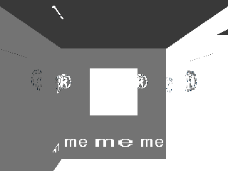

Technical details

When a stage loads, `func_80052F10` @0x80052F10 starts a texture-set loader (`func_80043008`, class `D_8006F0B8`, 0x84 bytes) at stage +0x58 and sets +0x60. On every tick `func_800531CC` checks it: when the loader's +0x80 is set, it destroys the loader without applying anything and calls DreamSys slot 0x104 `DreamSys_SwapTimeLimit` with slot 0x108 `DreamSys_GetElapsedSeconds` + 0x1E, so the limit becomes elapsed + 30 s. The loader sets +0x80 only in its fail branch (`func_80043200`), when the heap allocator `func_80017B34` returns 0 for the file list or the data buffer. That fits "after long sessions until power-off" (heap exhaustion or fragmentation); the allocator and the per-dream frees were not audited.

- Proof: `func_80052F10`, `func_800531CC`, `func_80043008`, `func_80043200`, `func_80017B34`, `DreamSys_SwapTimeLimit` @0x80059328.
- In game: yes, forced. Interpreter (`work/hunt4/B-texfail.lua`): at the first check (vsync 2891, stage 0, day 1) the loader's +0x80 was written to 1. The tatami room came up untextured with leftover menu graphics, and the limit +0x134 read 450 (30 s x 15) instead of the normal 3600. Forced: the loader's failure flag only. Not tried: a real long session, and the community's "zero the frame counters" recipe.
- Question: [11](mysteries.md#days-textures-randomness). Found 2026-10-15.

### The 40-day texture cycle

Every place has up to four texture sets, A to D. When a place loads, the game looks at where the day falls in a 40-day cycle. Days 1 to 10 always load set A. Days 11 to 20 load A or B, 21 to 30 one of A to C, 31 to 40 one of A to D, each equally likely. Then the cycle starts again at day 41. Since the day number returns to 1 after day 365, days 361 to 365 count as days 1 to 5 and always load set A.

Status: 🎮 checked in the game, with the draw forced: the same room wears set A on day 5 and set D on day 33.

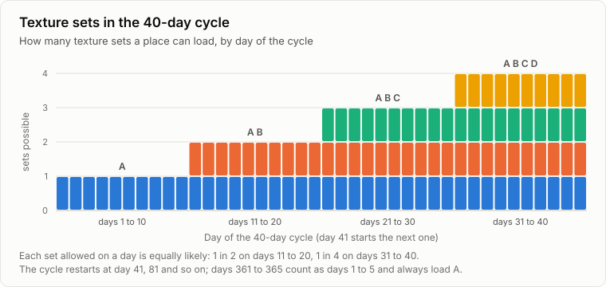

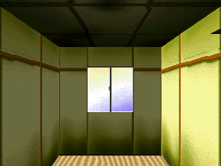
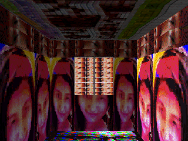

Technical details

Texture set: when a stage loads, `func_80052F10` calls `Stage_PickTexturePath @0x80048EA0(stage, day number)`, which picks set `rand() % (((day - 1) % 40) / 10 + 1)` among the stage's `TEXA` to `TEXD.TIX` paths (path table of 0x1C-byte entries from 0x80081A04, `Stage_GetPathBase` @0x80048E2C). Days 1 to 10 of each 40-day cycle always load A, 11 to 20 A or B, 21 to 30 A to C, 31 to 40 A to D, each at random.

- Proof: `Stage_PickTexturePath` @0x80048EA0, `Stage_GetPathBase` @0x80048E2C, `func_80052F10` @0x80052F10, rand wrapper `Rand_SeedAndNext` @0x80048CFC.
- In game: yes, forced. PCSX-Redux interpreter, same room and spot at the dream start: +0x180 = 4 (day 5) loads set A; +0x180 = 32 (day 33) with the rand state forced to 3 at `Stage_PickTexturePath` (rand % 4 = 3) loads set D, the photo collage. Day 33 rather than 35 because 35 is a special day. Log `work/shots/manifest.md`.
- Question: [9](mysteries.md#days-textures-randomness). Found 2026-10-15.

## Links between places

### Fixed links are the navigation goals, and one can never be completed

The 30 hidden navigation goals behind the [Flashback score](#what-unlocks-flashback-in-the-menu) are the game's fixed links: the first time you take each fixed link between two places, its goal is marked done. There are 49 such links, through walls and through passages, and together they mark 29 different goals. Goal 13 is not marked by any of them. So the 30th goal never completes, the 50,000,000 bonus for all 30 never pays out, and the navigation score tops out at 29,000,000.

Status: 📖 read in the code only.

Technical details

`func_8005C150` @0x8005C150 matches the player's (chunk, tile) against a stage's link list and, when its sixth argument is not 0, sets `g_navFlags[y->flag] = 1` from the destination entry. Two callers pass 1: `func_8005BCB4` (wall touch, `DreamSys_LinkStatic` @0x8005A5D8; tables 0x80088748 counts, 0x80088710 lists, 0x80088664 destinations: 17 links, flags 0 to 12) and `func_8005BCF8` (`func_8005A700`, DreamSys vtable 0x1D0; tables 0x800889F0, 0x80088980, 0x80088820: 32 links, flags 14 to 29). The other two callers (`func_8005BF74`, `func_8005BFDC`) pass 0. No other code writes the flags (`Nav_InitFlags` clears them, `Nav_CalcScore` counts 30 bytes and pays 50,000,000 only above 29,999,999). The union of the two tables lacks flag 13, so +0x188 tops out at 29,000,000. Script `work/hunt3/links.py`, output `links.txt`.

- Proof: `func_8005C150`, `func_8005BCB4`, `func_8005BCF8`, `Nav_CalcScore` @0x8005BA7C, `Nav_InitFlags` @0x8005BA50 (matched C), the six tables above. The flag writer and the missing flag 13 were checked a second time by the main thread.
- In game: no (no fixed link was taken in the emulator).
- Question: [6](mysteries.md#grey-man-and-flashback). Found 2026-10-15.

### Where a random link sends you

Touching a wall can send you to another place. The game first looks for a fixed link for that wall; only if there is none, and random links are allowed at that moment, does it pick a place at random. It rolls a 6-sided die over the six main places (0 to 5 in its list). If the die names the place you are in, you go to the next one instead. So the place right after yours comes up 2 times in 6 and each of the other four 1 time in 6. Every random link is counted, and each one lowers the [flashback score](#what-unlocks-flashback-in-the-menu) by 11,024.

Status: 📖 read in the code only.

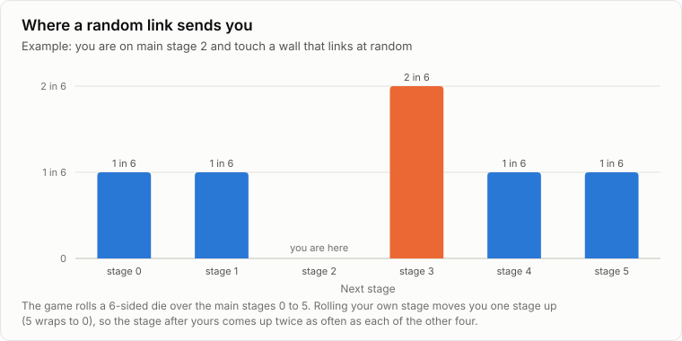

Technical details

Links: a wall touch (`DreamSys_OnWallTouch` @0x80058FAC, message 4, no transition running) tries the static tables first (`DreamSys_LinkStatic` @0x8005A5D8 → `func_8005BCB4` → `func_8005C150` with 0x80088748, 0x80088710, 0x80088664) and links dynamically only if +0x124 is set (`func_8005A1B0`, vtable 0x18C). A dynamic link (`DreamSys_LinkDynamic` @0x8005A580 → `Spawn_PickRandom` @0x8005BB30) draws `rand() % 6` and moves a draw equal to the current stage to the next one (wrapping at 6), so from a main stage 0 to 5 the next stage is twice as likely (2/6) as each of the other four (1/6). It increments the counter at +0x600.

- Proof: `DreamSys_OnWallTouch` @0x80058FAC, `DreamSys_LinkStatic` @0x8005A5D8, `DreamSys_LinkDynamic` @0x8005A580, `Spawn_PickRandom` @0x8005BB30, `func_8005A1B0` @0x8005A1B0.
- In game: no.
- Question: [13](mysteries.md#events-and-hidden-content). Found 2026-10-15.

### Fixed links do not change with visits, but some depend on who showed up

A fixed link always leads to the same place: the game does not count visits and does not read the day when it looks one up. One extra list of walk-through links is switched on only in stages 3 and 11, or once a character of type 11, 56, 78 or 93 has appeared in that dream. Those characters follow [the day rules](#the-hidden-rules-that-decide-which-characters-appear): type 11 is in stage 2 on even days, 56 in stage 5, 78 in stage 8 when the day is a multiple of 3, and 93 in stage 0 under the "once" rule. So when a fixed link seems to change from day to day, the day number is behind it through who appeared, not through visit counts. One more link routine, used only from stages 1, 3, 5, 9 and 12, sends you to stage 12 instead of its usual pick about half the time, depending on the dream timer; what you do to trigger it was not found.

Status: 📖 read in the code only.

Technical details

`func_8005C150` compares only (chunk, tile) (tile -1 is a wildcard) and stores the match in `D_8008ACBC`, `D_8008ACC0`, `D_8008ACC4`, `D_8008ACC8`; it reads neither the day nor a counter. The extra list (`func_8005BF74`, tables 0x80088B5C, 0x80088B24, 0x80088A80, run by `func_8005A82C`, DreamSys vtable 0x1D8) is used only while `D_8008ABE4` is set: `func_8005C6D8` sets it to (stage == 11 or stage == 3) at stage load, and `func_8005C714` sets it to 1 when a group of type 0xB, 0x38, 0x4E or 0x5D passes its rule in `func_8005CAB4`. Also in the link code: `func_8005BE90` (vtable 0x1D4) only works from stages 1, 3, 5, 9 and 12 and, when the dream timer is odd, sends the player to stage 12 instead of the usual pick; which player action calls it was not traced.

- Proof: `func_8005C150`, `func_8005BF74`, `func_8005C6D8`, `func_8005C714`, `func_8005BE90` (matched C).
- In game: no.
- Question: [13](mysteries.md#events-and-hidden-content). Found 2026-10-15.

## Music

### A Clockwork Machines track that can never play

Each place picks one of its five music tracks at random when you arrive. Stage 9 (Clockwork Machines in the community's numbering) has a special rule: when the dice choose its third track, the game plays the fourth one instead. The third track is a distinct piece of music on the disc, so it is never heard. This matches the "unused Clockwork Machines track" players had spotted in the files.

Status: 📖 read in the code only.

Technical details

`func_80048F84` @0x80048F84 draws `rand() % 5` and returns the stage's path entry at `Stage_GetPathBase(stage) + 0x70` (BGA to BGE.SEQ, 0x1C bytes each). For stage 9 it turns 2 into 3, and a forced track 3 (`D_8008A968`) into 4, so `STG09\BGC.SEQ` (1,500 bytes, md5 0ab37f1d..., different from the four others) is never returned. `func_80052F10` is its caller, when a stage loads.

- Proof: `func_80048F84` @0x80048F84, `Stage_GetPathBase` @0x80048E2C (file table 0x80081A04, s16 first-file index per stage at 0x800819E8: stage 9 = 474), so track 2 of stage 9 is the entry at 0x80084E84, `STG09\BGC.SEQ`.
- In game: no.
- Question: [14](mysteries.md#events-and-hidden-content). Found 2026-10-15.

### A switch to pin the music that nobody pulls

Every dream picks one of 7 sound banks and one of 5 tracks at random. The code keeps two override switches that would force a chosen bank and a chosen track, very likely left for the developers to test the music. Nothing in the game ever sets them.

Status: 📖 read in the code only.

Technical details

`func_80048D74` @0x80048D74 picks `rand() % 7` among the banks of `D_800819CC` (`SND\AMBIENT`, `CARTOON`, `ELECTRO`, `ETHNOVA`, `HUMAN`, `LOVELY`, `STANDERD`) unless `D_8008A964` is set; `func_80048F84` picks the track unless `D_8008A968` is set. The only writer of both is `func_80048D28` @0x80048D28, and no code calls it (no `jal`, no pointer to it in the executable).

- Proof: `func_80048D28`, `func_80048D74`, `func_80048F84`, word scan of `SLPS_015.56` for 0x80048D28 (none).
- In game: no.
- Question: [14](mysteries.md#events-and-hidden-content). Found 2026-10-15.

## Memory card

### Everything the game remembers fits in one block

All that the game carries from one day to the next lives in a single block of 1,792 bytes that starts with the letters "J01": the year, the day, the scores, your graph for all 365 days, the 30 navigation goals, the number of random links taken, and the flashback memories. It also keeps whether you have already seen [the video reel](#the-secret-video-reel-four-graph-points-and-11-minutes-of-film), and the SHAKE option of the menu. SHAKE is On in a new game; when it is on, the view dips and comes back up over each walking step, very likely the walking head bob (read in the code, not filmed). This block is what the memory card saves (next finding).

Status: 🎮 checked in the game (the block and its "J01" mark were found in memory, and the SHAKE byte follows the menu).

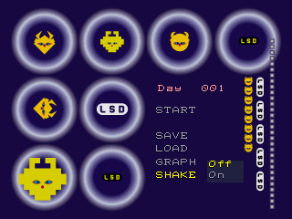

Technical details

One `DreamSys` object at `0x80091530` (vtable `0x80087BDC`). Its persistent block runs from +0x178 to +0x878 (0x700 bytes, returned with that size by `DreamSys_GetSaveBlock` @0x8005A350, vtable slot 0x1B0) and starts with the magic `"J01"` written by `DreamSys_InitNewGame` @0x8005A258. Layout read so far: +0x17C year, +0x180 day (0-based), +0x184 unlock score, +0x188 navigation score, +0x18C instance score, +0x190 graph (365 pairs of s8), +0x5E0 30 navigation flags, +0x600 dynamic-link count, +0x684 500 bytes cleared at new game. Likely the memory card payload; not yet traced to the card code. (Since traced: the memory card finding below saves exactly this block. The flashback list at +0x46C to +0x5D8 also sits inside it.)

More fields: +0x5DF is the "video reel already seen" flag (`func_800585B4`, see [the reel](#the-secret-video-reel-four-graph-points-and-11-minutes-of-film)). +0x678 is the SHAKE option: 1 at a new game (`DreamSys_InitNewGame`), the menu value is swapped in through DreamSys slot 0x19C `func_8005A2D0` (called from `func_8004DABC`, twice from `func_8004DE08` and from `SaveMenu_Save`), and in a dream `func_80059BE0` moves the camera object's +0x18 and +0x24 by -50 then +50 over the 4 ticks of a movement step when it is set. +0x5D8, +0x67C and +0x680 are cleared at a new game; no load from them, nor from +0x684 (500 bytes), was found, either from DreamSys or from the save block base (offsets 0x460, 0x504, 0x508, 0x50C). +0x878, right after the block and so not saved, is the "never saved or loaded" flag ([the save](#how-the-memory-card-save-works)).

- Proof: `DreamSys_InitNewGame` @0x8005A258, `DreamSys_GetSaveBlock` @0x8005A350, `Nav_InitFlags` @0x8005BA50 (stores the +0x5E0 and +0x600 addresses in `g_navFlags` @0x8008ACB4, `g_dynamicLinkCount` @0x8008ACB8), graph reader `func_80058404` @0x80058404.
- In game: yes. Headless PCSX-Redux Lua probe (`work/hunt/dreamsys.lua`) at the title and in the first dream: vtable found once at 0x80091530, `"J01"` at +0x178, `g_navFlags` = 0x80091B10 (+0x5E0), `g_dynamicLinkCount` = 0x80091B30 (+0x600). SHAKE (`work/hunt4/B-run5.log`): menu SHAKE set to Off, then START; +0x678 went from 1 to 0 at vsync 3150, when the dream began. The camera dip itself was not filmed.
- Question: [15](mysteries.md#events-and-hidden-content). Found 2026-10-15.

### How the memory card save works

Saving writes the whole memory block to the card under the file name `BISLPS-01556xxx`. The save title shows your day number in 3 digits. A game that has never been saved or loaded, a new one or one wiped by [the erase combo](#select--triangle-in-the-pause-erases-your-game), saves to a new file with a blank comment: in the emulator, the first save of a new game became `BISLPS-01556-01`. After a save or a load, later saves keep that file's name (read in the code, not tried). The card driver itself has not been read.

Status: 🎮 partly checked: a save made in the emulator on day 42 carries the title "LSD a Day042"; the save screen itself does not show the day.

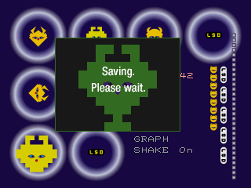

Technical details

Memory card: `func_8004D578` keeps the DreamSys save block (vtable 0x1B0) and its size 0x700 at +0xBC and +0xC0 of the save menu object and calls `SaveMenu_SetTitleDay @0x8004D6AC(day number)`, which writes the day as 3 characters (`func_8004109C`) into the save title `g_cardTitle` @0x8008AA18 (0x8001149C) at +0x12. `SaveMenu_Save` @0x8004E0E4 saves through the card object's slot 0x78 with file name `g_cardFileName` @0x8008AA10 = `BISLPS-01556xxx`, that title, 0xD, 3, the block and its size; `SaveMenu_Load` @0x8004E1C4 loads through slot 0x74. DreamSys +0x878 (read by `func_8005A344`) is the "never saved or loaded" flag, not a broken-save marker: the DreamSys constructor `func_800587F0` sets it at power-on, `DreamSys_EndDay` @0x8005A41C sets it again with `DreamSys_InitNewGame` @0x8005A258 on an end of type 2 (the erase combo), and `func_8005A33C` (vtable 0x1A8) clears it when a card operation reports code 0x16 (`func_8004E230`). While it is set, `SaveMenu_Save` zeroes the file name's first byte before the save and `func_8004DB18` copies `D_8008AA14` (19 full-width spaces) to title offset 0x18, the path every new game takes; a new game saved this way became `BISLPS-01556-01`, so a zeroed name gets a new numbered file. The card driver itself is not read.

- Proof: `func_8004D578` @0x8004D578, `SaveMenu_SetTitleDay` @0x8004D6AC, `SaveMenu_Save` @0x8004E0E4, `SaveMenu_Load` @0x8004E1C4, `func_8004DB18` @0x8004DB18, strings 0x80011464, 0x8001149C.
- In game: partly. With +0x180 = 41 (day 42), SAVE then an empty comment wrote card file `BISLPS-01556-01` with the title "ＬＳＤ　ａ　Ｄａｙ０４２" to the emulator's memory card (`~/.config/pcsx-redux/memcard1.mcd`); the screen shows only "Saving. Please wait.". That game had +0x878 set (a new game), so this save took the zeroed-name path. Not run: a save right after the erase combo (to keep the emulator's shared memory card as it is), and the card driver.
- Question: [15](mysteries.md#events-and-hidden-content). Found 2026-10-15.

## Randomness

### The dice of the game

Every die roll on this page (special days, flashbacks, the Grey Man, textures, random links, music) comes from one number sequence, the standard one of the PlayStation's development kit. The game can restart that sequence from a new point only once, early, before the title screen takes input, and the starting value is leftover data from drawing the screen. In the emulator that leftover was 0, which means "do not restart", so the sequence ran on from power-on. Whether a real console leaves something else there was not measured.

Two things players tie to randomness are not random, or not from this game. The "type A" and "type B" days are odd and even day numbers: each spot where characters stand has a rule (every day, odd days, even days), and the Grey Man needs an even day. And the debug picture showing "World: 17464 0 36838" was not made by this game: the word "world" appears nowhere on the disc.

Status: 🎮 partly checked in the game (in the emulator only, not on a console; the A/B days and the "World" text are read in the code and the disc only).

Technical details

Random numbers: `rand` @0x80049480 is the PSY-Q LCG, state `g_randState` @0x8008AC68 (0 in the executable) times 0x41C64E6D plus 0x3039, returning bits 16 to 30. `srand` has one caller, `Rand_SeedAndNext @0x80048CFC(seed)`, which reseeds only when seed is not 0 and then draws. The only non-zero seed comes from `Scene_SeedRandom` @0x800260A4 (slot 0x40 of the scene class that `func_80025FDC` builds with `ETC\DREAME5.TMD` and a new DreamSys): scratchpad word 0x1F800000 % 365. That scratchpad is a render work buffer (`func_80012064` hands it to `func_80018464`), so the seed is leftover render data, at most 728 seeds (-364 to 364, signed modulo) plus "no reseed".

- Proof: `rand` @0x80049480, `srand` @0x800494A8, `Rand_SeedAndNext` @0x80048CFC (matched C), `Scene_SeedRandom` @0x800260A4 (matched C), `func_80025FDC` @0x80025FDC, `func_80012064` @0x80012064.
- In game: partly. Breakpoints showed `Scene_SeedRandom` run once, at vsync 1318 before the title input, with scratchpad word 0, so `srand` was never called; the rand state at the first special-day check was 0xA70427DF. Real hardware's scratchpad at that moment was not measured.
- A/B days: `Sym_CheckDayParity` @0x8005C9A4 reads each spawn slot's day flag (0 every day, 1 odd day numbers, 2 even ones), and spawn rules 20 and 21 of `func_8005CBC8` test even and odd days; type A = odd day numbers, type B = even ones ([when the Grey Man can appear](#when-the-grey-man-can-appear)).
- "World: 17464 0 36838": neither the executable (ASCII or full-width Shift-JIS) nor any byte of the disc image contains "world" in any case (stream search of the 2352-byte sectors, so a word split across a sector edge would be missed). 36838 is above 32767, so it is not a single PSY-Q `rand()` output either. The picture comes from another build or a tool.
- Question: [10](mysteries.md#days-textures-randomness). Found 2026-10-15.

## Hidden and unused content

### SELECT + TRIANGLE in the pause erases your game

Pause a dream with START, hold SELECT, then press TRIANGLE. The dream stops at once and the menu comes back on "Day 001": the day, the year, the score, the flashback memories and the navigation goals are wiped, with no warning and no confirmation. Your next save then goes to a new file, as for a brand new game (read in the code). The [video reel](#the-secret-video-reel-four-graph-points-and-11-minutes-of-film) can be seen again after that.

It is the only hidden button input in the game. Every piece of code that reacts to the pad was read: each one reacts to a single press at a time and none remembers earlier presses, so no typed cheat code can exist. The pause code also holds a second exit, a quit that does not count the day, but no button leads to it: it is dead code, maybe a developer shortcut whose button was removed.

Status: 🎮 checked in the game (the wipe; the new save file and the dead exit are read in the code only).

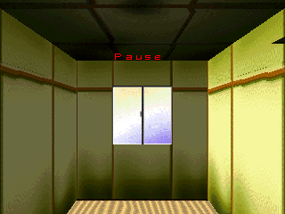

Technical details

The pad object (`func_80025B34`, vtable `0x8006D370`) reads `PadRead` once per frame (`func_80025CC4`) and turns 16 buttons into event codes (`func_80025D10`): code = state + button index, state 2 = held, 0x12 = pressed this frame, 0x22 = released this frame. Button order (`func_80025E1C`, table `D_8008B388`): 0 UP, 1 DOWN, 2 LEFT, 3 RIGHT, 4 TRIANGLE, 5 CROSS, 6 SQUARE, 7 CIRCLE, 8 and 9 L3 and R3, 10 SELECT, 11 to 14 the shoulder buttons, 15 START. The codes go to listeners through the base class send (`func_800182CC`, listener slot 0x38).

The dream stage class (vtable `0x80087034`) has one pad handler, `func_80053358` @0x80053358 (slot 0x58), with four cases: 33 = START pressed (slot 0x74, pause toggle; the pause window `func_800542D0`, slot 0xD0, shows "Pause" from `D_8008AB44`), 12 = SELECT held (slot 0xC0 `func_800541D4`: arms the exit, +0x84 = 1, only while the pause is open, +0x80 != 0, and the stage is in its normal state, +0x20 == 0), 22 = TRIANGLE pressed (slot 0xC8 `func_80054208`: when armed, closes the pause and sends code 0xD to the dream runner), 44 = SELECT released (slot 0xC4 `func_80054200`: disarms). The runner `func_80049EB4` @0x80049EB4 turns 0xD into `DreamSys_EndDay(2)` @0x8005A41C, which calls `DreamSys_InitNewGame` @0x8005A258 (year, day, three scores, flashback count, navigation flags, the reel flag +0x5DF and 500 bytes at +0x684 cleared; the graph at +0x190 is left in place) and sets +0x878, the "never saved or loaded" flag a new game also has ([the save](#how-the-memory-card-save-works)). Arming needs SELECT held for at least one frame after its press frame, which is why SELECT+START and single buttons did nothing in the first tries (`work/hunt3/run2.log`).

The second exit: slot 0xCC `func_8005426C` sends code 0xC (`DreamSys_EndDay(1)`: day restored, nothing recorded). `func_80053358` has no case for it, the address 0x8005426C appears once in the executable (the vtable, at 0x80087100), no other vtable inherits it, and the 32 functions that load a slot 0xCC call it on other classes with arguments, not on the stage.

Other pad handlers, all read (C scan for case and compare values in the pad ranges, plus the functions still in assembly at the time): the title and menu class `func_8003C48C` (UP, DOWN, START, CROSS, CIRCLE; 4 vtables), the yes/no box `func_8004FF90` (CIRCLE, CROSS), the comment keyboard `func_800513D0` (directions, CIRCLE, CROSS, SELECT, two shoulder buttons for the character page) and the walking controls `func_80058C58` @0x80058C58 (UP and DOWN walk, LEFT and RIGHT turn, TRIANGLE and SQUARE set +0x88, CROSS while walking calls slot 0x184, the shoulder buttons set +0x90 or +0xA0, CIRCLE sets +0x74). No handler tests a pad mask directly and no code stores past codes. The exact roles of the shoulder buttons were not tested.

- Proof: `func_80025D10`, `func_80025E1C`, `func_80053358` (matched C), `func_800541D4`, `func_80054200`, `func_80054208`, `func_8005426C`, `func_80049EB4`, `DreamSys_EndDay`, `DreamSys_InitNewGame`, the handlers above.
- In game: yes (`work/hunt4/B-run1.log`, dynarec): day +0x180 = 40 and score +0x184 = 5,000,000 written at vsync 2100, the dream started normally; START at 3800 (pause shown), SELECT held from 3900 for 150 vsyncs, TRIANGLE at 3960. RAM at 3964: day 0, year 0, score 0; the menu showed "Day 001" from vsync 4100 (that capture is pixel-identical to the Day 001 menu picture above, which is reused). Forced: the day and the score, to make the wipe visible; the input and its effect are the game's. Not run: a save after the wipe (to keep the emulator's shared memory card as it is).
- Questions: [14](mysteries.md#events-and-hidden-content), [15](mysteries.md#events-and-hidden-content). Found 2026-10-15.

### The dog that never loads

The disc holds a model for a dog next to the Grey Man's. The loader is written to load both, but it stops after the first one, and nothing else in the game asks for the dog. So the dog is never loaded and cannot appear. The character list even keeps a slot for it, right after the Grey Man's, with a bright mood and no behaviour at all.

Status: 📖 read in the code only.

Technical details

`ETC\SYMDOG.MOM` is never loaded: `Sym_LoadModels` @0x8005C508 loads `ETC\SYMSPY.MOM`, writes the dog's path into its load descriptor and leaves its loop after one pass (`beqz s1` after `s1++`). No other code references the dog path `D_8001187C`. The spy objects are created as type `i + 0x62` (`func_8005C650`), so the dog would be type 99, right after the Grey Man's 98; record 99 has mood (10, 10) and no handler (`work/hunt3/recs.txt`).

- Proof: `Sym_LoadModels` @0x8005C508, `D_8001187C`, `func_8005C650`, record 99 at `D_80089EA4` + 0x630.
- In game: no.
- Question: [14](mysteries.md#events-and-hidden-content). Found 2026-10-15.

### What the game never asks for

The executable names every file on the disc except three: a second Asmik logo picture, a second "ETC" picture, and a 62 MB dummy video that fills the end of the disc. The scene code also keeps an empty slot for a mode that the title screen can never choose. No debug menu, test mode or cheat sequence turned up in what we read, and the code has no path to a WC room file: rooms live inside the stage chunk files.

Status: 📖 read in the code only.

Technical details

All printable paths in `SLPS_015.56` were compared to the 685 files of the disc (patched English v1): every named path exists, and only `ETC\ASMKLOG.TIM` (153,620 bytes, dated 1997-05-20, same size as `ASMKLOGO.TIM`), `ETC\ETC2.TIM` (30,784 bytes) and `ZDUMMY\ZDUMMY.STR` (61,937,664 bytes) are never named. The `CARD\*.TIM` pictures are built from `CARD\` plus the names at 0x8008AA34 and are used. The scene loop `func_8003B110` calls slot 0x5C when the title returns 1; slot 0x5C is the empty `func_80026690`, and the title routine `func_80026410` only returns 0 or 2. The scene settings `D_80066828` passed by `main` (0x13, 0, 1, 1, 1, 1) turn the logos (+0xC), videos (+0x8) and title (+0x10) on; flipping them is the closest thing to a dev switch found. The pad handlers of the title and menu screens were read since: none keeps a sequence ([the erase combo](#select--triangle-in-the-pause-erases-your-game)).

- Proof: `func_8003B110`, `func_80026690`, `func_80026410`, `D_80066828`, `main` @0x800118DC, string scan (`work/hunt3`, inline scripts).
- In game: no.
- Question: [14](mysteries.md#events-and-hidden-content). Found 2026-10-15.

## Myths checked

Things players repeat about the game, checked against the code and, when possible, in the emulator.

### Myth: a hidden ending if the graph is full

The myth: fill every cell of the graph and you get a secret ending.

Verdict: false. The ending video plays only [when a year closes](#the-ending-plays-when-a-year-closes-not-on-day-365). No code counts how many cells you have filled: the graph is read only to pick where tomorrow starts and by the graph screen, which [shows 100 days at most](#the-graph-screen-only-shows-your-last-100-days) anyway. The one secret tied to the graph is [the video reel](#the-secret-video-reel-four-graph-points-and-11-minutes-of-film), and it needs four cells, not a full graph.

Status: 📖 read in the code only (the reel itself is checked in the game).

Technical details

`ETC\ENDING.STR` is reached only through scene slot 0x64, when `func_80026698` sees day number 1 and a year above 0. The graph points at +0x190 are read by `DreamSys_GetPreviousPoint` @0x8005B1F4 (yesterday's point, for `DreamSys_ChooseStart` @0x8005A508), by the graph screen `func_80058404` and by the reel check `func_800585B4`; none counts cells.

- Proof: `func_80026698`, `func_80026900`, `DreamSys_GetPreviousPoint`, `func_80058404`, `func_800585B4`.
- In game: no (the reel is, see its entry).
- Found 2026-10-15.

### Myth: no Grey Man after day 365

The myth: once you pass day 365, the Grey Man never shows up again.

Verdict: false. His check only looks at the day number you see, 1 to 365, never at the hidden year. In the emulator he stood under the torii of the canal place on day 4 of the second year, exactly as in the first.

Status: 🎮 checked in the game, with the die forced.

Technical details

`Sym_SpawnOrSpy` @0x8005C7D4 gets the day number from DreamSys slot 0x1A0 `DreamSys_GetDayNumber`, which is day + 1 and ignores the year; the rest of its test (spot rule, stage not 0, 1 in 12, even day) has no year term, and `Sym_LoadModels` loads `ETC\SYMSPY.MOM` every dream.

- Proof: `Sym_SpawnOrSpy`, `DreamSys_GetDayNumber` @0x8005A2E4, `Sym_LoadModels` @0x8005C508.
- In game: yes (interpreter, `work/hunt4/B-run2.log`): year +0x17C = 1 and day +0x180 = 3 (day number 4 of the second year), yesterday's point (-3, 1) for stage 2, rand state 0 at each `Sym_SpawnOrSpy` entry (3460, 3472, 3481, all with day number 4). He stood on the path under the torii (capture at 4300) and reached the player at 4399, when the flashback eraser ran. Forced: year, day, yesterday's point and the rand state, the same setup as the year-one picture of [when the Grey Man can appear](#when-the-grey-man-can-appear).
- Question: [5](mysteries.md#grey-man-and-flashback). Found 2026-10-15.

### Myth: over 500 music tracks

The myth: the game has more than 500 different music tracks.

Verdict: false: 462 at most, and some picks are silence. Each dream picks one of 7 sound banks, and each place you enter picks one of its 5 melodies, played on that bank. The 14 places hold 70 melody files, but three of them are the same tiny file that plays one inaudible note and stops, and one [Clockwork Machines melody never plays](#a-clockwork-machines-track-that-can-never-play). That leaves 66 real melodies, times 7 banks: 462. In three places (stages 0, 3 and 5), one place load in five plays no music at all.

Status: 📖 read in the code and the disc files (not heard: the emulator runs without sound).

Technical details

Bank: `rand() % 7` among `SND\AMBIENT`, `CARTOON`, `ELECTRO`, `ETHNOVA`, `HUMAN`, `LOVELY`, `STANDERD`, once per dream (`func_80048D74`, called by the world constructor `func_80049684`). Melody: `rand() % 5` among the place's `BGA` to `BGE.SEQ`, at each place load (`func_80048F84`, from `func_80052F10`). No other random step touches the music in those functions. On the disc: 70 sequence files, 68 different; `STG00\BGD.SEQ`, `STG03\BGD.SEQ` and `STG05\BGC.SEQ` are the same 38-byte file (one note at velocity 1, then the end), and `STG09\BGC.SEQ` is never returned. 66 melodies x 7 banks = 462.

- Proof: `func_80048D74`, `func_80048F84`, `func_80049684`, `func_80052F10`; hashes in `work/hunt4/B-seq.txt`, read in place by `work/hunt4/B-tools/isohash.py`.
- In game: no.
- Question: [14](mysteries.md#events-and-hidden-content). Found 2026-10-15.

