# Discoveries

What reading the game's code taught us about LSD: Dream Emulator. Each finding below says in plain words what happens when you play, then keeps the proof (functions, addresses, tables, how it was checked) folded under "Technical details". Open questions live in [mysteries.md](mysteries.md).

Status of each finding:

- 🎮 Checked in the game: we ran the game in an emulator, changed or watched its memory, and saw the predicted result on screen or in memory.
- 🎮 Partly checked: part of it was seen in the emulator, the rest is read in the code.
- 📖 Read in the code only: the code says so, nobody has seen it happen yet.

What the mark before each title means:

- 🆕 New: nobody had written it down before us, not the wikis, not lsddecomp, not the community notes.
- 🧩 Known in part: players had seen it or knew some of it; we add how it works, its exact conditions or its numbers.
- ✅ Confirmed: something players or earlier projects believed, now proven by the code or the emulator.
- 🔄 Corrected: a belief that was partly wrong; the finding gives the right version.
- ❌ Myth busted: a belief the code proves false.

The screenshots come from the game running in an emulator, sometimes with memory values written in to reach a state quickly; each finding says when.

## The findings at a glance

Days and years
- ✅ [The day counter and the hidden year](#-the-day-counter-and-the-hidden-year): after day 365 you are back on day 1 and a hidden year counter goes up.
- 🆕 [The first dream of a new year starts from the wrong data](#-the-first-dream-of-a-new-year-starts-from-the-wrong-data): a bug picks the start place from part of a score instead of day 365.

The ending
- ✅ [The ending plays when a year closes, not on day 365](#-the-ending-plays-when-a-year-closes-not-on-day-365): the video comes right after the dream of day 365, when the counter goes back to day 1.

The dream graph
- ✅ [The secret video reel: four graph points and 11 minutes of film](#-the-secret-video-reel-four-graph-points-and-11-minutes-of-film): a face drawn on the graph makes it blink green, then plays 20 special-day videos back to back.
- ✅ [How a day becomes a point on the graph](#-how-a-day-becomes-a-point-on-the-graph): an average of the moods of where you walked and what you touched.
- ✅ [The graph screen only shows your last 100 days](#-the-graph-screen-only-shows-your-last-100-days): a full year-long graph never appears on screen.
- 🧩 [How the graph picks where tomorrow starts](#-how-the-graph-picks-where-tomorrow-starts): 51 graph points lead nowhere, and 93 others wake you in the right place but on another square.

How long a dream lasts
- ✅ [The start place sets the length of the dream](#-the-start-place-sets-the-length-of-the-dream): from 1 to 10 minutes, fixed the moment you fall asleep.

Special days
- ✅ [The 42 special days](#-the-42-special-days): 13 fixed days plus a weekly run that stops at day 204.
- ✅ [What a special day shows](#-what-a-special-day-shows): a video 1 time in 3, a still picture 2 times in 3.

Flashbacks
- 🧩 [How flashback memories are kept](#-how-flashback-memories-are-kept): 1 chance in 3 per moment, 10 slots, and the tenth is never replaced.
- ✅ [What unlocks Flashback in the menu](#-what-unlocks-flashback-in-the-menu): a score above 9,999,999, mostly from the navigation goals, which are the fixed links.
- ✅ [What erases the flashbacks](#-what-erases-the-flashbacks): touching the Grey Man wipes them all, every time.

The Grey Man
- ✅ [The Grey Man flips your graph and wipes your memories](#-the-grey-man-flips-your-graph-and-wipes-your-memories): his mood sits past the edge of the graph, so touching him throws your day to the opposite corner.
- 🧩 [When the Grey Man can appear](#-when-the-grey-man-can-appear): even days only, 1 chance in 12 at a spot left empty that day, and he is placed about four tiles in front of you.
- 🔄 [Who can meet the Grey Man, and where](#-who-can-meet-the-grey-man-and-where): he only replaces odd-day characters, and six places never get him.

Rare sights
- 🧩 [The flying train: a pink day and a long dream](#-the-flying-train-a-pink-day-and-a-long-dream): waking Happy Town's odd-day train turns your day pink, and it flies off from the opera pillar if the dream did not start in Happy Town.
- ✅ [The astronaut lands at the bar on a pink day](#-the-astronaut-lands-at-the-bar-on-a-pink-day): on an even pink day it dives into the cottage's yard and stands at the bar; a walk in Happy Town then a wall gets you there 7 times in 48.
- 🔄 [A red day fills the Maze of Questions with rainbow penguins](#-a-red-day-fills-the-maze-of-questions-with-rainbow-penguins): one penguin becomes nine and the question mark goes away; 1 in 5 lone penguins is a giant. They are not gunmen.
- 🧩 [Three minotaur rickshaws on a yellow day in Kyoto](#-three-minotaur-rickshaws-on-a-yellow-day-in-kyoto): one rickshaw becomes three on an odd yellow day.
- 🆕 [Three purple beasts on a yellow day: our best match for the special lions](#-three-purple-beasts-on-a-yellow-day-our-best-match-for-the-special-lions): a lone beast of Pit & Temple gets three walking companions.
- 🧩 [A red day puts a geisha on a Kyoto bridge](#-a-red-day-puts-a-geisha-on-a-kyoto-bridge): she stands still on the red bridge, and her link goes to Black Space.
- 🧩 [A green day sends a file of Buddha statues through Kyoto](#-a-green-day-sends-a-file-of-buddha-statues-through-kyoto): four statues walk in single file; the wiki's odd-day four are another group.
- 🧩 [A white day brings two more red-headed runners to a Kyoto plaza](#-a-white-day-brings-two-more-red-headed-runners-to-a-kyoto-plaza): three figures on an even white day, and a link to the Long Hallway.
- 🔄 [A yellow day gives Black Space's walker a giant twin](#-a-yellow-day-gives-black-spaces-walker-a-giant-twin): the giant comes with a yellow day, not with any Black Space start.
- 🆕 [A blue day sends four more fetuses down the Flesh Tunnels](#-a-blue-day-sends-four-more-fetuses-down-the-flesh-tunnels): one fetus becomes five, each worth -100,000 points.
- 🔄 [Happy Town's flowers and mushrooms grow with the day number](#-happy-towns-flowers-and-mushrooms-grow-with-the-day-number): giant flowers on days 4, 10, 16, tall mushrooms on days 8, 20, 26; not a seed.
- 🧩 [Tiny lips walk toward you in Happy Town](#-tiny-lips-walk-toward-you-in-happy-town): the floating lips at 1/32 size, on even days.

Characters and events
- 🧩 [The hidden rules that decide which characters appear](#-the-hidden-rules-that-decide-which-characters-appear): day cycles, your mood so far, and groups that show up only once.
- 🧩 [The character record: mood, points, waking up and leaving](#-the-character-record-mood-points-waking-up-and-leaving): 130 character types, and the five that end the dream on a video.
- 🧩 [Signals from characters and objects](#-signals-from-characters-and-objects): touching, forced links, forced endings and event videos.
- 🧩 [More characters that change size](#-more-characters-that-change-size): the bunny, the Buddha statues and a dozen more, by day or by chance.
- ✅ [Four characters stretch or flatten the whole place](#-four-characters-stretch-or-flatten-the-whole-place): the Kyoto old woman, the Starship, a small ghost and the Zeppelin, each seen in the emulator with its odds.
- ✅ [Characters that answer to CIRCLE](#-characters-that-answer-to-circle): the Ferris wheel, the fast train and the gunman, both endings of each played; a cyan day brings four more gunmen.

Textures
- 🧩 [Glitch textures: a texture set that failed to load](#-glitch-textures-a-texture-set-that-failed-to-load): the place is drawn with leftovers, and the dream ends 30 seconds later; a 20 KB leak is enough, and the "location time" recipe makes one.
- ✅ [The 40-day texture cycle](#-the-40-day-texture-cycle): the later in a 40-day cycle, the more texture sets a place can wear.
- 🧩 [Three quiet rules for the look of a place](#-three-quiet-rules-for-the-look-of-a-place): clouds in one band on days divisible by 7, Kyoto's water changing colour every frame, a veil of the day's colour over flashbacks.

Links between places
- 🆕 [Fixed links are the navigation goals, and one can never be completed](#-fixed-links-are-the-navigation-goals-and-one-can-never-be-completed): 29 of the 30 goals can be reached, so the big bonus never pays out.
- 🔄 [Where a random link sends you](#-where-a-random-link-sends-you): the place after yours comes up twice as often as the others.
- 🔄 [Fixed links do not change with visits, but some depend on who showed up](#-fixed-links-do-not-change-with-visits-but-some-depend-on-who-showed-up): no visit counter; four characters switch on extra links.
- 🧩 [Falling off an edge, walls and the cottage's walking squares](#-falling-off-an-edge-walls-and-the-cottages-walking-squares): a fall ends the dream like the clock, a wall links only 1 tick in 16.
- ✅ [The world is built from square blocks, and only marked blocks are walls](#-the-world-is-built-from-square-blocks-and-only-marked-blocks-are-walls): quarter turns, whole-tile heights, and one block in six can link you.
- 🔄 [The Long Hallway's room turns the sky blue, then pulls you out 2 times in 3](#-the-long-hallways-room-turns-the-sky-blue-then-pulls-you-out-2-times-in-3): the blue is the background, and a die decides between the Natural World and the walk back.

Music and sound
- ✅ [A Clockwork Machines track that can never play](#-a-clockwork-machines-track-that-can-never-play): the dice can pick it, but the game plays the next track instead.
- 🆕 [A switch to pin the music that nobody pulls](#-a-switch-to-pin-the-music-that-nobody-pulls): a leftover way to force one sound bank and one track.
- 🆕 [Places have fixed sound sources](#-places-have-fixed-sound-sources): 56 spots on the maps play their own sounds as you walk near.

Memory card
- 🧩 [Everything the game remembers fits in one block](#-everything-the-game-remembers-fits-in-one-block): 1,792 bytes, starting with the letters J01, with the SHAKE option and the video reel flag.
- 🧩 [How the memory card save works](#-how-the-memory-card-save-works): the day number goes into the save title, and a new game saves to a new file.
- 🆕 [SELECT on the comment keyboard makes the cursor run](#-select-on-the-comment-keyboard-makes-the-cursor-run): a mode the help never mentions, and where your comment lands in the title.

Randomness
- 🔄 [The dice of the game](#-the-dice-of-the-game): a fixed number sequence that is almost never reseeded; "type A and B days" are just odd and even days.

Hidden and unused content
- 🆕 [SELECT + TRIANGLE in the pause erases your game](#-select--triangle-in-the-pause-erases-your-game): the game's only hidden button input, with no warning; no cheat code exists.
- ✅ [The dog that never loads](#-the-dog-that-never-loads): a dog model sits on the disc, but the loader stops before it.
- 🧩 [What the game never asks for](#-what-the-game-never-asks-for): three files on the disc and one menu slot, and no debug menu found.
- 🆕 [Switches and features the game never uses](#-switches-and-features-the-game-never-uses): a CD lookup switch, place overrides, looping videos, a holding fade, and fog that each model sets for itself.

Myths checked
- ❌ [Myth: a hidden ending if the graph is full](#-myth-a-hidden-ending-if-the-graph-is-full): false.
- ❌ [Myth: no Grey Man after day 365](#-myth-no-grey-man-after-day-365): false, he came back in year two.
- ❌ [Myth: over 500 music tracks](#-myth-over-500-music-tracks): false, 462 at most, and some of them are silence.
- ❌ [Myth: the astronaut lands only between days 200 and 300](#-myth-the-astronaut-lands-only-between-days-200-and-300): false, a pink day decides it, and it landed on day 4.

## Days and years

### ✅ The day counter and the hidden year

The game counts your days. The number you see is the internal counter plus one, so the first day shows as day 1. When day 365 ends, the counter goes back to day 1 and a hidden year counter goes up by one. The game never shows the year, but it is saved, it plays [the ending video](#-the-ending-plays-when-a-year-closes-not-on-day-365) when it goes up, and it changes how the next dream starts (see the next finding).

Status: 🎮 checked in the game.

Technical details

Day counter: +0x180 counts from 0; `DreamSys_AdvanceDay` @0x8005A304 increments it and at 365 sets it to 0 and increments the year at +0x17C. Code that needs the day number calls `DreamSys_GetDayNumber` @0x8005A2E4 (vtable 0x1A0), which returns day+1 and the year. `DreamSys_StartDay` @0x8005A368 saves the day at +0x88C when a dream starts and `DreamSys_EndDay` @0x8005A41C restores it before advancing.

- Proof: `DreamSys_AdvanceDay` @0x8005A304 (matched C), `DreamSys_GetDayNumber` @0x8005A2E4, `DreamSys_StartDay` @0x8005A368, `DreamSys_EndDay` @0x8005A41C.
- In game: yes. Poked day 364 (and +0x88C) during a dream and forced the timer; after that dream ended the RAM read year 1, day 0.
- Question: [8](mysteries.md#days-textures-randomness). Found 2026-10-15.
- Before us: lsddecomp already read the wrap to day 0 and the year increment in `DreamSys_AdvanceDay`, and the fandom wiki (Data Analysis) knew the RAM holds the day minus one; new here are the emulator proof and what the year changes.

### 🆕 The first dream of a new year starts from the wrong data

Each dream starts from the graph point of the day before. On the first day of a new year, yesterday is day 365, but the game reads the wrong two bytes: part of the touch score (see [the flashback unlock](#-what-unlocks-flashback-in-the-menu)) instead of day 365's point. So the first dream of year 2 and later can start somewhere unrelated to how day 365 went. Only the very first day of a new game is handled on purpose: it always starts from the middle of the graph.

Status: 🎮 checked in the game.

Technical details

First dream of a new year: the start point comes from the wrong bytes. `DreamSys_GetPreviousPoint` @0x8005B1F4 (vtable 0x1EC, mode 1) reads yesterday's graph point at +0x190 + (day-1)*2; on day 0 with year >= 1 it reads +0x18E, the upper half of the instance score at +0x18C, instead of day 364's point. Only year 0 day 0 is special-cased to (0,0).

- Proof: `DreamSys_GetPreviousPoint` @0x8005B1F4 (asm: `lb 0x190(day*2-2)`), caller `DreamSys_ChooseStart` @0x8005A508.
- In game: yes. Set the instance score to 0x01FD0000 (bytes 0x18E, 0x18F = -3, 1) and wrapped the year; the next dream started on stage 2 with time limit 7200 and its first logged chunk mood (-3, 1), as predicted from the table; day 364's point (0,0) would have given stage 0.
- Questions: [8](mysteries.md#days-textures-randomness), [2](mysteries.md#graph-and-dream-start). Found 2026-10-15.
- Before us: nothing on it in the fandom wiki (Chart, Ending, Data Analysis), compu-lsd (Graph), the LSD Revamped docs or lsddecomp; the bug is new.

## The ending

### ✅ The ending plays when a year closes, not on day 365

The ending video (the erupting Mount Fuji and a countdown) does not play during day 365. It plays right after that dream ends, at the moment the day counter goes back to day 1 and the hidden year counter goes up. Then the menu comes back on "Day 001". The game checks for "day 1 and a year above 0", so the video should come back at the end of every later year too. Nothing else in the game asks for the ending video.

Status: 🎮 checked in the game (the end of year 1; later years are read in the code only).

Technical details

The scene class (vtable `0x8006D3C8`, built by `Scene_New` from `main` @0x800118DC) runs its loop in `App_Run`: slot 0x50 logos, then forever slot 0x54 opening video, slot 0x58 title; when the title returns 2, slot 0x60 runs the dream (`Scene_RunDream`), and if that returns non-zero slot 0x64 `Scene_PlayEnding` plays the video returned by `Cine_GetEndingPath` (file table base `File_GetPathTable` + 0x3E04 = `ETC\ENDING.STR` @0x80085808, video index 7). `Scene_RunDream` returns 1 when `DreamSys_GetDayNumber` @0x8005A2E4 (vtable 0x1A0) returns 1 and writes a non-zero year. After a normal end, `DreamSys_EndDay` @0x8005A41C calls `DreamSys_AdvanceDay` @0x8005A304, which wraps 364 to 0 and adds a year. No other code reads the ending entry.

- Proof: `App_Run` @0x8003B110, `Scene_RunDream` @0x80026698, `Scene_PlayEnding` @0x80026900, `Cine_GetEndingPath` @0x800491FC, `DreamSys_GetDayNumber` @0x8005A2E4, vtable 0x8006D3C8 (slot 0x64 = 0x80026900, the only pointer to it).
- In game: yes. Interpreter run (`work/hunt3/run3.log`): day +0x180 = 364 at vsync 2300, dream started (StartDay at 3126), timer +0x24 = 3590 of 3600 at 4000. Breakpoints: `DreamSys_EndDay` type 0 at 4366, then `Scene_PlayEnding` at 4378 with year 1, day 0; the video ran until the title at 6360, which showed "Day 001". Forced: day and timer.
- Not checked: the end of year 2 and later. By the same test, a dream that does not advance the day (a flashback) started on day 1 of year 1 or later should replay the ending; not run. The pause code's type 1 quit would do the same, but no input reaches it ([the erase combo](#-select--triangle-in-the-pause-erases-your-game)).
- Questions: [14](mysteries.md#events-and-hidden-content), [8](mysteries.md#days-textures-randomness). Found 2026-10-15.
- Before us: the fandom wiki (Ending) already says the video starts when day 365 comes to an end and comes back at the end of every later year; we confirm it in the code and the emulator and show that nothing else asks for `ENDING.STR`.

## The dream graph

### ✅ The secret video reel: four graph points and 11 minutes of film

The graph hides a face. If, among the days the graph screen shows (your last 100), your day points have landed at least once on each of four exact cells, the game plays a secret. The four cells are the centre, the cell just above it to the left, the cell just above it to the right, and the cell three steps below the centre: two eyes, a nose and a mouth. The order and the dates do not matter.

When the graph screen comes up after the title, those four cells turn green one after the other. Then, instead of the menu, a long film starts by itself: the special-day videos back to back (pigeons on a window sill, a sheep, a radio tower and more), 20 of the 24, about 11 minutes by the game's own count. You can only see it once per game: a flag is set and saved with the game, and only a new game, or [the erase combo](#-select--triangle-in-the-pause-erases-your-game), clears it.

Status: 🎮 checked in the game, with the graph points written in (the film was watched for several minutes, not to its end).

Technical details

The graph screen draw `Graph_Draw` @0x80058404 gets the save block (DreamSys vtable 0x1B0, DreamSys + 0x178: +0x4 year, +0x8 day, +0x18 graph) and stores `Graph_CheckReel` @0x800585B4 in +0x238. `Graph_CheckReel` (now C, `src/game/graph.c`) returns 0 at once when byte +0x467 of the save block is set. That byte is DreamSys +0x5DF: the hunters' notes give both offsets, and they are the same byte (0x178 + 0x467 = 0x5DF). Otherwise, for each of the 4 targets of `g_reelPoints` (s8 pairs as (x, y): (-1, 1), (1, 1), (0, 0), (0, -3)) it compares the stored s16 point of the last n days, n = min(day, 100) in year 0 and 100 from year 1 on, walking back from yesterday and wrapping to index 0x16C. It writes the position of a matching day into the 4-byte buffer at +0x240 and returns 0 as soon as one target has no match. When all four match it sets +0x467 = 1, +0x23C = 0 and returns 1.

- Blink: `Graph_BlinkReel` @0x80058694, while +0x238 is set and the screen timer +0x1C is at least 31, paints the next of the four matched points every 24 frames with `g_graphReelColor` = (0, 255, 0). The newest point is normally red `g_graphNewestColor` and older ones fade from white `g_graphOldColor` (`Graph_CreateSprites`).
- Exit: `Graph_Run` returns 2 instead of the screen's normal result when +0x238 is set. The title routine `Scene_RunTitle` @0x80026410 runs the graph before the menu when the game is not on its first day (and the video flag of the scene settings is on); a 2 calls `Scene_PlayReel` @0x8002658C, which asks `Cine_GetSpecialDayRun(&len, 0, 10)` @0x800493E4 for the path `FILM\SPDAY01A.STR` (`Cine_GetSpecialDayPaths(0)`) and a length: the sum of the 20 entries of `g_videoTable` @0x80086170 from index 14 (categories 0 to 9, both videos each) plus 10 frames per join, 10,122 frames, 674.8 s at 15 frames per second. The video player (`VideoScreen_New`, slots 0x6C, 0x12C, 0x44) plays that path for that length; `SPDAY01A.STR` to `SPDAY10B.STR` are contiguous on the disc (LBA 127656 to 229085), so the stream runs on through the ten categories' A and B videos in order.
- Once per game: +0x5DF lies inside the 0x700-byte block the memory card saves ([the save block](#-everything-the-game-remembers-fits-in-one-block)), and only `DreamSys_InitNewGame` @0x8005A258 clears it (`arg0->unk5DF = 0`), which a new game and the erase combo both call. Saving then reloading a game that has seen the reel was not run.
- Proof: `Graph_Draw`, `Graph_CheckReel`, `Graph_BlinkReel`, `Graph_Run`, `Scene_RunTitle`, `Scene_PlayReel`, `Cine_GetSpecialDayRun`, `DreamSys_InitNewGame`; tables `g_reelPoints`, `g_graphReelColor`, `g_videoTable`.
- In game: yes, two independent runs (dynarec, `work/shots/drive.lua`). Run A: +0x180 = 4 (day 5), +0x190 to +0x197 = the four points, +0x5DF = 0 at vsync 2100, CIRCLE at 2200 opened the graph; the cells were white at 2520 and turned green one at a time (one at 2600, three at 2700, four at 2800, 100 pure-green pixels per cell); at 3200 a full-screen video played with no input. A second run with captures every 700 vsyncs up to 13,400 showed the film going through different clips (inverted city crowd, machinery, TV static, the pigeons of the day-7 video, a sheep with a timecode, a pagoda, a radio tower). Control run: same day with points (2, 2), (3, 3), (4, 4), (5, 5), no green, and the graph left to the menu (Day 005) on its own. Run B (`work/hunt4/B-run6.log`): day 10, the four points then six others; +0x5DF went from 0 to 1 between vsync 2300 and 2400, the four cells turned green between 2560 and 2900, and a video ran from about 3600 and was still running at 4500. Forced: the day and the graph points only.
- Not checked: the end of the film (its 11 minutes are the game's own count, not timed), which frames come from which file, and the flag surviving a save and load.
- Question: [4](mysteries.md#graph-and-dream-start). Found 2026-10-15.
- Before us: the fandom wiki (Chart trivia, Video Dreams) already gives the same four cells and the green blink, and calls the film all the video dreams; new here: only the last 100 days count, the film is 20 of the 24 videos, and it plays once per game.

### ✅ How a day becomes a point on the graph

Every area of a dream carries a mood, a point on the graph from -9 to 9 on each axis, and so do the characters and objects you touch. At the end of a normal day, the game averages the moods of the areas you walked through and adds a third of the last one; it does the same for what you touched, then takes the middle of the two. If you touched nothing, only the areas count. A result past 9 does not stop at the edge: it jumps to the opposite edge, -9, and a result below -9 jumps to 9. That jump is how [the Grey Man flips your graph](#-the-grey-man-flips-your-graph-and-wipes-your-memories). Only a normal day end stores a point, and days watched in flashback mode leave none. The graph screen shows [your last 100 days](#-the-graph-screen-only-shows-your-last-100-days).

Status: 🎮 checked in the game (the whole sum, the third of the last one and the jump included, during the Grey Man test).

Technical details

Graph point of a day: `Mood_Log` @0x8005B5B8 (vtable 0x208) keeps two accumulators, chunks at +0x144 and entities at +0x154, each {last point, sum x, sum y, count}. `Mood_CalcAxis` @0x8005B66C makes each axis `sum / count + last / 3` (C division, truncated), and a result above 9 becomes -9 and below -9 becomes 9 (a flip to the edge, not a modulo). `DreamSys_ComputeDayPoint` @0x8005B420 averages the chunk and entity results per axis, using the chunk result twice when no entity was logged (+0x160 = 0). `DreamSys_EndDay` @0x8005A41C stores it in the graph at +0x190 + day*2, only on a normal end (argument 0) outside flashback mode, then advances the day. The graph screen `Graph_Draw` draws the last 100 days at 10 units per step.

- Proof: `Mood_Log` @0x8005B5B8, `Mood_CalcAxis` @0x8005B66C (both matched C), `Mood_Resolve` @0x8005B5F0, `DreamSys_ComputeDayPoint` @0x8005B420, `DreamSys_EndDay` @0x8005A41C, `Graph_Draw` @0x80058404.
- In game: yes. The forced end wrote day 364's point from a chunk-only accumulator ((0,0), count 1); the new dream's chunk accumulator held (-3,1). The Grey Man run then exercised every term: chunks {last (-3, 1), sum (-3, 1), n 1} gave (-3 + -1, 1 + 0) = (-4, 1); entities {last (-10, -10), sum (-10, -10), n 1} gave -10 + -3 = -13, flipped to 9 on both axes; the stored point was the truncated mean (2, 5). Logs `work/hunt3/gm.log` to `gm3.log`.
- Question: [1](mysteries.md#graph-and-dream-start). Found 2026-10-15.
- Before us: Higashi's formula (fandom wiki, Chart; compu-lsd, Graph) and lsddecomp's `last / 3` already described it; the community's five-step table for the last term differs from the code only at plus or minus 9, where the code adds 3, not 2.

### ✅ The graph screen only shows your last 100 days

The graph screen draws one point per day, but only for your last 100 days. On day 150 the first 50 days are gone from the picture, and from the second year on it always shows exactly 100. The newest point is red and the older ones fade from white to dark grey. A full year-long graph never appears on screen.

Status: 🎮 checked in the game, with the graph points written in.

Technical details

`Graph_Draw` @0x80058404 draws n = min(day, 100) points in year 0 and 100 from year 1 on, walking back from yesterday's index and wrapping from 0 to 0x16C (day 365). `Graph_CreateSprites` creates exactly 100 point sprites: the first is red, the next six fade by 20 per step from white, the rest by 1.

- Proof: `Graph_Draw`, `Graph_CreateSprites`.
- In game: yes (dynarec, runs 3 and 4 of `work/hunt4/`): days 1 to 50 written at (8, 8), the top-right cell, then a 10 x 10 block in the lower left. With +0x180 = 150 the top-right cell is empty; with 99 a dark grey point sits in it. Forced: the day and the graph points.
- Found 2026-10-15; it also rules out [the "full graph" ending](#-myth-a-hidden-ending-if-the-graph-is-full).
- Before us: the fandom wiki (Chart) already says each filled cell stays for 100 days, so the whole chart can never be filled; we confirm it in the code and the emulator.

### 🧩 How the graph picks where tomorrow starts

Tomorrow's dream starts in the first area, in the game's own list order, whose mood is exactly yesterday's point. Day 1 starts from the middle of the graph and so always opens in the same place. Of the 361 points of the graph, 51 match no area at all: most sit in the four corners, plus two odd holes near the middle. After a day that lands on one of them, the dream always starts in the same place (number 1 in the game's list) at one of its 3 spawn points, and the game counts it as a random link, which lowers the [flashback score](#-what-unlocks-flashback-in-the-menu).

Each place is a grid of map squares, each with its own mood. Filler squares (sea edges, empty corners) carry the mood (9, 0), which the game uses as "no mood here": 106 squares in 8 places. But (9, 0) is also a real graph point, so a day that ends there matches the first filler square in the list, an empty square of place 1, and you then wake up at one of place 1's arrival points. The game can only drop you on a square that has an arrival point: 93 of the 310 points that match a square name one without, so you wake up in the right place, but on another of its squares.

Status: 🎮 partly checked in the game (the fallback to place 1 was not triggered; the filler squares and the 93 off-square starts are read in the code and data only).

Technical details

Start chunk choice: `Stage_FindChunkByMood` @0x8004950C scans stages 0 to 13 and their chunks row by row and returns the first chunk whose s16 mood equals yesterday's point. `Spawn_PickFromMood` @0x8005C28C then takes the stage's spawn point that names that chunk (else chunk % count). With no match it returns -1, and `Spawn_PickRandom` @0x8005BB30 turns -1 into stage 1 (`negu`), with a random spawn among its 3: always stage 1, not a random zone. 51 of the 361 points have no chunk: 49 in the four corners, all with abs(x) >= 6 and abs(y) >= 6 (13 in the top-left corner, 12 in each other one; the corners are cut along a rough diagonal, not as full 4 x 4 squares, see the chart), plus (0,3) and (5,7). (0,0) lands on stage 0, chunk (0,3). That fallback also increments the dynamic-link counter.

The {9, 0} sentinel: the grids `g_stageChunkMoods[stage]` (s16 mood per square, row-major, low byte x, high byte y; sizes at `g_stageGrids`) hold (9, 0) on 106 squares: stage 1 (1), 2 (1), 3 (74), 4 (3), 5 (3), 11 (10), 12 (13), 13 (1). They are filler pieces: in stage 4 the squares of column 5 rows 0, 2 and 4, whose files are the small 8,580 and 6,740-byte ones; in stage 3 the 4,944-byte edge pieces (chunk file of square (col, row) = `M{row*cols+col:03d}.LBD`, checked on all 14 stages; lsddecomp's `StageGrid.c` shows the same values). `Stage_FindChunkByMood` has no special case, so the point (9, 0) matches stage 1, square (0, 1), key 0x100. `Spawn_PickFromMood` then looks for an arrival record (`g_spawnPoints[stage]`, 6-byte records keyed by row << 8 | col, counts `g_spawnCounts`) naming that square; none does, so it takes record `key % count` = 256 % 3 = 1, square (1, 0) of stage 1. The same happens for 93 of the 310 matched points (count printed by an inline script over the same tables): the place is exact, the square is not always. The chunk mood logger has no filter either (`DreamSys_OnMapMessage`, event 5 → vtable 0x1F4 → `Mood_Log`), so walking into a (9, 0) square would count (9, 0) toward the day; whether any filler square can be walked into was not checked.

- Proof: `Stage_FindChunkByMood` @0x8004950C, `Spawn_PickFromMood` @0x8005C28C, `Spawn_PickRandom` @0x8005BB30, tables 0x80086590, 0x800861D4, 0x800885B8, 0x800885F0; coverage computed by `work/hunt/moodmap.py`. The same script shows stage 3 is the first match for 180 of the 310 covered points. Square-to-file check: `work/hunt4/A/mml.py`.
- In game: partly. Day 1 (point (0,0)) and the poked point (-3,1) both landed on the predicted stage; the stage-1 fallback was not triggered.
- Chart: `work/findings/charts.py`, which checks its list of 51 points against the executable (`--check`).
- Question: [2](mysteries.md#graph-and-dream-start). Found 2026-10-15.
- Before us: Higashi's spawn chart (fandom wiki, Chart; compu-lsd, Graph) already maps points to places and says points outside the drawn chart start in Pit & Temple, while the community notes (from lsddecomp) said a random zone; new here: the 51 dead points with two holes near the middle, the (9, 0) filler squares and the 93 off-square starts.

## How long a dream lasts

### ✅ The start place sets the length of the dream

How long you get to wander is decided the moment you fall asleep, by the place the dream starts in: from 1 minute to 10. Walking through links never adds or removes time; only in flashback mode does a link restart the clock. These are the game's own figures; in the emulator the clock ran slower than real seconds, so the real length on a console may be longer.

Status: 🎮 checked in the game (the limit, not the real-time speed of the clock).

Technical details

Dream length is fixed when the dream starts, from the starting stage: `Spawn_PickFromMood` @0x8005C28C reads the s16 seconds table `g_stageTimeLimits` @0x80087F14 (stages 0 to 13: 240, 180, 480, 420, 120, 600, 60, 300, 240, 300, 240, 180, 120, 480) and `DreamSys_SwapTimeLimit` @0x80059328 (vtable 0x104) stores seconds x 15 at +0x134. `DreamSys_TickTimer` @0x80058D94 (vtable 0x98) adds 1 to the timer at +0x24 on each message 2 and ends the dream once the count before the increment reaches the limit; `DreamSys_GetElapsedSeconds` @0x80059360 converts ticks back with /15. Links do not touch the limit; `DreamSys_ExecuteLink` @0x8005A928 zeroes the timer on a link only in flashback mode (+0x68 set).

- Proof: `DreamSys_ChooseStart` @0x8005A508, `Spawn_PickFromMood` @0x8005C28C, `DreamSys_SwapTimeLimit` @0x80059328 (matched C), `DreamSys_TickTimer` @0x80058D94, `DreamSys_GetElapsedSeconds` @0x80059360, `DreamSys_ExecuteLink` @0x8005A928, table 0x80087F14.
- In game: yes. Day 1 started on stage 0 with limit 3600 (240 x 15) and the year-1 dream on stage 2 with 7200 (480 x 15). In the emulator the timer gained 50 to 76 ticks per 600 vsyncs, so a tick is a game frame, not 1/15 s of real time; hardware rate not measured.
- Question: [11](mysteries.md#days-textures-randomness). Found 2026-10-15.
- Before us: lsddecomp's DreamTimer.md already had the 14 lengths per starting place, from 60 to 600 seconds; we confirm them in the emulator and show that links do not change the limit outside flashback mode.

## Special days

### ✅ The 42 special days

The game keeps a list of 42 special days. 13 are fixed dates spread over the year, and 29 form a weekly run: every 7th day from day 7 to day 126, then, one day late, from 134 to 204. Day 126 is in both groups, so the list holds 41 different days and its second entry for 126 can never be reached. After day 204 only the fixed dates remain. On a special day the game skips the normal choice of a start place, and the day's mood log starts from the middle of the graph.

Status: 📖 read in the code only (the content a special day shows is checked, see the next finding).

Technical details

Special days: `DreamSys_StartDay` @0x8005A368 calls `Day_FindSpecial @0x8005C438(+0x168, day number)`, which searches the 42 s16 days of `g_specialDays` @0x80088CCC. On a match it writes {index % 12, rand() % 6} at +0x168, the dream gets mood (0,0) from `g_specialDayPoint` and no spawn is chosen. Day 126 is listed twice (indexes 5 and 30), so index 30 is unreachable.

Table order: indexes 0 to 12 are 2, 15, 43, 81, 120, 126, 202, 259, 267, 284, 308, 328, 358; indexes 13 to 30 are 7 to 126 in steps of 7; indexes 31 to 41 are 134 to 204 in steps of 7 (133 is not listed). Read from the executable by `work/findings/charts.py --check`.

- Proof: `Day_FindSpecial` @0x8005C438, `DreamSys_StartDay` @0x8005A368, `DreamSys_ResetMoodAccumulators` @0x8005B2F4, table 0x80088CCC.
- In game: no.
- Question: [7](mysteries.md#days-textures-randomness). Found 2026-10-15.
- Before us: lsddecomp had the 42-day table and the fandom wiki (Video Dreams) lists the days of each of the 12 sets; new here: how the list is built (13 fixed days plus a weekly run) and the unreachable second entry for day 126.

### ✅ What a special day shows

Each special day belongs to one of 12 categories, and each category has 6 pieces: 2 videos and 4 still pictures, 72 files in all on the disc. When a special day comes, the game rolls a 6-sided die: 1 or 2 plays a video, 3 to 6 shows a still picture. So a special day is a video 1 time in 3 and a picture 2 times in 3. Since there are 42 entries and only 12 categories, several days share the same category. The video also needs one more condition that is not understood yet.

Status: 🎮 checked in the game (both the video and the picture branch).

Technical details

Special-day content: `Scene_PlayCinematic` @0x8002677C reads {category, variant} through `DreamSys_GetCinematic` @0x8005A4E8 (vtable 0x1BC, the 4 bytes at +0x168) and `Cine_GetPath` @0x80049334 resolves them. For a category >= 0 the path is the table at 0x800858CC (`g_pathTable` + 0x3EC8, `Cine_GetSpecialDayPaths` @0x800492D0), 0xA8 bytes per category = 6 paths of 0x1C bytes: variants 0 and 1 are `FILM\SPDAYnnA.STR` and `B.STR`, played by `VideoScreen_New` with video id category x 2 + 14 + variant (s16 table `g_videoTable` @0x80086170); variants 2 to 5 get id -1 and show `IMG1\` or `IMG2\SPDAYnnC` to `F.TIM` through `MenuScreen_New`. With `rand() % 6` a special day is a video 1 time in 3 and a still picture 2 times in 3. The 42 days are 13 fixed ones (2, 15, 43, 81, 120, 126, 202, 259, 267, 284, 308, 328, 358, indexes 0 to 12) then a weekly run (indexes 13 to 41): every 7th day from 7 to 126, then from 134 to 204; `index % 12` names the category, so categories share days. The video branch also needs the scene's `+0x20->+0x8` flag (unknown); the 72 files exist on the disc.

- Proof: `Scene_PlayCinematic` @0x8002677C, `Cine_GetPath` @0x80049334 (matched C), `Cine_GetSpecialDayPaths` @0x800492D0 (matched C), `DreamSys_GetCinematic` @0x8005A4E8, `Day_FindSpecial` @0x8005C438, tables 0x800858CC, 0x80086170, 0x80088CCC.
- In game: yes. PCSX-Redux interpreter with Lua breakpoints (`work/hunt2/bp.lua`): poked day 6 at `DreamSys_StartDay` @0x8005A368, `Day_FindSpecial` got day number 7, `Cine_GetPath` got category 1 variant 1 and an STR video with a timecode played (capture at vsync 3600); with the rand state forced to 1 at the same call, variant 2 came out and a still diary picture showed (vsync 3200).
- Question: [7](mysteries.md#days-textures-randomness). Found 2026-10-15.
- Before us: the fandom wiki (Video Dreams) already says each set has 2 videos and 4 text dreams, a video 2 times in 6; we confirm the die and both branches in the code and the emulator.

## Flashbacks

### 🧩 How flashback memories are kept

Now and then the game keeps a memory of the moment: when you touch something, and when a dream runs out of time, it rolls a 3-sided die and keeps the moment on a 1. A memory holds the place, where you stood, which way you faced and the day. Up to 10 are kept. Once all 10 slots are full, a new memory replaces one of the first nine, picked from the timer, so the tenth memory stays forever. In flashback mode each memory plays for 20 seconds before the next, and those days add no point to the graph.

Status: 📖 read in the code only.

Technical details

Flashback list: count at +0x46C, entries of 0x24 bytes from +0x470 (10 at most, ending at +0x5D8). `DreamSys_MaybeSaveFlashback` @0x8005B81C (vtable 0x218) saves one with probability 1/3 (`rand() % 3 == 0`) when the player object at +0x4C exists; it runs when the day timer expires (`DreamSys_TickTimer` @0x80058D94) and on entity message 9 (`DreamSys_OnEntityEvent` @0x8005B03C). `DreamSys_AddFlashback` @0x8005B74C (0x214) appends {stage, position, rotation, length 0x10, day} while fewer than 10 are kept, else overwrites entry `timer % 9`: once full, the 10th entry is never replaced. Flashback mode is +0x68, set by `DreamSys_SetFlashbackMode` @0x800590E8 (vtable 0xF0) from the menu (`Menu_Confirm` case 1). Playback: `DreamSys_LoadNextFlashback` @0x8005A63C (0x1CC) loads entry +0x87C (stage, position, its day into +0x180), `DreamSys_EnterMap` gives it 0x10 + 4 = 20 seconds and moves to the next; in that mode the day end stores no graph point.

- Proof: `DreamSys_MaybeSaveFlashback` @0x8005B81C, `DreamSys_AddFlashback` @0x8005B74C, `DreamSys_LoadNextFlashback` @0x8005A63C, `DreamSys_EnterMap` @0x80058968, `DreamSys_SetFlashbackMode` @0x800590E8 (matched C), `Menu_Confirm` @0x8004D9D4.
- In game: no (the Grey Man run saw one memory saved on a touch, the count going from 3 to 4, without checking the die).
- Question: [6](mysteries.md#grey-man-and-flashback). Found 2026-10-15.
- Before us: lsddecomp knew the limit of 10 memories and the fandom wiki (Flashback) that notable events, even repeated trumpeters, are kept; new here: the 1 in 3 roll, the tenth memory that stays and the 20 seconds per memory.

### ✅ What unlocks Flashback in the menu

Flashback appears in the menu once two things are true: at least one memory is kept, and your score is above 9,999,999. The score is recomputed at the end of each normal day from two parts. The first: 1,000,000 for each hidden "navigation" goal you completed, minus 11,024 for every random link you took. The second: points from touching characters and objects, up to 50,000,000. The navigation goals are [the fixed links between places](#-fixed-links-are-the-navigation-goals-and-one-can-never-be-completed): the first time you take each one, its goal is done. There are 30 goals and a 50,000,000 bonus for all 30, but one goal can never be completed, so that bonus never pays out and the navigation part stops at 29,000,000. So 10 navigation goals with no random link are enough on their own.

Status: 🎮 checked in the game, with the values written in: a score of 10,000,000 and one kept memory made FLASHBACK appear between START and SAVE. The navigation goals are read in the code only.

Technical details

Flashback unlock: the menu item is enabled by `Menu_UpdateFlashbackItem` @0x8004D678 only when the save block's +0xC (DreamSys +0x184, unlock score) is above 9,999,999 and +0x2F4 (+0x46C, flashbacks kept) is not 0. `DreamSys_CalcUnlockScore` @0x8005B6E0 (vtable 0x210, run by `DreamSys_EndDay` @0x8005A41C on a normal day end) sets +0x184 = +0x188 + +0x18C. +0x188 comes from `Nav_CalcScore` @0x8005BA7C: 1,000,000 per non-zero byte among the 30 navigation flags (+0x5E0 via `g_navFlags` @0x8008ACB4), 50,000,000 once all 30 are set (only above 29,999,999), minus 11,024 per dynamic link (+0x600), floored at 0. +0x18C, the instance score, is clamped to 0..50,000,000 and grows on entity message 9 by the entity's vtable 0x150 value (`DreamSys_OnEntityEvent` @0x8005B03C). So 10 navigation challenges with no dynamic link unlock it; each dynamic link costs 11,024. The flags are set only by `Link_Find` @0x8005C150 when its sixth argument is not 0, from the two static link tables, whose union lacks flag 13: +0x188 stops at 29,000,000 and the unlock score at 79,000,000 (see [the fixed links](#-fixed-links-are-the-navigation-goals-and-one-can-never-be-completed)).

- Proof: `Menu_UpdateFlashbackItem` @0x8004D678, `DreamSys_CalcUnlockScore` @0x8005B6E0, `Nav_CalcScore` @0x8005BA7C (all matched C), `DreamSys_OnEntityEvent` @0x8005B03C, `DreamSys_EndDay` @0x8005A41C, `Link_Find` @0x8005C150.
- In game: yes, forced. On a fresh day 1 +0x184 and +0x46C read 0 and the item is absent. Writing +0x184 = 10,000,000, +0x46C = 1 and zeroing entry +0x470 at vsync 2100 made the menu show FLASHBACK between START and SAVE (capture at 2460; with a flashback kept, the title skips the graph and opens the menu). Script `work/shots/drive.lua`, log `work/shots/manifest.md`. The navigation flags were not exercised (no fixed link was taken in the emulator).
- Question: [6](mysteries.md#grey-man-and-flashback). Found 2026-10-15.
- Before us: lsddecomp already read a score of 30 navigation challenges at 1,000,000 each minus a penalty per random link, where the fandom wiki (Flashback) spoke of a gauge of events; we confirm it in the emulator and add the exact threshold.

### ✅ What erases the flashbacks

The Grey Man does. One piece of code empties the whole memory list, and only he runs it: when he touches you, he vanishes in a white flash and every kept memory is gone. There is no die roll, so every touch erases them all. The same touch also [flips your graph](#-the-grey-man-flips-your-graph-and-wipes-your-memories).

Status: 🎮 checked in the game, with the Grey Man forced to appear.

Technical details

Erasing flashbacks: `DreamSys_ClearFlashbacks` @0x8005B8FC (vtable 0x21C) sets +0x46C to 0 and has one caller, `Behavior_EraseFlashbacks` @0x80064618, the handler of entity type 98 (16-byte record {handler, parameters} at 0x8008A4D0, the handler at +0xC of record 98 from `g_entityRecords`). Type 98 is the Grey Man: `Sym_InitStage` creates the spy object with `Entity_Create(i + 0x62, ...)`, so the `SYMSPY.MOM` model and the eraser are the same character. A touch (`Entity_CheckTouch`, slot 0x178 → slot 0x164 `Entity_SetTouched`) sends message 9 and sets +0xF4. On its next run the handler sees +0xF4, starts the effect object `Entity_StartEffect(obj, 0, 0, 10, 0)` (the white flash), sets state 7 on the object at +0x100, calls its own vtable 0x160, then clears the list. No code negates stored graph points: the "graph flip" is the wrap of `Mood_CalcAxis` @0x8005B66C on his mood (-10, -10).

- Proof: `DreamSys_ClearFlashbacks` @0x8005B8FC, `Behavior_EraseFlashbacks` @0x80064618, `Sym_InitStage`, `Entity_SetTouched`, `Entity_CheckTouch` (all matched C), record 0x8008A4D0.
- In game: yes, forced. Flashback count +0x46C = 3 written at vsync 3700; at 4399 the Grey Man touched the player, the handler ran with +0xF4 = 1 on an object of type 98 and `DreamSys_ClearFlashbacks` ran with the count at 4 (the touch had just saved one); at 4449 the count read 0. Logs `work/hunt3/gm.log`, `gm2.log`, `gm3.log`.
- Question: [5](mysteries.md#grey-man-and-flashback). Found 2026-10-15.
- Before us: the game's manual (quoted on the fandom wiki, Gray Man) says meeting him erases your memory, and compu-lsd (Spy) says it might; we confirm that every touch erases them all and that nothing else does.

## The Grey Man

### ✅ The Grey Man flips your graph and wipes your memories

When you touch the Grey Man, three things happen at once. He vanishes in a white flash, every kept flashback memory is erased, and his mood is logged like any character you touch. His mood is (-10, -10), one step beyond the -9 edge of the graph. Then the "last thing touched" bonus pushes your "things touched" score further down. Past -9 the value jumps to +9, so if he is the only thing you touched, or most of what you touched was dark, that half of your day point jumps to the opposite corner. This is the graph flip players report. In the emulator, one touch moved the day's point from where it should have landed, (-6, -4), to (2, 5). If you never touch him, he leaves on his own after a fixed time: 3 minutes if his clock runs at the speed of the dream timer.

Status: 🎮 checked in the game, with the Grey Man forced to appear (his leaving on his own is read in the code only).

Technical details

The Grey Man is entity type 98: `Sym_InitStage` creates the spy object with `Entity_Create(i + 0x62, ...)`, and record 98 of the behaviour table (16 bytes from `g_entityRecords + 16 * type`, handler at +0xC, so 0x8008A4D0) holds `Behavior_EraseFlashbacks` @0x80064618. Record 98: mood (-10, -10) at +0/+1, touch score 20 (x 1000, read by vtable 0x150 `Entity_GetPoints`), wake mode 0 (awake at spawn), sleep mode 180 (leaves after 180 x 15 ticks of his own counter +0x24), touch range 1, no link, no video. Touch: `Entity_CheckTouch` (0x178) calls slot 0x164 `Entity_SetTouched`, which sends message 9 and sets +0xF4. Message 9 (`DreamSys_OnEntityEvent` @0x8005B03C) logs the record's mood into the entity accumulator at DreamSys +0x154 (`DreamSys_LogEntityMood` → `Mood_Log` @0x8005B5B8), adds 20,000 to +0x18C and may save a flashback. On its next run the handler sees +0xF4, starts the effect object `Entity_StartEffect(obj, 0, 0, 10, 0)` (the white flash), sets state 7, calls slot 0x160 and `DreamSys_ClearFlashbacks` @0x8005B8FC. The day point is `Mood_CalcAxis` @0x8005B66C = sum / count + last / 3, wrapped to the other side past +/-9: with the Grey Man as the only entity, -10 + (-10 / 3 = -3) = -13 → +9 on both axes. The wrap happens whenever the mean of touched moods, the Grey Man included, is below -6 on an axis while he is the last one touched.

- Proof: `Sym_InitStage` (0x62 constant), record 0x8008A4C4, `Behavior_EraseFlashbacks` @0x80064618, `Entity_SetTouched`, `Entity_CheckTouch`, `DreamSys_OnEntityEvent` @0x8005B03C, `Mood_CalcAxis` @0x8005B66C, `DreamSys_ComputeDayPoint` @0x8005B420 (all matched C).
- In game: yes, forced. Interpreter, +0x180 = 3 (day number 4), +0x194/+0x195 = (-3, 1) so the dream starts on stage 2, rand state 0 at every `Sym_SpawnOrSpy` entry, flashback count +0x46C = 3 written at vsync 3700. At vsync 4399 he touched the player: message 9, the handler ran with +0xF4 = 1 on an object with type 98, and `DreamSys_ClearFlashbacks` ran with the count at 4 (the touch had just saved one); at 4449 the count read 0 and the instance score 20,000. The accumulators then read zones {last (-3, 1), sum (-3, 1), n 1} and entities {last (-10, -10), sum (-10, -10), n 1}. With the timer forced to the limit at 4700 the day ended and stored point (2, 5) for that day: zones give (-4, 1), entities wrap to (9, 9), mean (2, 5). Without the wrap it would have been (-6, -4). Flash captured at 4460, graph at 7100. Logs `work/hunt3/gm.log`, `gm2.log`, `gm3.log`.
- Question: [5](mysteries.md#grey-man-and-flashback). Found 2026-10-15.
- Before us: the fandom wiki (Gray Man, Linking) already explains his (-10, -10) value and the jump to the opposite side of the chart; we confirm it in the code and the emulator, and add when the jump does not happen and that he leaves after a fixed time.

### 🧩 When the Grey Man can appear

Each spot where a character can stand has a day rule: always, odd days only, or even days only. When a spot stays empty because of its rule, the day number is even and you are not in the first place of the game's list, the game rolls a 12-sided die; on a 1, the Grey Man stands there instead. So he never shows up on odd days. Forcing the die in the emulator on day 4 brought him out, walking toward the player; when he reached the player the screen flashed white and [the memories were erased](#-what-erases-the-flashbacks).

He does not walk in from far away. When he spawns, the game puts him about four tiles straight ahead of you, turned to face you, and he glides toward you from there. There is only one Grey Man: when another empty spot rolls him while he is out, the code moves the same one in front of you again. That is very likely why players see him jump from place to place.

Status: 🎮 checked in the game, with the die forced (the spawn spot ahead of you was measured in memory).

Technical details

Grey Man spawn: per entity spawn slot, `Place_SpawnCell` calls `Sym_SpawnOrSpy @0x8005C7D4(entity, slot, day number)` (day number from vtable 0x1A0 of the object that `Place_Setup` also passes as `g_symDreamSys`). `Sym_CheckDayParity` @0x8005C9A4 returns `flag != (day % 2) + 1` for a non-zero flag: a slot's entity appears when its flag is 0, or 1 on odd day numbers, or 2 on even ones. When the flag blocks it, the stage index (`g_currentStage` @0x8008ABF8) is not 0, `rand() % 12 == 0` and the day number is even, `Sym_SpawnSpy` @0x8005CF34 spawns the model loaded from `ETC\SYMSPY.MOM` (`g_spyModel` @0x80088D28, loaded by `Sym_LoadModels` @0x8005C508). So only flag-1 slots on even days can hold him. The forced spawn in the emulator shows the Grey Man (hat, long coat), so `SYMSPY.MOM` is his model; he is entity type 98, whose handler erases the flashbacks (see [What erases the flashbacks](#-what-erases-the-flashbacks)).

- Proof: `Sym_SpawnOrSpy` @0x8005C7D4 (asm: `andi s1,1` and the 0x2AAAAAAB divide by 12), `Sym_CheckDayParity` @0x8005C9A4, `Sym_FindSlot` @0x8005C8AC, `Sym_LoadModels` @0x8005C508, `Place_SpawnCell` @0x80054120.
- In game: yes, forced. PCSX-Redux interpreter: +0x180 = 3 (day number 4, even), yesterday's point +0x194/+0x195 = (-3, 1) so the dream starts on stage 2, rand state 0 at every `Sym_SpawnOrSpy` entry (3 slots, vsyncs 3460 to 3481); the Grey Man walked toward the camera (capture at 4400) and the screen flashed white when he reached the player (4500). A later run with the same setup measured the flashback list cleared by that contact (`work/hunt3/gm.log`). Log `work/shots/manifest.md`.
- Spawn spot: `Sym_SpawnSpy` @0x8005CF34 takes the one spy entity of `g_spyModel`, detaches it and attaches it again at `SceneNode_LocalToWorld(dreamer, spawnOffset)`, then calls `Entity_FaceDreamer`. `spawnOffset` (`SpyModel` +8, 0x80088D30) is (0, -200, 8000): z points ahead (as in `DreamSys_TestPointAhead`) and negative y is up, so 8,000 units ahead and 200 higher. A tile is 0x800 = 2,048 units, so 8,000 is just under four tiles. In game (`work/unknowns/U3/bspy.log`, same forced die): `Sym_SpawnSpy` ran at f 3,460, 3,481 and 4,519 with that offset; two frames after the first, the spy stood at (0, -200, -7,970) from the dreamer, whose forward matrix column was (0, 0, -4,096); after the call at 4,519 he stood at (0, -200, -7,842) while the dreamer kept walking. The 30-unit gap from 8,000 was not explained.
- Question: [5](mysteries.md#grey-man-and-flashback). Found 2026-10-15, spawn spot 2026-10-16.
- Before us: the wikis (fandom Gray Man, compu-lsd Spy) knew he comes on even (type B) days, but put his spawn down to the seed or an unknown "Gray Man Power"; new here: the 1 in 12 roll on a spot left empty. The fandom wiki also says he appears right in front of you and may "teleport around rapidly"; new here: the distance, and that the code moves the same Grey Man again.

### 🔄 Who can meet the Grey Man, and where

The Grey Man only takes a spot that its own rule leaves empty. A spot marked "odd days only" is empty on even days, and since he also needs an even day, he only ever takes the place of odd-day characters. Some places have no such spot at all: stages 1, 3, 8, 10 and 12 have only "every day" spots, and stage 0 is excluded outright. He cannot appear in those six. He can appear in stages 2, 4, 5, 6, 7, 9, 11 and 13.

Status: 📖 read in the code only (the rule that lets him spawn was seen working on stage 2).

Technical details

`Sym_CheckDayParity` @0x8005C9A4 returns `flag != (day % 2) + 1` for a non-zero flag: flag 1 lets the slot's characters appear on odd day numbers only, flag 2 on even ones only. `Sym_SpawnOrSpy` @0x8005C7D4 rolls for the Grey Man only when that check fails, the stage is not 0 and the day number is even, so only flag-1 slots on even days can hold him. Slot tables: per stage, `g_spawnSlots[stage]` points to 6-byte slots {s16 chunk key, s8 day flag, s8 groups[3]}, with the count in `g_spawnSlotCounts[stage]`. All slots have flag 0 in stages 1, 3, 8, 10 and 12. Dump: `work/hunt3/spawns.py`.

- Proof: `Sym_CheckDayParity` @0x8005C9A4, `Sym_SpawnOrSpy` @0x8005C7D4, `Sym_FindSlot` @0x8005C8AC (matched C), tables 0x80089A8C and 0x80089AC4.
- In game: only the stage 2 case (`work/shots/manifest.md`, grey-man.png); the empty stages were not walked.
- Question: [5](mysteries.md#grey-man-and-flashback). Found 2026-10-15.
- Before us: the fandom wiki (Gray Man, Sun Faces Heave) lists seven places where he appears and seven where he never does, Sun Faces Heave among them; the code agrees on every place but one: Sun Faces Heave (stage 11) can hold him.

## Rare sights

The rare events players hunt for are ordinary characters with a condition attached. Most of the conditions are the colour of your day so far: the game cuts [your graph point](#-how-a-day-becomes-a-point-on-the-graph) into a 3 by 3 grid and gives each part one of 8 colours, and some characters only come out, or only act differently, in one of them. The ones below were all seen in the emulator. To reach them quickly we wrote the day number, yesterday's point and, for most of them, the colour into memory, and often moved the camera to wake the characters; what the characters did on screen was the game's own code. Some characters also change size by the day or by chance.

### 🧩 The flying train: a pink day and a long dream

On odd-numbered days, Happy Town's slow train (a green locomotive and one wagon) starts rolling along its track once you have looked toward its spot on the rails from far away. Standing close to that spot and looking at it does nothing. This is the code behind the players' "it spawns when you look at a certain spot of the railroad".

If your day is pink at the moment it starts, the train does not vanish at the end of its run. It stops beside the opera singer's pillar, waits about 27 seconds of dream time, honks, sets off again and climbs into the sky. Pink is the graph's upper-right corner. The same pink colour brings four opera singers down to the foot of the pillar, so the two sights come together.

You rarely have to bring the pink yourself: the train does it. Waking it counts as touching it, and its mood sits so far to the left of the graph that it flips over to the far right. So in most dreams your day turns pink at the very moment the train starts. Stand about 30 tiles south of its spot and look north: from the north it drives straight at you, runs you over and sends you to the Natural World.

The catch is time. The train stops at the pillar about 2 minutes 24 seconds of dream time after it wakes and lifts off about 3 minutes 7 seconds after. A dream that starts in Happy Town lasts 2 minutes, so it can never even see the stop. The dream has to start in a place with a longer clock (the Natural World, Kyoto, Monument Park or Violence District; Bright Moon Cottage only if you wake the train within its first minute), reach Happy Town early on an odd day, and you have to wake the train quickly. On a day of any other colour, the code makes the train vanish just after the point where the pink train stops, near the same pillar (not filmed).

Status: 🎮 checked in the game. Hunt 5 forced the pink colour. Hunt 6 forced only the day number and yesterday's point, then moved the player once inside Happy Town to the viewing spot: the two random links that led there, the pink day and the flight were the game's own.

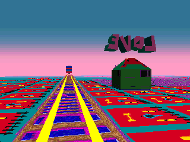
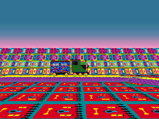

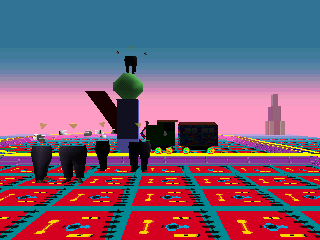
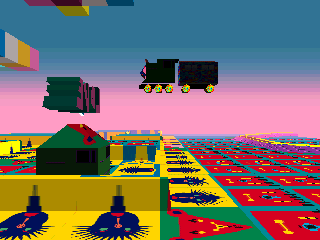

Technical details

- Spawn: stage 4 (Happy Town), square (col 1, row 1), slot 3 (key 257, day flag 1: odd day numbers only), group 4: type 111, rule 1 (always), model 0, place 2. Record 111 (0x8008A594): wake mode 1 (in range), wake range +5 = 15, range +9 = 3, touch range 15, link -4 (stage 3, the Natural World), handler `Behavior_FlyingTrain` @0x80064E34 (C, `src/game/entity.c`).
- How "in range" works: `Entity_IsInRange` asks DreamSys slot 0x120 `DreamSys_TestPointAhead` for the point (record +5) << 11 units straight ahead of the player and tests, axis by axis (`Entity_IsWithinBox`), whether the character is within (record +9) << 11 of it. For the train: the spot 30,720 units ahead of you must land within 6,144 of it. Player position: DreamSys (0x80091530) +0x14 points to a block with x, y, z as s32 at +0x18, +0x1C, +0x20, copied at +0x38, +0x3C, +0x40 (the copy `Entity_GroundDistance` and `DreamSys_TestPointAhead` read).
- Handler: at tick +0xFC = 0 it asks DreamSys slot 0x200 (`GetDreamColor`); colour 5 (pink) sets +0x44 = 11. Normal run: `Behavior_TrainRun(.., 0x1E1, 0x884, -0x3C)`, forward at speed 0x3C, three turns of 1 degree per tick about y (rotation table `g_rotY1`, slot 0x44) in tick windows from 481 (first read as a horn; corrected while naming the code, 2026-10-16), sound 4 on its three voices at the start, and at tick 0x884 = 2,180 slot 0x160 (leave). Pink run: the same until tick 0x870 = 2,160, then slot 0x130 (stop); tick 0xA00 = 2,560 calls slot 0x12C (play an animation), with sound 5 on voice 0 from tick 0x9F6 to 0x9FF (the honk); from tick 0xA03 it rolls again with the leave tick moved to 0xFA0 = 4,000, and from tick 0xAF1 = 2,801 slot 0xCC with -0x20 every tick lifts it (PS1 y points down).
- Opera singers: stage 4 square (col 1, row 0), slot 0 (every day): group 0 is the singer on the pillar (type 38), group 28 is type 112 at places 137 to 140 with rule 17 (`SPECIAL_COLORS[7]` = 5, pink).
- In game: yes, interpreter (`work/hunt5/C/r5.log`). Forced: day +0x180 = 4 (day number 5), yesterday's point +0x196 = (-2, 7) (start on square (1, 1)), mood accumulator (6, 5) at each spot check (colour 5), time limit +0x134 = 200,000 at vsync 3600, player moved at vsync 3600 to 30,720 units behind the spot facing it, then put back every 10 vsyncs 14,000 units south of the train. Spawned at vsync 3488, woke at 3603, +0x44 = 11 from the first tick, stopped at tick 2,160 at (-59117, 0, -70763), 4,100 units from the pillar and next to the four type 112 singers; still from vsync 14,800 to 17,100; moving again at tick 2,642; y left 0 between ticks 2,787 and 2,837 and reached -9,088 at tick 3,085. Control `r4.log`: 12,000 units from the spot, facing it, it never woke in 13,000 vsyncs.
- Waking is touching: record 111 has wake range +5 = 15 and touch range +6 = 15 with range parameter +9 = 3, so `Entity_CheckWake` and `Entity_CheckTouch` pass in the same tick (both through `Entity_IsInRange` @0x8005D714). The touch sends event 9; `DreamSys_OnEntityEvent` @0x8005B03C logs the record mood (-9, 5) in the touched-characters accumulator (+0x154). `Mood_CalcAxis` gives x = -9 + (-9 / 3) = -12, below -9, flipped to 9; y = 5 + 5 / 3 = 6. `DreamSys_ComputeDayPoint` averages it with the squares' result (c_x, c_y): ((c_x + 9) / 2, (c_y + 6) / 2), pink whenever c_x >= -1 and c_y >= 2 with nobody touched before; every Happy Town square has y from 7 to 9. The handler asks the colour at its tick 0, after that log.
- Natural route, hunt 6 (`work/hunt6/A/t1.log`, `t3.log`, interpreter): forced day +0x180 = 4 (day number 5) and yesterday's point +0x196 = (6, 2) only; the dream started on Natural World square (11, 11) (clock 6,300 ticks); a wall gave a random link to Kyoto, a Kyoto wall a random link to Happy Town square (0, 0) at timer 565 (both the emulator's own dice); the player was then moved once to (-93184, -29696), 30,720 south of the train, and turned by pad. Logged `ent (-9,5)` in the wake vsync, colour point (6, 6), +0x44 = 11 from the first tick; it stood at (-59117, 0, -70763) from tick 2,403 to 2,503, moved again at tick 2,569 and reached y -13,056 at tick 3,209 (timer 3,879 of 6,300). From the north (`t2.log`) the train drove at the player and its touch linked him to the Natural World square (9, 14).
- Why it is rare: the train counter +0xFC and the dream timer +0x24 advance together, one per game frame (`t3.log`: train 7 to 3,209 while the timer went 646 to 3,879); hunt 5's "0.175 per vsync" was the emulator's frame rate in that scene, not another clock. Latest wake to see the stop = start clock - 2,160, to see the lift-off = start clock - 2,801 (`g_stageTimeLimits`, seconds x 15): Happy Town (stage 4), stages 6 and 12 (1,800 or less): never; stages 1 and 11 (2,700): the stop only, if woken by tick 540; stage 0 (3,600): lift-off by tick 799; stage 3 (6,300): 3,499; stages 2 and 13 (7,200): 4,399; stage 5 (9,000): 6,199. From a long-clock place a wall with no fixed link lands in Happy Town 2 times in 6 from the Natural World and 1 in 6 from stages 0, 1, 2 and 5 ([random links](#-where-a-random-link-sends-you)).
- Not seen: the normal train leaving at tick 2,180 and the pink train leaving at tick 4,000 (code only). Types 41 and 49 share its model (Happy Town squares (3, 3) and (5, 3)); type 49's handler, fast and carrying the dreamer to Kyoto on CIRCLE, is the even-day fast train players describe, played in hunt 8 ([CIRCLE](#-characters-that-answer-to-circle)). A route walked by pad through Happy Town's streets to the viewing spot was not played.
- Question: [12](mysteries.md#events-and-hidden-content). Found 2026-10-15, natural route 2026-10-16.
- Before us: the fandom wiki (Train, Rare Events) already had the odd-day slow train woken by looking at a spot, its stop at the opera pillar, the honk and the flight on a pink chart point (x 4 to 9, y 3 to 9); new here: the train makes the pink point itself when it wakes, why a dream started in Happy Town can never see it fly, and the emulator proof.

### ✅ The astronaut lands at the bar on a pink day

On even-numbered days a giant astronaut floats over Bright Moon Cottage, out and back, playing its trumpet. If your day is pink at the moment it appears, it turns out of its flight path, dives into the yard, walks to the cottage's bar and stays standing beside the counter, and the trumpet stops. On any other colour it never comes down.

Nothing in its code looks at the day number beyond odd or even, so the "days 200 to 300" players repeat is [a myth](#-myth-the-astronaut-lands-only-between-days-200-and-300): it landed on day 4. It appears once per dream. A dream that starts in the cottage cannot do it: the first place a dream logs is its start square, and no cottage square leans far enough to the right.

A recipe that works: on an even day, start the dream in Happy Town's upper street, walk west along it for two blocks, then push into a wall. When the random link drops you anywhere in Bright Moon Cottage except the yard itself, your day is still pink, the astronaut appears over the yard and lands. A wall in Happy Town sends you to the cottage 1 time in 6, and 7 of the cottage's 8 arrival spots keep the pink: 7 chances in 48 per wall. A dream that starts in Happy Town lasts long enough, since the landing takes about 40 seconds.

Status: 🎮 checked in the game. Hunt 5 forced the even day, the start square and the pink colour; with the natural colour it kept flying. Hunt 6 played the recipe with the day number, yesterday's point and the dice of the one random link forced, and the walk in Happy Town was a straight line that ignored walls; the pink, the dive and the stop at the bar were the game's own, and the next morning the graph showed the pink point.

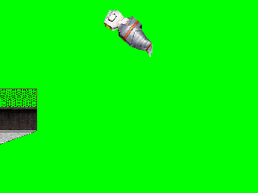
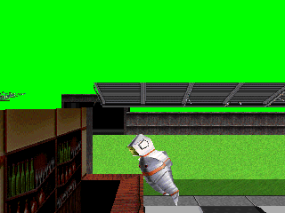
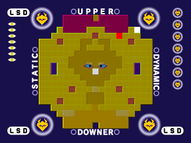

Technical details

- Spawn: stage 0 (Bright Moon Cottage), square (col 0, row 4), mood (-5, -7), slot 4 (key 1024, day flag 2: even day numbers). Group 0: type 0, rule -1 (always, once per world build: the done flag is cleared by `Sym_LoadModels`), place 42. Record 0 (0x80089EA4): mood (0, 2), points 20, wake mode 0, touch range 2, link -13 (stage 12, Black Space, as players report), handler `Behavior_Astronaut` @0x8005E160.
- Handler: at its first tick it reads DreamSys slot 0x200 (`GetDreamColor`); 5 (pink) sets +0x44 = 100. Normal: trumpet every 10 ticks, `unkC4(+0x32)` for 1,200 ticks then `unkC4(-0x32)` for 1,200 ticks, and at tick 2,400 the counter restarts. Landing: forward for 100 ticks, then `unkBC(g_moveY64ZNeg64)` = (0, 0x40, -0x40) until tick 250 (the dive), sound only before tick 250, walk `unkC4(-0x32)` with the absolute rotation `g_rotYNeg120` (0, -120, 0) degrees from tick 261 to 567, then the absolute rotation `g_astronautBarPose` (50, -120, 30) degrees from tick 569.
- No day rule: the only day-of-year rules in the spawn code are the 30-day "month" rules 2 to 4 (another square of stage 0, another model); the [40-day cycle](#-the-40-day-texture-cycle) changes only textures; the ambience pick `Ambience_PickFamily` feeds only rule 7, used by one group of stage 3.
- In game: yes, interpreter. Pink runs `work/hunt5/C/r6-astro-pink.log`, `r14`, `r16`: colour point (8, 6) at vsync 3463, +0x44 = 100 from the first tick; y went from -9,216 to 384 between ticks 68 and 308, then it reached (-5104, 384, -5328) and stayed there from tick 588 to the end of the run (tick 866). Control `r6b-astro-ctl.log`: natural colour point (-6, -9), +0x44 = 0, y stayed -9,216, still flying at tick 508. Forced: day +0x180 = 3 (day number 4), yesterday's point +0x194 = (-5, -7), mood (6, 5) at spot checks, limit +0x134 = 200,000, camera kept 4,000 to 5,000 units behind it; in `r16` the player's height was set to the astronaut's minus 1,000 after its tick 600 to see the ground floor. In `r16` the camera touched it at vsync 3500 (instance score +20,000, no link); its landing had been decided at its first tick.
- The recipe, hunt 6 (`work/hunt6/A/a2.log`, `a3.log`, interpreter): forced day +0x180 = 3 (day number 4), yesterday's point +0x194 = (7, 7) (start on Happy Town square (2, 0)), the player moved west along Happy Town row 0 at walking pace ignoring walls (vsyncs 3,500 to 6,500), rand state 0xD at the one `Spawn_PickRandom` call (cottage, arrival 5 of 8). All five cottage slots load on arrival (keys 0 to 1024 at f 7,758 to 7,800), so the astronaut reads the colour right after arrival. Square moods logged: (7, 7) (the start square (2, 0)), (5, 8), (5, 9), then (0, 0) on arrival: (17, 24) / 4 + (0, 0) / 3 = (4, 6), pink; +0x44 = 100 from its first tick; y from -9,216 to 384 between ticks 89 and 318, then it stood at (-5104, 384, -5328) from tick 634 to the end of the dream (tick 751, timer 1,801). Next morning (`a5.log`, no camera follow): +0x196 = (4, 6), shown on the graph screen.
- The other arrivals, same Happy Town squares before: cottage rows 0 to 3 give (4, 4) or (4, 6), pink; row 4, the yard (-5, -7), gives (2, 2), not pink: 1 in 6 for the cottage times 7 of 8 arrival points = 7 in 48 per wall bump. Bumping a wall at once, with only the start square logged, only row 1 keeps pink. A cottage start: every cottage square has x from -5 to 1, so the day's x is at most 1 when the yard loads.
- Not played: Happy Town's row 0 walked by pad (whether it is one open street from (2, 0) to (0, 0)), and the cottage link without forcing the dice.
- Question: [12](mysteries.md#events-and-hidden-content). Found 2026-10-15, recipe 2026-10-16.
- Before us: the fandom wiki (Floating Astronaut, Rare Events) already gives even days, a pink chart point when it appears and no landing in a dream started in the cottage; we confirm the colour rule in the code and the emulator, and the Happy Town recipe with its odds is new.

### 🔄 A red day fills the Maze of Questions with rainbow penguins

In Happy Town's "Maze of Questions", on odd-numbered days, a single rainbow penguin stands in the maze and a big question mark spins in the sky above the walls. If the colour of your day so far is red when that square loads, the question mark is gone and eight more penguins stand there, nine in all. Touching one flashes the screen red and sends you to another corner of Happy Town, a grey courtyard with a blue and white checkered floor.

Red is the bottom middle part of the colour grid: neither static nor dynamic, and downer. The easiest way in is to end a day on the point (2, 8), near the top of the graph. If the next day has an odd number, the dream starts on that very square, and the square's own mood plus the game's bonus for the last place visited pushes your point past the top edge. It flips to the bottom of the graph: red, and the penguins come out.

The lone penguin has a trick of its own: one time in five, when it wakes up, it is six times bigger and towers over the maze walls. The roll is made once per wake, whatever the colour of the day.

Our first version of this finding called these figures gunmen. They are the maze penguins: the same character, square and spawn as the wiki's rainbow penguin, as a closer look in the emulator showed. The real gunmen are in Violence District: three on one square every even day, and seven on an even cyan day, our best match for the community's "multiple gunmen" sighting, seen in the spawn log but not on screen ([the CIRCLE characters](#-characters-that-answer-to-circle)).

Status: 🎮 checked in the game. The crowd: only the day number and yesterday's point were written in; the red colour and the nine penguins came from the game itself. The giant: the dice were forced at its wake-up to get the 1 in 5 roll.

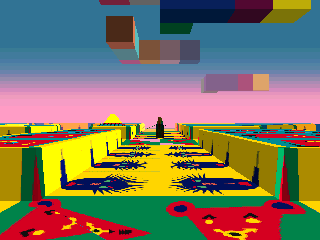
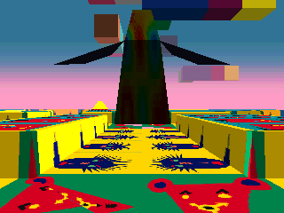
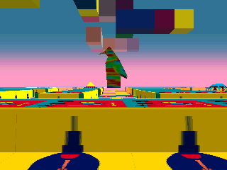

Technical details

Square: stage 4 (Happy Town), column 0 row 4 (key 0x400, `STG04\N1\M024.LBD`, mood (2, 8)). Its spawn slot 16 (day flag 1: odd day numbers only) lists groups 13 (type 51, rule always, place 81), 22 (type 54, model 1, place 84: the question mark) and 25 (type 113). `Sym_PickSlotVariant` swaps slot 16 for slot 21 when the stage is 4 and `GetDreamColor` (DreamSys vtable 0x200) returns 4; it compares the colour with the stage number, which happens to be 4. Slot 21 holds groups 13, 26 and 27; the last two are type 114 with rule 11 (`SPECIAL_COLORS[1]` = 4), 4 places each (129 to 136), and `Sym_SpawnGroup` spawns a group at each listed place. Types 51 and 114 use the same model (model 0 of the square's MML) and the same record (touch range 6, link -5 → stage ~(-5) = 4 with +8 = 1, so they link as soon as the player is close); only the handler differs (`Behavior_MazePenguin` @0x80060D80 vs `Behavior_RedDayPenguin` @0x800650F4, which picks random animations; the code names predate the penguin and are kept for now). Type 113 runs the same handler as 51 (`Behavior_Type113` only calls it).

- Colour at the start: the chunk accumulator holds only (2, 8); `Mood_CalcAxis` gives x = 2 + 2 / 3 = 2 and y = 8 + 8 / 3 = 10 (integer division), flipped to -9; `Mood_GetColor` bands (2, -9) to [1][0] of `g_moodColors` = 4 (red in lsddecomp's colour enum). The link flash uses `g_fadePalette[4]` = (255, 0, 0).
- Giant: at its first tick (`handlerTicks` +0xFC = 0 after it wakes) `Behavior_MazePenguin` does `if (rand() % 5 == 0 && state == 0)`: `SceneNode_SetScale` (entity slot 0x48) with `g_scaleSix` @0x80089E38 = (6, 6, 6), then 0x320 units down (PS1 y points down) and state 11.
- Proof: `Sym_PickSlotVariant`, `Sym_SpawnGroup`, `Sym_CheckRule`, `Sym_CheckColorRule`, `Mood_GetColor`, `Mood_CalcAxis` @0x8005B66C, `Behavior_MazePenguin` @0x80060D80, spawn dump `work/hunt3/spawns.txt`.
- In game, the crowd: yes, interpreter (`work/hunt4/A/q12.lua`, breakpoints on `Sym_SpawnOrSpy`, `Sym_CheckRule`, `Sym_SpawnAtPlace`, `Mood_GetColor`). Forced: +0x180 = 4 (day number 5) and yesterday's point +0x196 = (2, 8) at vsync 2100, nothing else. Log `work/hunt4/A/ht1.log`: colour point (2, -9) at 3420, type 51 at place 81, then type 114 at places 129 to 136; six of them in one frame while turning (run `ht-pan`). Control `ht-ctl.log`: the chunk accumulator forced to (0, 0) at every slot check (colour 7): types 51 and 54 only, and the question mark floats over the square. Touch (`ht-red.log`): walking forward from 4400 met a penguin, red screen from 4700 to 5000, then the grey checkered courtyard at 5100, still stage 4.
- In game, the giant: yes, interpreter (`work/hunt7/G1/r5-gunman-giant.log`): same day and yesterday's point, limit +0x134 = 200,000, `g_randState` 0x8008AC68 = 0 at the first entry of `Behavior_MazePenguin` (rand() returns 0), camera kept 9,000 to 35,000 units behind it. Logged `setscale type=51 table=0x80089e38 (6/1, 6/1, 6/1)` at f 3,453, scale vector (24576, 24576, 24576). Control `r8-gunman-ctl.log`: rand state 1 (rand() = 16838, % 5 = 3), no resize, (4096, 4096, 4096). Hunt 7 ran the very spawn of hunt 4 (stage 4, square (0, 4), slot 16, group 13, place 81, type 51): the pictures show the rainbow penguin; the small figures of hunt 4's red-day picture are the same penguins.
- Not checked: whether the red-day crowd is the wiki's "dancing penguins" (a group of smaller penguins in the maze that do not move): the handler of type 114 picks random animations and has no resize call, so "smaller" would come from distance. The 1 in 5 giant without forcing the dice.
- Question: [12](mysteries.md#events-and-hidden-content). Found 2026-10-15, corrected and giant added 2026-10-16.
- Before us: the fandom wiki (Penguins, Happy Town) already had the rainbow penguin of the Maze of Questions on A-type (odd) days with the spinning question mark over the maze, a rare group of "dancing penguins" with no condition given, and pictures of a giant penguin; our earlier text misread the penguin as a gunman. New here: the red-day rule that brings the nine penguins and removes the question mark, and the 1 in 5 roll at wake-up behind the giant.

### 🧩 Three minotaur rickshaws on a yellow day in Kyoto

Kyoto's rickshaw minotaur, a cart pulled by a brown bull-man, normally rolls alone down one street on odd-numbered days. If your day so far is yellow when that street loads, two more rickshaws join it, three in a row. Yellow is the graph's lower-left corner. Kyoto's own squares mostly lean the other way, so the yellow has to come from places or touches earlier that day.

Status: 🎮 checked in the game: the odd day, the start square and the yellow colour were forced; with the natural colour only one rickshaw came. Their link to the Natural World, which players report, is read in the code only.

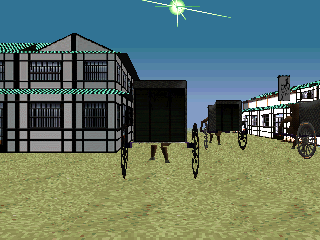
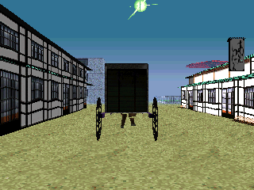

Technical details

- Spawn: stage 2 (Kyoto), square (col 0, row 2), mood (2, -1), slot 5 (key 512, day flag 1: odd day numbers). Group 14: type 21, rule 1 (always), place 35. Group 19: type 21, rule 10 (`SPECIAL_COLORS[0]` = 6, yellow), places 126 and 127. Both use model 0 of the square, so the extra two look the same. Record 21 (0x80089FF4): mood (-1, -2), wake mode 0, link -4 (stage 3, the Natural World), handler `Behavior_MinotaurRickshaw` (moves at -0x1E with the follow flag, sound every half animation loop).
- In game: yes, interpreter. Yellow runs `work/hunt5/C/r9-mino-yellow.log`, `r12-mino-yellow.log`: colour point (-8, -8) at vsync 3445, type 21 at places 35, 126 and 127, at (-89088, -200, -15360), (-93184, -200, -17408), (-91136, -200, -19456), all moving the same way. Control `r9b-mino-ctl.log`, `r12b-mino-ctl.log`: colour point (2, -1) (white), type 21 at place 35 only. Forced: day +0x180 = 4 (day number 5), yesterday's point +0x196 = (2, -1), mood (-6, -6) at each spot check in the yellow runs, limit raised, camera 5,000 units behind the first cart.
- Other Kyoto colour groups in the same table, not run: green (rule 15) puts 4 more of type 20 on square (3, 1); white (rule 13) 2 more of type 94; red (rule 11) type 110, [the geisha on the bridge](#-a-red-day-puts-a-geisha-on-a-kyoto-bridge).
- Question: [12](mysteries.md#events-and-hidden-content). Found 2026-10-15.
- Before us: the fandom wiki (Minotaur, Rickshaw Minotaur) says several sometimes appear together and that the rickshaw comes on odd days and links to the Natural World; new here: the yellow-day rule and the street.

### 🆕 Three purple beasts on a yellow day: our best match for the special lions

Pit & Temple (stage 1) normally has one purple beast with a mane that stands still and, rarely, wakes up when you are near. On a yellow day three more of the same beast walk through that square in single file. In the code, coming close to any of them sends you elsewhere in Pit & Temple.

Players talk about "special lions near Temple Dojo". These four-legged maned beasts are our best match, by their look and their behaviour, but nothing in the game names them, so the match is not proven. The lions players see in the Natural World were not looked for.

Status: 🎮 checked in the game: the start square and the yellow colour were forced; the trio and its walk were the game's own. The link when you come close is read in the code only.

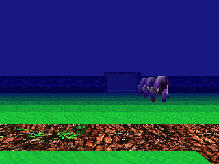
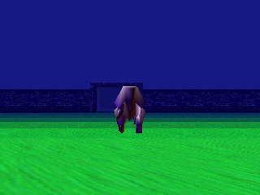

Technical details

- Spawn: stage 1, square (col 1, row 1), mood (0, -9), slot 1 (key 257, every day). Group 1: type 8, rule 1, place 24. Group 2: type 109, rule 10 (yellow), places 110 to 112. Both model 0 of the square (10 objects, 90 polygons, `work/hunt4/A/models.txt`).
- Record 8: wake mode 3 (in range, then 1 in 128 per tick), handler `Behavior_PurpleBeast` (idle animation, turns toward a fixed target). Record 109: wake mode 0, touch range 7, link -2 (stage 1) with +8 = 4 (links as soon as the player is within 4 << 9 = 2,048), handler `Behavior_YellowDayBeast` (walk animation and `unkC4(-10)` each tick).
- In game: yes, interpreter. Yellow runs `work/hunt5/C/r7-lions-yellow.log`, `r11-lions-yellow.log`, `r15-lions-side`: colour point (-8, -8) at vsync 3347, type 109 at (-3072, -200, -25600), (-3072, -200, -27648), (-3072, -200, -29696), all moving +z at about 2 units per vsync. Control `work/hunt4/A/lc.log` (colour blue): type 8 only. Forced: day +0x180 = 4, yesterday's point +0x196 = (0, -9), mood (-6, -6) at each spot check, camera 6,000 units from the first beast (9,000 behind and 2,500 to the side in `r15`).
- Kyoto square (4, 3), the other candidate, holds a geisha model, not a lion (see [the geisha](#-a-red-day-puts-a-geisha-on-a-kyoto-bridge)).
- Question: [12](mysteries.md#events-and-hidden-content). Found 2026-10-15.
- Before us: the community notes mention "special lions near Temple Dojo" without a page we could open, the fandom wiki (Lion) covers only the two Natural World lions, and the LSD Revamped catalogue of Pit & Temple does not list this beast; the yellow-day trio is new, and its match to the lions is not proven.

### 🧩 A red day puts a geisha on a Kyoto bridge

On a red day, a geisha stands still on the red arched bridge of a Kyoto canal, in the same square where on even days another geisha walks down the street toward you. Players report a geisha "rarely standing still on a bridge" whose link goes to Black Space, and her code sends you there.

The walking one is the dangerous one: in one of her two scripts she turns, comes at you and ends the dream with her video.

Status: 🎮 checked in the game: the start square and the red colour were forced; she stood on the bridge for the whole run. Her link and the walking geisha's video are read in the code only.

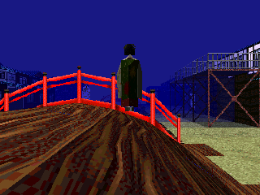
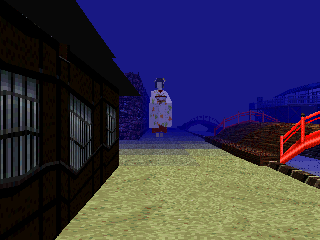

Technical details

- Spawn: stage 2 (Kyoto), square (col 4, row 3), mood (-1, -1), slot 10 (key 772, every day). Group 2: type 11, rule 20 (even days), place 58. Group 17: type 110, rule 11 (`SPECIAL_COLORS[1]` = 4, red), place 121. Group 21: type 125, rule 21 (odd days), places 207 to 210. All model 0 of the square (5 objects, 88 polygons).
- Record 110: wake mode 0, touch range 5, link -13 (stage 12, Black Space in the community numbering), handler `Behavior_BridgeGeisha`: idle animation, and when the player comes within 0x800 a 45-tick animation, then 500 ticks of rest. Record 11: +7 = 8, +8 = 4 (video 3), handler `Behavior_WalkingGeisha`: at tick 1,560 a coin flip picks one of two scripts; in one, if DreamSys slot 0x100 answers non-zero between ticks 3,421 and 3,540, she turns, comes at the player at speed 0x78 and ends the dream with her video within 0x400. Record 125: 1 in 4 leaves at its first tick, the others walk slowly and leave at tick 3,600.
- In game: yes, interpreter. Red runs `work/hunt5/C/r8c-ky43-red.log`, `r13-ky43-red.log`: colour point (0, -8) at vsync 3465, type 110 at place 121, standing at (31744, -900, 29048) on the bridge (y -900, above the street's -200), still through the run; type 11 also spawned (even day). Forced: day +0x180 = 3 (day number 4), yesterday's point +0x194 = (-1, -1), mood (0, -6) at spot checks, camera 4,000 units from her. The walking geisha: `r8b-ky43-even.log`, no colour forced.
- Question: [12](mysteries.md#events-and-hidden-content). Found 2026-10-15.
- Before us: the fandom wiki (Geisha) already says a geisha standing still on a bridge links to Black Space; new here: she comes on a red day, on that square.

### 🧩 A green day sends a file of Buddha statues through Kyoto

When your day is green as one square of Kyoto loads, four standing Buddha statues appear one behind the other and walk north through the town together, under the torii. On an even day the statue that is always there on even days joins the end of the file, five in all. On an odd day the four odd-day statues walk too, so Kyoto has eight walking statues. Green is the graph's upper-left corner.

The odd-day statues are a different show: four of them on every odd day, whatever the colour, each woken on its own and walking alone in a straight line from four corners of the town toward the same crossing, two of them along the same street toward each other. Players describe four Buddha statues walking on A-type days, which are odd days: that is this odd-day group. The single-file parade is the green-day one.

You have to look at them from far away to wake them: a statue starts walking when it stands about 12 tiles straight ahead of you. Standing next to one does nothing, and asleep it is not drawn at all, so the street looks empty. Walking into one sends you to Pit & Temple.

No dream that starts in Kyoto can be green there, since the squares around it lean to the right of the graph; the green has to be carried in from places on the upper left of the graph, like some squares of the Natural World.

Status: 🎮 checked in the game: the day number, yesterday's point and the green colour were forced, and the camera was moved to wake the file, then to follow it. The walk was the game's own. The natural way to green, the touch and the link are read in the code only.

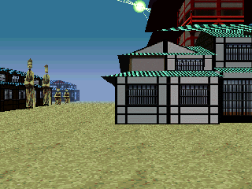
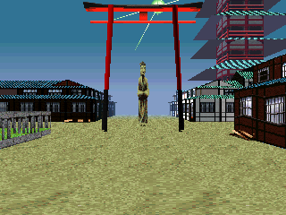
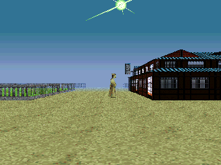

Technical details

- Spawn: stage 2 (Kyoto), square (col 3, row 1), slot 2 (key 259, every day): group 13 rule 20 (even days) type 20 at place 61; group 18 rule 15 (`SPECIAL_COLORS[5]` = 2, green) type 20 at places 122 to 125; group 25 rule 21 (odd days) type 20 at places 216 to 219. Every group of a slot whose rule passes spawns (`Sym_SpawnSlot`).
- Record 20 (0x80089FE4): mood (0, -4), +8,000 points, wake range +5 = 12 (the box of record +9 = 3, so +/- 6,144 units, around the point 24,576 units ahead of the player: `Entity_IsInRange` @0x8005D714), leaves after 180 x 15 = 2,700 ticks, touch box 10,240 ahead (+6 = 5), link -2 = stage 1 (Pit & Temple) within 1 << 9 = 512 units (`Entity_CheckLinkRadius`). Handler `Behavior_Type20` @0x8005EFF4: a footstep every 4 ticks, `moveZ(-0x64)` each tick, and 1 chance in 7 at its first tick to be twice as tall (`g_scaleTallTwo` @0x80089E50 = (1, 2, 1)).
- In game: yes, interpreter (`work/hunt7/G2/`). Green runs `k-green2.log`, `k-green-side.log`: forced day number 5, yesterday's point (3, 1), mood accumulator (-7, 7) at each slot check, so colour point (-9, 9) at f 3,460; the four at (-18432, -400, z) for z = -66,560 to -72,704, 2,048 apart; with the camera 24,576 units in front of the second one at f 3,600 all four woke on the same tick and walked north at 100 units per tick, still 2,048 apart (head z -58,260 at f 4,100, -33,260 at f 5,600). Even day `k-green-even.log`, `k-green5-even.log` (day number 4): five in one line, place 61 at the tail. Control `k-odd-ctl.log` (day number 5, natural colour black): the four odd-day statues only, woken one by one, walking from (19456, -66560) west, from (-50176, -66560) east, and from z near -43,000 south. Hunt 6 lane D had the spawn log but never woke the statues: in `k-green.log` the player stood 856 to 7,000 units from them for 2,700 vsyncs and none woke.
- Natural green, read in the code: every square around (3, 1) has x >= 1, so a Kyoto start is never green there. Example: five squares at (-7, 7) then an arrival on Kyoto square (2, 0), mood (2, 5): (-33, 40) / 6 + (2, 5) / 3 = (-5, 7), green; Natural World squares (5, 4) at (-6, 7) and (15, 3) at (-7, 6) carry such moods (`work/hunt7/G2/firstchunk.py`). Not played.
- Not triggered: the touch, the link to Pit & Temple and the 1 in 7 tall statue.
- Question: [12](mysteries.md#events-and-hidden-content). Found 2026-10-16.
- Before us: the fandom wiki (Kyoto) says Buddha statues walk through Kyoto, sometimes in pairs, one or more stretched, and link to Pit & Temple, and it describes four statues walking on A-type days; which group those writers saw is our reading of their words. New here: the green-day file, the odd-day rule behind the four, the 1 in 7 stretch and the far-away wake-up.

### 🧩 A white day brings two more red-headed runners to a Kyoto plaza

On even days a figure with a red head and outstretched arms walks around one Kyoto plaza. If your day is white as that square loads, two more come with it, three in all. Walking into any of them sends you to the Long Hallway. White is the centre of the graph, so this one is easy: end a day near (2, -1) or (-2, 0), and if the next day is even, the dream starts next to the plaza, already white.

Our best match for them is the wiki's tengu, red faces running through Kyoto, several at once, with a link to the Long Hallway; the match is by look and link, not proven.

In the code the usual figure has one more trick: on a day that is not white, when its first animation ends, it has 1 chance in 2 to become six times bigger. The white-day trio never does. We did not see it grow.

Status: 🎮 checked in the game: only the day number and yesterday's point were written in; the white colour, the trio and the link to the Long Hallway (one of them walked into the camera) were the game's own. The giant figure is read in the code only.

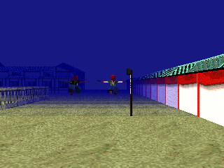
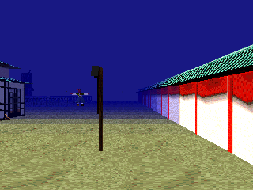

Technical details

- Spawn: stage 2 (Kyoto), square (col 0, row 3), slot 8 (key 768, day flag 2: even day numbers only): group 6 rule 6 (day % 3 != 0) type 94 at place 62; group 20 rule 13 (`SPECIAL_COLORS[3]` = 7, white) type 94 at places 144 and 145.
- Record 94 (0x8008A484): mood (0, 5), +100,000 points, awake at spawn, leaves after 40 x 15 = 600 ticks, touch box 16,384 units ahead, link -11 = stage 10 (the Long Hallway in the community numbering) within 3 << 9 = 1,536 units. Handler `Behavior_Type94` @0x80064294: at its first tick, a colour other than white (`getDreamColor`, DreamSys slot 0x200) sets state 11; when its first animation ends, state 11 and `!(rand() & 1)` call `scale(g_scaleSix)` = (6, 6, 6) and `moveY(0x800)`; then 1 in 3 turns 180 degrees; it walks at 0x80 per tick.
- In game: yes, interpreter. White runs `work/hunt7/G2/k-white-nat-even.log`, `k-white2.log`: forced day number 4 and yesterday's point (2, -1) only; colour point (2, -1) at f 3,462; type 94 at places 62, 144, 145, at (-117760, -200, 13312), (-114688, -200, 17408), (-115712, -200, 21504). One walked into the camera at f ~4,100 and the dream went to stage 10. Control `k-white-ctl2.log`: yesterday's point (0, -5), natural red, type 94 at place 62 only, its height -200 in every log line (no growth seen). Odd day `k-white-nat.log`: the slot ran no group. Hunt 6 lane D had forced red and green instead of white.
- Not seen: the six-times growth of the usual figure on a non-white day.
- Question: [12](mysteries.md#events-and-hidden-content). Found 2026-10-16.
- Before us: the fandom wiki (Kyoto) lists tengu that run through Kyoto, several at once, linking to the Long Hallway, and a "Giant Geisha" and "Giant Minotaur" but no giant tengu; new here: the white-day trio, the even-day square and the code's giant figure.

### 🔄 A yellow day gives Black Space's walker a giant twin

In Black Space a small dark figure always walks on the white floor. On a yellow day a twin six times taller comes out on the same spot, and the two walk side by side, the small one between the giant's feet. Players know a "larger mirrored version" that sometimes appears, and say it comes when your dream starts in Black Space. The code is more precise: it comes on a yellow day. A dream that starts on the square fed by the point (-6, -5) is yellow from the start and gets the giant; one started on the square fed by (-6, 5) is green and does not.

Status: 🎮 checked in the game: only the day number and yesterday's point were written in; the yellow colour, the giant and its walk were the game's own. Control: a green start, no giant.

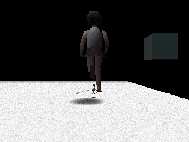
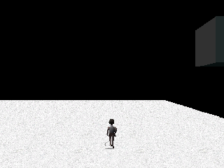

Technical details

- Spawn: stage 12 (Black Space), square (col 1, row 2), slot 0 (key 513, every day): group 0 rule 1 type 71 at place 0; group 1 rule 10 (`SPECIAL_COLORS[0]` = 6, yellow) type 108 at place 0, the same model of the same square.
- Records 71 and 108 are identical: mood (9, 0), +100,000 points, wake 6 tiles ahead, leave after 2,700 ticks, link -3 = stage 2 (Kyoto) within 512 units. Only the handler differs: `Behavior_Type108` @0x80064CA4 calls `Behavior_Type71` @0x80062570 (a sideways shift of 0, 1 or 2 times 0xC800 at its first tick, a slow walk, facing you after tick 2,401) and then rescales by `g_scaleSix` (6, 6, 6) every tick.
- In game: yes, interpreter. Yellow runs `work/hunt7/G2/s12-yellow-nat.log`, `s12-yellow2.log`: forced day number 5 and yesterday's point (-6, -5) only; the dream started on square (0, 2), colour point (-8, -6) at f 3,308; types 71 and 108 both at (-19456, -200, 1024); woken from 12,288 units, both walked south side by side (z 364 at f 3,700, -10,826 at f 5,200); the giant's matrix column read (0, 24576), six times 4,096. Control `s12-ctl2.log`: start square (1, 2), mood (-6, 5), colour point (-8, 6) green, type 71 only.
- Stage 12's clock is 1,800 ticks (120 s), so a dream started there gives the giant two minutes.
- Question: [12](mysteries.md#events-and-hidden-content). Found 2026-10-16.
- Before us: the fandom wiki (Black Space) says there can be two Hoop and Stick Girls, the second a larger mirrored version, and that a large one appears if your dream starts in Black Space; the start is only half of it: the rule is a yellow day, and only one of the Black Space starts we ran is yellow.

### 🆕 A blue day sends four more fetuses down the Flesh Tunnels

The red tunnel of the Flesh Tunnels has one fetus figure, wearing a bib with the character 胎 ("womb"), that comes out only once per dream. On a blue day four more come out on the same spot and walk up and down the tunnel. Touching one costs 100,000 points, among the worst touches in the game, and sends you nowhere. Blue is the top middle of the graph.

No dream that starts in the Flesh Tunnels is blue, so the blue has to come from earlier places that day.

Status: 🎮 checked in the game: the day number, yesterday's point and the blue colour were forced; the four extra fetuses and their walk were the game's own. Control with the natural colour (white): one fetus. The natural way to blue is read in the code only.

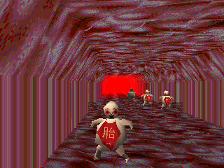
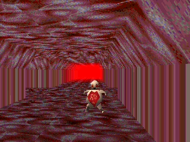

Technical details

- Spawn: stage 8, square (col 0, row 1), slot 1 (key 256, every day): group 1 rule -1 ("once") type 95 at place 48; group 4 rule 16 (`SPECIAL_COLORS[6]` = 1, blue) type 95 at places 117 to 120. Slot 2 (square (0, 2)) always adds eight type 96.
- Record 95 (0x8008A494): mood (4, 2), -100,000 points, wakes 3 tiles ahead, leaves after 300 ticks, touch box 2,048 ahead, no link, no video. Handler `Behavior_Type95` @0x80064450: animation 3, then animation 1 walking at 0x80 per tick.
- In game: yes, interpreter. Blue run `work/hunt7/G2/s8-blue.log`: forced day number 5, yesterday's point (-7, 0) (start on square (0, 1)), accumulator (0, 6) at each slot check, colour point (0, 8) at f 3,311; five type 95 at (-16384, 2048), (-15360, 2048), (-16896, 0), (-18432, -3584), (-17408, 1024); two walked in opposite directions along the tunnel between f 4,100 and 4,900, two stood. Control `s8-ctl.log`: point (-9, 0), white, type 95 at place 48 only. Hunt 6 lane D had forced (-9, 0), white, not blue.
- Natural blue, read in the code: the stage 8 start squares (7, 0), (-7, 0), (-7, 1) give black or white; example: three squares at (0, 7) then an arrival on square (0, 1): (-7, 21) / 4 + (-7, 0) / 3 = (-3, 5), blue. Which links lead into stage 8 was not checked.
- Question: [12](mysteries.md#events-and-hidden-content). Found 2026-10-16.
- Before us: nothing on a blue-day group of fetuses in the pages we read (the community notes, the fandom wiki pages copied in `work/hunt7/G1/wiki/`); the wiki's own Flesh Tunnels page could not be opened on 2026-10-16, so a player sighting may exist.

### 🔄 Happy Town's flowers and mushrooms grow with the day number

Two Happy Town sights change size by the day number, not by chance. Both come on even days only.

The eight smiling flowers near the castle are six times bigger, all of them, on days 4, 10, 16, 22 and so on (even days that leave 1 when divided by 3). On even days that are multiples of 3 (6, 12, 18) each flower has 1 chance in 3. On the others (8, 14, 20) they are never giant.

The eight rainbow mushrooms by the rails are four times taller, all of them, on days 8, 20, 26, 32 and so on (even days that leave 2 when divided by 3; days 2 and 14 would count, but they are special days with no dream). On even multiples of 3 each mushroom has 1 chance in 3. On the others (4, 10, 16) they stay short.

Status: 🎮 checked in the game: only the day number and yesterday's point were written in, plus the camera position; nothing random was forced. The 1 in 3 days were not run.

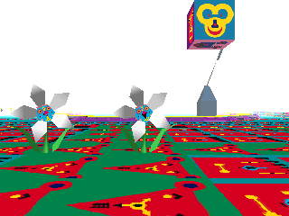
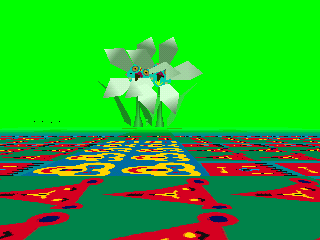

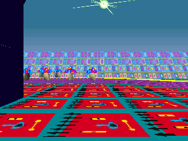
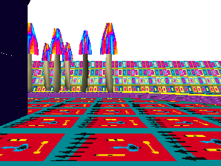

Technical details

- Flowers: type 46, `Behavior_Flower` @0x80060800; at its first tick (`handlerTicks` +0xFC = 0 after it wakes), `getDayNumber % 3`: 1 → `SceneNode_SetScale` (entity slot 0x48) with `g_scaleSix` @0x80089E38 = (6, 6, 6); 0 → the same if `rand() % 3 == 0`; 2 → nothing; then it faces the player. Spawn: stage 4, square (col 3, row 2) (key 0x203), slot 10, day flag 2 (even days), groups 8 (places 73 to 76) and 24 (places 77 to 80).
- Mushrooms: type 39, `Behavior_Mushroom` @0x8005FF7C; first tick, `getDayNumber % 3`: 2 → scale table 0x80089E5C = (1, 4, 1), height only; 0 → the same if `rand() % 3 == 0`; 1 → nothing. Spawn: stage 4, square (col 4, row 0) (key 4), slot 1, day flag 2, groups 1 (places 73 to 76) and 23 (places 77 to 80).
- In game, flowers: interpreter, `work/hunt7/G1/r2-t46-day10.log` (+0x180 = 9, day 10, yesterday's point (-2, 9), start on the flower square): `setscale type=46 table=0x80089e38 (6/1, 6/1, 6/1)` for the two flowers that woke, scale (24576, ...) at vsync 4,600. Control `r6-t46-day8-ctl.log` (day 8): the same two flowers, (4096, 4096, 4096). Wide picture: run `r11`, same forcing.
- In game, mushrooms: `r9b-t39-day8.log` (+0x180 = 7, day 8, yesterday's point (3, 7)): `setscale type=39 table=0x80089e5c (1/1, 4/1, 1/1)`, six of the eight awake with scale (4096, 16384, 4096) at vsync 4,600. Control `r10-t39-day4-ctl.log` (day 4): six awake, (4096, 4096, 4096). They wake when they stand about 20 tiles ahead (wake range 20): the player stood 41,000 units behind the first one at vsync 3,450, then 24,000 and 14,000.
- Question: [12](mysteries.md#events-and-hidden-content). Found 2026-10-16.
- Before us: the fandom wiki (Flowers, Happy Town) says the flowers can be small or extremely large and shows "8 Giant Flowers"; its Mushrooms page says their size "is directed by the current dream seed". The size follows the day number (day % 3), the same for all eight, with a die only on even multiples of 3.

### 🧩 Tiny lips walk toward you in Happy Town

On even days, near the Happy Town maze, a pair of lips 32 times smaller than the usual floating lips walks toward you along the floor. It is easy to miss: 500 units away it is smaller than one floor tile. It is the same model as the big floating lips on the same square, drawn at 1/32 every tick.

Status: 🎮 checked in the game: the day number, yesterday's point and the camera position were written in; the size and the walk were the game's own. Its link is read in the code only.

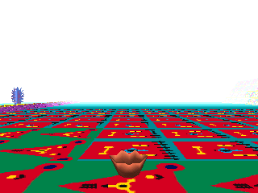
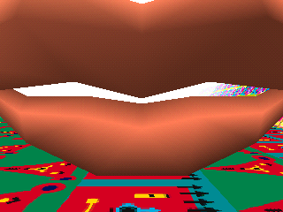

Technical details

- Type 128, `Behavior_TinyLips` @0x800654A0: every tick it faces the player, scales by (1/32, 1/32, 1/32) (0x80089E80) and moves forward (`moveZ(-0x1E)`). Spawn: stage 4, square (col 0, row 3) (key 0x300), slot 12 (every day), group 29 rule 20 (even days), places 205 and 206. It uses model 0 of that square, like type 48 (`Behavior_FloatingLips`, group 10, every day), whose record links to stage 8. Record 128 links to stage 13 (link -14, Monument Park).
- In game: interpreter, `work/hunt7/G1/r7-lips-day8.log` (+0x180 = 7, day 8, yesterday's point (1, 9)): `setscale type=128 table=0x80089e80 (1/32, 1/32, 1/32)`, scale (128, 128, 128) at vsync 4,600; camera 3,000, then 1,500, 800 and 500 units behind it. Control `r12-lips48-day8.log`: type 48 on the same square and day kept (4096, 4096, 4096).
- Not tested: touching it.
- Question: [12](mysteries.md#events-and-hidden-content). Found 2026-10-16.
- Before us: the fandom wiki (Floating Lips) says they come in small and large versions and that the small ones cannot be linked with; the code gives the small one a link to Monument Park through its record (not tested), and the 1/32 size, the even-day rule and the walk are new.

## Characters and events

### 🧩 The hidden rules that decide which characters appear

Each place has a list of character groups, and each group has a rule checked when its spot loads. Some rules follow the day: every day, even or odd days, one day in three, or a 90-day cycle of three 30-day "months". Others follow your mood so far today: the group appears only if the colour of your day so far (one of 8 colours) matches. Some groups are marked "once": they can appear one time, then not again until the dream world is rebuilt (most likely each new dream). A group can stand at up to 4 places at once, and stage 4 has a spot where, in one mood colour, two such groups fill 8 places with the same character: [the red-day crowd of maze penguins](#-a-red-day-fills-the-maze-of-questions-with-rainbow-penguins), seen in the game (we first took them for the community's "many gunmen", wrongly; our best match for those is now a cyan-day row of four more gunmen in Violence District, see [the CIRCLE characters](#-characters-that-answer-to-circle)). The "many minotaurs" work the same way: [three rickshaws on a yellow day in Kyoto](#-three-minotaur-rickshaws-on-a-yellow-day-in-kyoto).

The colour table players know from lsddecomp as `SPECIAL_COLORS` is part of these rules: for 8 of them it names the colour your day must be in for a group to come out (yellow, red, cyan, white, black, green, blue, pink, one each). It has nothing to do with links.

A character's look comes from the map square it stands on, not from its type: each square's file carries one to three models, and a group only says "model 0, 1 or 2 of this square". So a "rare version" of a character is often the same model with another behaviour swapped in by a day or colour rule. The rainbow penguin of Happy Town's maze is one (types 51 and 114). Another: in stage 1, a creature that normally stands alone comes as three on a yellow day, walking, and sends you elsewhere in stage 1 as soon as you come near ([now seen on screen](#-three-purple-beasts-on-a-yellow-day-our-best-match-for-the-special-lions)). All the sights of [Rare sights](#rare-sights) come from these rules or from a character that checks the colour itself.

Status: 📖 read in the code only, except the colour rules shown in [Rare sights](#rare-sights), which are checked in the game.

Technical details

A slot lists up to 3 groups; `Sym_SpawnSlot` tries each group in turn. Groups are 8-byte entries in `g_spawnGroups[stage]` (count `g_spawnGroupCounts[stage]`): {+0 done flag, +1 s8 rule, +2 model index, +3 entity type, +4 u8 places[4] ending at 0xFF}. `Sym_CheckRule` reads the rule; a negative rule only passes while the done flag is clear, and the flags are cleared by `Sym_LoadModels` @0x8005C508, called from `DreamRunner_Init` (the world constructor that also loads `ETC\DREAMER.TMD`); that this runs once per dream is likely, not measured. Rules: 0 and 1 always; 2, 3 and 4 pass when the 30-day month `(day - 1) / 30 + 1` equals 1, 2 or 3 plus a multiple of 3 (`Sym_CheckMonthRule`; the 13th month, days 361 to 365, never passes); 5 day % 3 == 0; 6 day % 3 != 0; 8 and 9 day % 3 == 1 or 2; 20 even days; 21 odd days; 7 `Ambience_IsEvenFamily` (bit 0 of `g_ambienceFamily`, picked by `Ambience_PickFamily` from a 16-entry table; its meaning is unproven); 10 to 17 (`Sym_CheckColorRule`) compare `g_ruleColors[rule]` (6, 4, 3, 7, 0, 2, 1, 5) with the current colour, DreamSys vtable 0x200 `DreamSys_GetDreamColor` = `DreamSys_ComputeDayPoint` banded by `Mood_GetColor` (< -3, -3..3, >= 4) into the 3x3 table `g_moodColors` = {6,7,2 / 4,7,1 / 3,0,5}. `Sym_SpawnGroup` spawns the type at every listed place (`Sym_SpawnAtPlace` per place). Stage 4, slot 16 (chunk 1024) switches to slot 21 when the colour is 4 (`Sym_PickSlotVariant`), whose groups 26 and 27 put type 114 on 8 places. Other colour groups: stage 1 type 109 (x3, colour 6), stage 2 types 110, 20 (x4), 21 (x2), 94 (x2), stage 3 types 119 to 122, stage 4 types 112 (x4, colour 5) and 113, stage 5 type 85 (x4, colour 3), stage 8 type 95 (x4, colour 1), stage 12 type 108 (colour 6). Full dump: `work/hunt3/spawns.txt`.

`SPECIAL_COLORS`: lsddecomp's symbol 0x80088D20 (s8[8], "gets compared against the current dream color") is `g_ruleColors`, the table that `Sym_CheckColorRule` @0x8005CD58 reads as `g_ruleColors[rule - 10]` for rules 10 to 17 (`Sym_CheckRule` default branch): rule 10 → 6 (yellow), 11 → 4 (red), 12 → 3 (cyan), 13 → 7 (white), 14 → 0 (black), 15 → 2 (green), 16 → 1 (blue), 17 → 5 (pink), in lsddecomp's colour enum. The colour is that of the running day point when a square's characters are created.

Models: `Sym_SpawnGroup` gets the model with `chunk->vt->unk88(chunk, group.model)` on the square's LBD object (`Mml_Create`), then creates the entity with the group's type (`Sym_SpawnAtPlace` → `Entity_Create(type, ...)`). The square file's MML (offset at LBD +0x10) holds the models; every group's model index exists in its square's file (all 14 stages, `work/hunt4/A/mml.py`, list `work/hunt4/A/models.txt`). Stage 1, square (col 1, row 1), model 0 is shared by type 8 (rule always, place 24, wake mode 3, handler `Behavior_PurpleBeast` stands still) and type 109 (rule 10 = yellow, places 110 to 112, awake at spawn, link -2 → stage 1 with +8 = 4, handler `Behavior_YellowDayBeast` walks).

- Proof: `Sym_SpawnSlot`, `Sym_SpawnGroup`, `Sym_CheckRule`, `Sym_CheckMonthRule`, `Sym_CheckColorRule`, `Sym_PickSlotVariant`, `Sym_SpawnAtPlace` (all matched C), `DreamSys_GetDreamColor`, `Mood_GetColor`, tables 0x80089A44, 0x80089A7C, 0x80088D16, 0x80087E14.
- In game: the stage 4 colour rule ([the maze penguins](#-a-red-day-fills-the-maze-of-questions-with-rainbow-penguins)), the stage 2 rules 13 and 15 ([the Buddha statues](#-a-green-day-sends-a-file-of-buddha-statues-through-kyoto), [the red-headed runners](#-a-white-day-brings-two-more-red-headed-runners-to-a-kyoto-plaza)), the stage 8 rule 16 ([the fetuses](#-a-blue-day-sends-four-more-fetuses-down-the-flesh-tunnels)), the stage 12 rule 10 ([the Black Space giant](#-a-yellow-day-gives-black-spaces-walker-a-giant-twin)), the stage 2 rules 10 and 11 ([the minotaurs](#-three-minotaur-rickshaws-on-a-yellow-day-in-kyoto), [the geisha](#-a-red-day-puts-a-geisha-on-a-kyoto-bridge)) and the stage 4 rule 17 (the opera singers of [the flying train](#-the-flying-train-a-pink-day-and-a-long-dream)). The stage 1 yellow trio, first in the spawn log: interpreter, +0x180 = 4, yesterday's point +0x196 = (0, -9) (the dream starts on that square), chunk accumulator forced to (-6, -6) at each slot check (colour 6): `work/hunt4/A/ly.log` shows type 8 at place 24 and type 109 at places 110 to 112; control `lc.log` (natural colour blue): type 8 only. Hunt 5 brought them into view ([the purple beasts](#-three-purple-beasts-on-a-yellow-day-our-best-match-for-the-special-lions)); whether they are the community's "special lions" is not proven.
- Questions: [12](mysteries.md#events-and-hidden-content), [3](mysteries.md#graph-and-dream-start). Found 2026-10-15.
- Before us: the fandom wiki (Rare Events, Linking) tied rare events to zones of the chart and knew the A and B days, and lsddecomp noted that `SPECIAL_COLORS` is compared with the dream colour; new here: the full rule list (day cycles, 30-day months, "once" groups) and what the table does.

### 🧩 The character record: mood, points, waking up and leaving

Every character type, 130 of them, has a 16-byte record. It gives the mood logged when you touch it, the points it is worth (from -100,000 to +100,000), when it wakes up, when it leaves, how close you must be to touch it, and where it sends you or which video it plays. A character can wake up when you come near or when you walk away. Three types (7 and 8 in stage 1, 102 in stage 6) also need luck: near you, they have 1 chance in 128 per tick to wake. Type 102 is the only character of stage 6 and sends you to stage 12. The characters that end the dream on a video are type 13 (stage 2, always there), type 11 (stage 2, even days), type 47 (stage 4), type 79 (stage 9, rule "once") and type 89 (stage 5, rule "once"). Type 12 in stage 2 ends the dream without a video, and type 85 in stage 5 does so 1 time in 5 ([the CIRCLE characters](#-characters-that-answer-to-circle)).

Status: 🎮 partly checked: the Grey Man and, in hunt 8, the endings of a few characters were seen in the emulator; the rest is read in the code.

Technical details

Record `g_entityRecords + 16 * type`: +0/+1 s8 mood (returned whole by vtable 0x14C `Entity_GetRecord`), +2 s8 points / 1000 (0x150 `Entity_GetPoints`), +3 wake mode (`Entity_CheckWake`, 0x170: 0 at spawn via `Entity_Attach`, 1 in range, 2 out of range, 3 in range then `(rand() & 0x7F) == 0`, 4 `(rand() & 0x7F) == 0` anywhere), +4 sleep mode (`Entity_CheckSleep`: 1 in range, 2 out of range, >= 10 after `mode * 15` ticks), +5 wake range, +6 touch range (`Entity_CheckTouch`; negative also makes it face or follow the player through `Entity_FaceDreamer`), +7 link (0x154 `Entity_GetLinkStage`: v > 0 → stage v - 1, v < 0 → stage ~v, sent as message 10; when v < 0 and +8 != 0, `Entity_CheckLinkRadius` links as soon as the player is within +8 << 9), +8 video + 1 (0x158 `Entity_GetVideo`, message 11), +9 range parameter, +0xB another range (0x168), +0xC handler run each tick (`Entity_StartHandler` registers it). Message 11 senders: handlers of types 11 (`Behavior_WalkingGeisha`, video 3), 13 (`Behavior_Type13`, video 3), 47 (`Behavior_Type47`, 11 or 12, video 1), 79 (`Behavior_Type79`, video 0), 89 (`Behavior_Type89`, video 4); message 12 from type 12 (`Behavior_Type12`), 47 and 85 (`Behavior_Type85` @0x80063874, `rand() % 5 ? 10 : 12`). Six `FILM\EVENTn.STR` paths sit 0x1C apart at 0x80085829; which video number maps to which file was not checked. Types 98 and 100 have mood (-10, -10), types 99 and 101 have (10, 10) and (9, 9); type 99 would be the dog (the loader's `i + 0x62` loop), and its record has no handler.

- Proof: behaviour vtable 0x80089AD4 (slots 0x14C to 0x17C), the functions above (matched C), dump `work/hunt3/recs.txt`.
- In game: type 98 ([the Grey Man](#-the-grey-man-flips-your-graph-and-wipes-your-memories)); the endings of types 12, 47, 62 and 85 and the links of types 47 and 49 were seen in hunt 8 ([the stretch characters](#-four-characters-stretch-or-flatten-the-whole-place), [the CIRCLE characters](#-characters-that-answer-to-circle)). The other records are read only.
- Question: [12](mysteries.md#events-and-hidden-content). Found 2026-10-15.
- Before us: the wikis give chart values and links for many characters (Higashi's research on the fandom wiki, such as the Gray Man's (-10, -10)) and lsddecomp's DreamTimer.md the forced endings; new here: the 16-byte record itself, the wake and leave rules and the full list of video endings.

### 🧩 Signals from characters and objects

Characters and objects talk to the dream through a handful of signals. Touching one logs its mood for the graph, adds its points to the touch score and may keep a [flashback memory](#-how-flashback-memories-are-kept). Others send you to a fixed place, end the dream and queue their own video, or simply end the dream. Which characters send which signal is listed in [the character record](#-the-character-record-mood-points-waking-up-and-leaving), and when they appear in [the spawn rules](#-the-hidden-rules-that-decide-which-characters-appear). The [flying train](#-the-flying-train-a-pink-day-and-a-long-dream), [the astronaut](#-the-astronaut-lands-at-the-bar-on-a-pink-day) and [the purple beasts](#-three-purple-beasts-on-a-yellow-day-our-best-match-for-the-special-lions) are now matched on screen: their records name a place to send you to, and none of them ends the dream or plays a video. In flashback mode touching, event videos and forced endings do nothing.

Status: 🎮 partly checked: in hunt 8 the endings and links of a few characters were seen in the emulator; the rest is read in the code.

Technical details

Entity events reach DreamSys through `DreamSys_OnEntityEvent` @0x8005B03C, ignored while +0x44 is set: 4 calls the entity's slot 0x38; 9 (touch) logs the entity mood (0x14C), adds its slot 0x150 to the instance score and may save a flashback; 10 links to the fixed stage given by slot 0x154 (through `Spawn_PickRandom` @0x8005BB30 with a negative argument); 11 ends the dream (timer = limit) and queues the entity's video (+0x168 = -1, +0x16A = slot 0x158), played by the category -1 branch of `Cine_GetPath` @0x80049334 (`Cine_GetEventPath` @0x80049270); 12 ends the dream. 9, 11 and 12 do nothing in flashback mode. These are the forced endings and event videos. Message 11 comes from the handlers of types 11, 13, 47, 79 and 89, message 12 from types 12, 47 and 85 (record dump `work/hunt3/recs.txt`); the flying train is type 111, the astronaut type 0 and the purple beasts type 109 (matched on screen in hunt 5, see [Rare sights](#rare-sights)), and none of them sends message 11 or 12.

- Proof: `DreamSys_OnEntityEvent` @0x8005B03C, `Cine_GetEventPath` @0x80049270 (matched C), `DreamSys_ExecuteLink` @0x8005A928.
- In game: message 12 from type 85 was logged at `DreamSys_OnEntityEvent` (`work/hunt8/Q2/n85b2.log`), and the endings of types 12, 47 (with and without its video) and 62 were seen on screen in hunt 8 ([CIRCLE](#-characters-that-answer-to-circle), [stretch](#-four-characters-stretch-or-flatten-the-whole-place)); flashback mode ignoring them was not tried.
- Question: [12](mysteries.md#events-and-hidden-content). Found 2026-10-15.
- Before us: lsddecomp's DreamTimer.md knew that some characters end the dream (lions, Ferris wheel, Kyoto old ladies) and the fandom wiki (Clips) lists the event videos; new here: the signal system behind them and that flashback mode ignores them.

### 🧩 More characters that change size

Many more characters are resized by their own code, by the day, by the day's colour or by chance at the moment they wake up. Some players have seen: Happy Town's bunny and teddy bear each have 1 chance in 5 to be stretched three times wider and 3 in 10 to slide away; Kyoto's Buddha statues have 1 in 7 to be twice as tall; a Bright Moon Cottage character, probably the two-faced figure in the bar, has 1 in 2 to freeze, thin and twice as tall. Others nobody has matched yet: a Natural World character that is always resized, either twice or six times bigger, three Natural World characters fixed at six times or a quarter, a Violence District one six times bigger, one in Temple Dojo that has 1 in 3 to shrink to half and rise a little, and a Happy Town train that flickers flat 1 time in 5.

Status: 📖 read in the code only. The ones checked in the game have their own entries: [the giant maze penguin](#-a-red-day-fills-the-maze-of-questions-with-rainbow-penguins), [the flowers and mushrooms](#-happy-towns-flowers-and-mushrooms-grow-with-the-day-number), [the tiny lips](#-tiny-lips-walk-toward-you-in-happy-town) and [the Black Space giant](#-a-yellow-day-gives-black-spaces-walker-a-giant-twin).

Technical details

Every resize goes through entity slot 0x48 `SceneNode_SetScale` @0x8001D008: three {num, den} fractions turned into 20.12 fixed point and written (first argument 1) or added (0) to the model's scale. "First tick" is `handlerTicks` +0xFC = 0 after the character wakes, so a random size is rolled once per wake. Tables read from the executable (`work/hunt7/G1-findings.md` section 0).

| Type | Where | Handler | Rule |
|---|---|---|---|
| 43, 44 | Happy Town, square (1, 2), even days (bunny and teddy bear; which is which not checked) | `Behavior_RollWideOrSlide` @0x80060710 | first tick `rand() % 10`: 8 or 9 → three times wider (0x80089E8C); 5 to 7 → slides away (0x80089DC0 each tick) after tick 200 |
| 36 | Natural World, every day, place 69 | `Behavior_Type36` @0x8005FDFC | first tick `rand() & 1` → x2 (0x80089DF0), else x6 |
| 118 | Natural World, day % 3 == 1, once | @0x800651D0 | x6 every tick |
| 119 | Natural World, yellow days, 2 places | @0x8005F6D4 | x6 every tick |
| 121 | Natural World, red days, 2 places | @0x80065204 | 1/4 every tick |
| 29 | Natural World, rule 7 | @0x8005F708 | white day: x3 and 30,720 units up |
| 81, 120 | Natural World | @0x80063144 | in one state adds 8/7 to its scale each tick while facing you, until within 512 units |
| 20 | Kyoto | `Behavior_Type20` @0x8005EFF4 | first tick 1 in 7 → (1, 2, 1) |
| 94 | Kyoto | `Behavior_Type94` @0x80064294 | non-white day, end of its first animation, 1 in 2 → x6 |
| 17 | Kyoto, every day, place 16 | @0x8005EF20 | 1/2 every tick |
| 125 | Kyoto, odd days, 4 places | @0x8006536C | 0.4 (0x80089E44); 1 in 4 goes back to sleep at once |
| 55 | Violence District, every day, place 25 | @0x80061070 | first tick 1 in 3 → twice as tall |
| 117 | Violence District, day % 3 == 1, once | @0x8006519C | x6 every tick |
| 65 | Temple Dojo, day % 3 != 0, once | @0x80061F30 | first tick 1 in 3 → half size, 300 units up, turned 90 degrees |
| 104 | Temple Dojo, once, 3 places | @0x80064AA4 | 1/4 |
| 106 | Bright Moon Cottage, day % 3 == 2, place 105 | @0x80064B80 | first tick 1 in 2 → animation stopped, (1/8, 2, 1/8) |
| 91, 92 | Bright Moon Cottage, day % 3 == 1 / 2, once | @0x80063ED4, @0x80064078 | (4/5, 6/5, 1) every tick |
| 41 | Happy Town, square (3, 3), even days (the train model) | @0x800602AC | 1 in 5 (state 14): after tick 320, every 4 ticks depth = 1 / (1 + rand() % 32) |

- Proof: the handlers above in `src/game/entity.c` (C, names as they stand), spawn dump `work/hunt3/spawns.txt`.
- In game: no, for this table.
- Question: [12](mysteries.md#events-and-hidden-content). Found 2026-10-16.
- Before us: the fandom wiki (Bunny, Kyoto, Bright Moon Cottage) describes the bunny that may flee or stretch width-ways "by the dream seed", stretched Buddha statues and a stretched "Doubleface in the bar" (our likely match for type 106, not checked); new here: the odds and the rules in the code, and the unmatched resizes.

### ✅ Four characters stretch or flatten the whole place

A few characters do not change themselves: they stretch every piece of scenery around you. The whole place grows taller, or sinks flat, and stays that way until you leave it. Players had seen all four; we found the characters, their odds, and saw each one in the emulator.

- Kyoto, the old woman kneeling on a mat in her room (even days): half the time, when you walk up to her, the walls and ceiling shoot up to twice their height in a blink. About ten seconds later the dream ends, with no video.
- Violence District, the flying shape over the alleys (even days, very likely the wiki's Starship): one time in ten, 20 seconds after it wakes, every wall doubles in height in a blink.
- Violence District, the small crawling figure of a courtyard (odd days, very likely the wiki's small ghost): the first time you step right up to it, one time in two the dream ends about five seconds later, half of those times on its video. In one case out of four the buildings also sink into the ground over about four seconds, until the place is a flat floor under the night sky.
- Monument Park, the Zeppelin over the Empire State Building (odd days): it floats so high that it only wakes when you look up with TRIANGLE. Then, at two moments, it has 1 chance in 5 each to make the whole park grow slowly to five times its height over about 17 seconds. If both fire, the code takes the park to nine times its height (not seen).

Status: 🎮 checked in the game, all four. In each run the day number and yesterday's point were written in (so the dream starts next to the character), the player was moved by memory writes to wake it or reach it, and the dice were forced at the one roll that decides the stretch. The growth or the flattening, and the end of the dream for the old woman and the ghost, were the game's own.

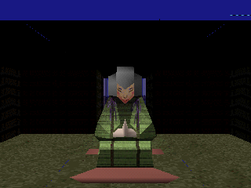
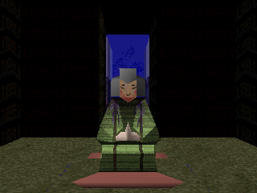
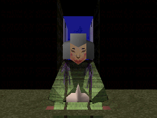

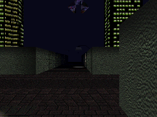
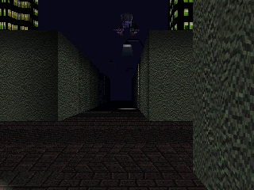

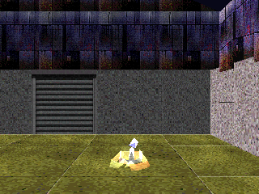
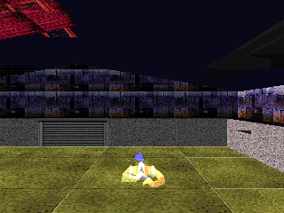
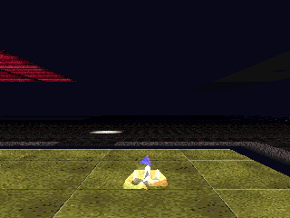

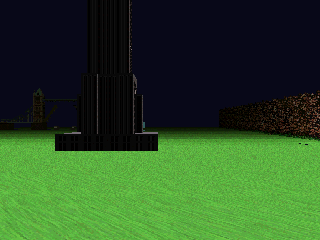
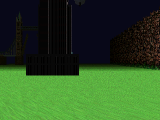
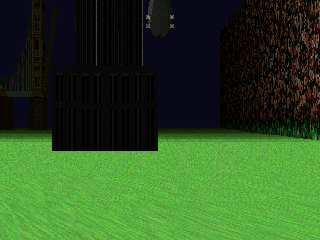

Technical details

StageMap slot 0x138 `StageMap_StartTileStretch` @0x8004CFB8 (count, fast) picks a step for the y scale of every tile model of the loaded chunks: `g_tileStretchFastUp` (+1/4), `g_tileStretchSlowUp` (+1/64), `g_tileStretchFastDown` (-1/4) or `g_tileStretchSlowDown` (-1/64), for denominator x |count| ticks, so the y scale moves by exactly count. Each tick `StageMap_StepTileStretch` adds the step to every tile (`SceneNode_SetScale` in add mode). The scale comes back to 1 only when the map clears its slots (`StageMap_ResetTileScale`). A second call before the first ends replaces the counter, so steps stack in the scale. Logged in game: the counter StageMap +0x1E0 and the y scale of the first tile of map slot 0 (`tile->coord->param->scale[1]`, 4096 = 1).

| Type | Where, when | Handler | Rule | Call |
|---|---|---|---|---|
| 12 | Kyoto (stage 2), square (4, 4), slot 13, even days (groups 3 and 29) | `Behavior_Type12` @0x8005EA94 | first tick `!(rand() & 1)` → state 11; within 0xA00 units | (1, fast): x2 in 4 ticks; state 12 counts 2 a tick, so event 12 (end, no video) about 150 ticks later |
| 59 | Violence District (stage 5), square (3, 2), slot 7, even days | `Behavior_Type59` @0x80061A90 | first tick `rand() % 10 == 0` → state 12; its tick 300 | (1, fast): x2 in 4 ticks |
| 62 | Violence District, square (3, 3), slot 10, odd days, group 11 "once", places 89 and 90 | `Behavior_Type62` @0x80061C2C | first time within 0x400 in state 0: `rand() & 1` → sound 6 and state 10, then `rand() & 1` → stretch; else state 11 (nothing more); in state 10 at tick 70 event `(rand() & 1) ? 12 : 11` | (-1, slow): 1 to 0 over 64 ticks |
| 103 | Monument Park (stage 13), square (0, 1), slot 0, odd days, place 94 | `Behavior_Type103` @0x80064928 | ticks 100 and 800, `rand() % 5 == 0` each; at tick 700 `rand() % 3 == 0` → state 11 (turns and sinks, event 10 at tick 930) | (4, slow): 1 to 5 over 256 ticks |

- Wake: types 59, 62 and 103 wake in range (record wake mode 1): the point (record +5) << 11 units straight ahead of the camera must fall inside a box around the character (`DreamSys_TestPointAhead`, `Entity_IsWithinBox`), not a radius around the player. Type 103 floats 9,216 units above the lawn at (-31744, -9216, 15360), so from the ground the sight line passes far below it.
- Type 12, in game (`work/hunt8/Q1/k12a.log`, `k12c.log`): forced day +0x180 = 3 (day number 4), yesterday's point +0x194 = (-4, 2), rand state 0 at its handler tick 0. `k12c`: player held 3,072 units in front of her, moved once to 1,500 at vsync 4,256; counter 3, 2, 1, -1 and y scale 5,120 to 8,192 by vsync 4,290. `k12a`: UP held 40 vsyncs from 4,300, the stretch started at 2,304 units; the dream timer +0x24 went from 387 to 4 between vsyncs 5,140 and 5,290, about 150 ticks after the stretch.
- Type 59, in game (`v59b.log`): forced day number 4, yesterday's point +0x194 = (-3, -9), player moved at vsync 3,600 to 30,720 units south of it (it woke at 3,602), rand state 0 at its tick 0, player held 8,000 units behind it. Tick 301: counter 3, y scale 5,120; tick 304: 8,192, and it stayed. `v59a`: at 6,000 units it never woke.
- Type 62, in game (`v62a.log`): forced day +0x180 = 4 (day number 5), yesterday's point +0x196 = (-4, -8), player moved 3,000 south of it at vsync 3,600, then 500 behind it at its tick 151, rand state 3 at that handler entry (both draws odd). y scale 4,032 at vsync 4,360, 2,048 at 4,610, 0 at 4,870 (tick 64); timer reset at its tick 70: the dream ended. Which of event 11 (its video) or 12 came was not looked at. The handler also stops your controls at its tick 300 when you are within 0x1000 units and gives them back at tick 500 (read in the code only).
- Type 103, in game (`m103b.log`, `m103c.log`): forced day number 5, yesterday's point +0x196 = (-1, 2), player moved 10,240 units south of it, rand state 0 at its tick 100. The wake was not forced: without pad (`m103a`) it never woke in 6,500 vsyncs; L1, L2, R1 and R2 did nothing; TRIANGLE held from vsync 4,100 raised the camera pitch DreamSys +0x8C to -4,200 and it woke at 4,132. Scale 4,672 at tick 109, 12,672 at 234, 20,480 (x5) at 361, and it stayed.
- Not checked: the odds without forcing; type 103's second chance at tick 800 and its sinking at tick 700 (1 in 3, then event 10, the record's link -10 = stage 9, Clockwork Machines, which matches the wiki's landing Zeppelin); type 12's other half (state 0, nothing happens). Which wiki characters types 59 and 62 are was matched by place, days and behaviour, not by comparing models.
- Proof: the four handlers and the StageMap functions above (C), spawn dump `work/hunt3/spawns.txt`, records `work/hunt3/recs.txt`. Runs and pictures: `work/hunt8/Q1-findings.md` section 1, `work/hunt8/Q1-shots.md`.
- Question: [12](mysteries.md#events-and-hidden-content). Found 2026-10-16, checked in game the same day.
- Before us: the fandom wiki (Stretching Objects, Old Woman, Starship, Zeppelin, Ghost, Monument Park) already had all four: Kyoto stretching up near the old woman, the Violence District stretching after the Starship, the Monument Park stretch after looking up at the Zeppelin with TRIANGLE, and the small ghosts that either end the dream on a clip or make the place collapse; lsddecomp's DreamTimer.md has the Kyoto old ladies ending the dream. New here: the odds (1 in 2, 1 in 10, 1 in 4, 1 in 5 twice), that the old woman's end comes about 150 ticks after the stretch, and the emulator proof.

### ✅ Characters that answer to CIRCLE

Three characters give you a choice through the CIRCLE button. Players knew all three; we found the windows in the code and played each one in the emulator.

- Happy Town's Ferris wheel (odd days): stand by it and look at it, and you have about 2 seconds. Press CIRCLE and you rise straight up through the wheel, past its hub and its gondolas, into the pink sky; about 7 seconds later the dream ends quietly, with no video. Do nothing and the screen turns red and the wheel's video plays: a green field crossed by rails, then a climb through the clouds into a purple starry sky where a sun with a face comes down. Walking into the wheel's frame instead takes you to Sun Faces Heave.
- Happy Town's fast train (even days): it comes out of its tunnel straight at you. Press CIRCLE as it reaches you and you ride at its front down the tracks across Happy Town for about 7 seconds, then you are in Kyoto. Do nothing and its face fills the screen and you are sent to Kyoto at once.
- Violence District's gunman, the man in a long coat and hat (even days): walk up to him and he turns and raises his rifle. Press CIRCLE right then and he falls over and stays on the ground; the dream goes on. Wait, and he steps toward you and fires (a white flash), your view tips over for 6 seconds, then the code sends you to Clockwork Machines 4 times in 5 or ends the dream 1 time in 5. In our three tries he ended the dream every time.

Three gunmen stand on that Violence District square on every even day. On an even day whose colour is cyan, four more stand in a row next to them, seven in all. That is our best match for the community's "multiple gunmen" sighting: the same character type, seen in the spawn log of the emulator, but never on screen (the place is dark and our camera did not wake the row).

Status: 🎮 checked in the game, both branches of each, except the gunman's link to Clockwork Machines (never drawn) and the cyan row (spawn log only). Only the day number, yesterday's point (so the dream starts next to the character) and the dream's time limit were written in; the walk, the touch, CIRCLE and the endings went through the pad and the game's own code. CIRCLE was pressed by the script a few frames after the character's window opened.

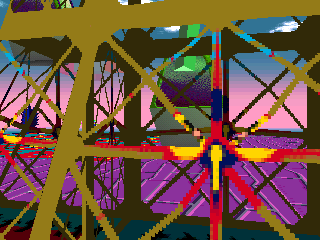
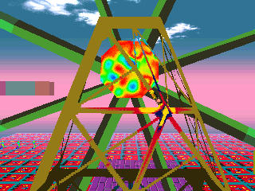
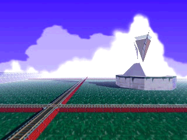

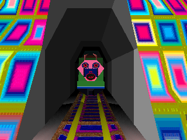
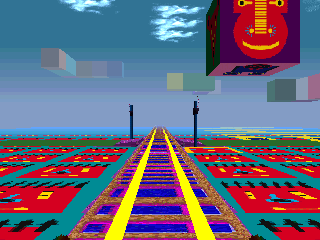
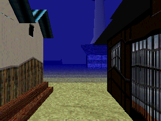

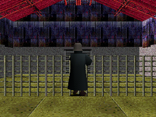
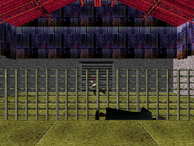

Technical details

Every press of CIRCLE in the dream sets DreamSys +0x74 (`DreamSys_OnPad` case 23), cleared each tick by `DreamSys_TickBegin`; the characters read it through `DreamSys_WasCirclePressed` @0x8005931C (DreamSys slot 0x100). In game the flag read came a few vsyncs after the pad press, with the caller in each handler (`ra=0x80060984` in `Behavior_Type47`, `0x80060BC8` in `Behavior_Type49`, `0x80063940` in `Behavior_Type85`). Common forcing: title START at vsync 1,900, day +0x180 and yesterday's point (+0x190 + 2 x (day - 1)) at 2,100, time limit +0x134 = 200,000 at 3,600. Scripts and logs: `work/hunt8/Q2/`.

- Type 47, the Ferris wheel (stage 4, square (4, 2), slot 11, key 516, odd days, group 9, place 12, at (60416, 0, 1024)), `Behavior_Type47` @0x8006090C: once touched, state 12 for 30 ticks; CIRCLE inside → slot 0x130 with 0 and state 11: the dreamer moves -100 in y each tick and at tick 100 event 12 (end, no video); after 30 ticks without it, event 11 (end on the record's video). In game: forced day +0x180 = 4 (day number 5), yesterday's point (-1, 9). `c47b.log`: RIGHT held 157 vsyncs to face it, touch flag +0xF4 at vsync 3,759 at 4,096 units (touch range 1 seems to need the wheel in front of you, not contact), CIRCLE down at 3,763, state 11 at 3,769, y from 0 to -12,400 in 100 ticks with the pad locked, pink fade, graph at 4,600, Day 006 at 5,600, no video. `n47b.log`: no other pad, state 10 at vsync 3,909, event 11, red fade 3,960 to 4,040, video from 4,200. `n47.log`: UP walked into the wheel's frame and linked to stage 11 (Sun Faces Heave) at timer 182 with a yellow fade; 182 is not a multiple of 16, so not a random wall link; which link table answered was not traced.
- Type 49, the fast train (stage 4, square (5, 3), slot 15, key 773, even days, asleep at (89088, 0, 39936)), `Behavior_Type49` @0x80060B34: moves at -0x100 per tick; once touched, state 10: at its tick 10 event 10 (the record's link -3 → `Spawn_PickRandom(-2)` → stage 2, Kyoto); CIRCLE before that → the dreamer is put on its position every tick, turned to face its way, controls locked, and at tick 100 event 10. In game: forced day +0x180 = 3 (day number 4), yesterday's point (3, 8). LEFT 66 vsyncs, UP until within 9,000 units; it woke at vsync 3,837 at about 12,000 units (wake mode 1, range 5), touch at 3,925 at 3,840 units. `c49d.log`: CIRCLE down at 3,929, state 11 at 3,931, the dreamer's x went with the train from 81,920 to 54,016, stage 2 at vsync 4,440, a Kyoto street at 4,900. `n49d.log`: stage 2 at 3,955, the face filling the screen, red fade. `c49c.log` turned too far, walked into a wall and got a random link to Pit & Temple at timer 240.
- Type 85, the gunman (stage 5, square (4, 3), slot 11, key 772, even days: group 12 at places 30, 163, 200; group 22 rule 12, `SPECIAL_COLORS[2]` = 3, cyan, at places 159 to 162), `Behavior_Type85` @0x80063874; record 85 (0x8008A3F4): mood (3, 0), +20,000 points, wake range 8 ahead, handler start range 1 (2,048 units), link -10 (stage 9) within 1,536 units. After its first animation, 10 ticks of turning (`g_rotY9`); CIRCLE inside → it rolls by `g_rotZNeg9` for 10 ticks and stops its handler. Otherwise slot 0x130 with 1, it faces you and steps 30 ticks toward you, a flash (`Entity_StartEffect`, colour 7), your view rolls 1 degree a tick about z for 90 ticks, then event `rand() % 5 ? 10 : 12`. In game: forced day +0x180 = 3, yesterday's point (-3, -8); UP until 3,456 units from the one at (52224, -300, 19456). `c85b.log`: touch at vsync 4,313, state 10 at 4,373, CIRCLE down at 4,377, state 12 at 4,379, state 1 at 4,445, still lying there at 5,600. `n85b.log`: state 11 at 4,439, state 13 (the shot) at 4,625, state 14 at 5,167, red fade, graph at 5,500. `n85b2.log` (with `events.lua`): `DreamSys_OnEntityEvent` got message 12 at vsync 5,166, then `DreamSys_EndDay` reason 0; the fade colour is `Place_OnTimeUp`'s pick from (place ticks + stage) & 3 (no fade at all in `n85e2.log`). `n85b`, `n85d`, `n85e` (walks started 0, 8 and 12 vsyncs apart) all ended the dream; the rand state at state 14 was not logged, so whether they shared one draw is open.
- The cyan row (hunt 7, `work/hunt7/G2/s5-cyan-even.log`, `s5-cyan2.log`, interpreter): forced day number 4, yesterday's point (-3, -8), colour point (8, -8); seven type 85, the cyan four in a row 2,048 apart at z 76,800. Controls `s5-ctl-even.log`, `s5-ctl2.log` (natural point (-4, 9), green): three. Odd day `s5-cyan.log`: the slot ran no group. Not on screen.
- Not checked: the CIRCLE timing a player needs (pressed by script 4 vsyncs after the window opened; the windows are 30 ticks for the wheel, 10 for the train and the gunman, from the code); the gunman's link branch; the wiki's linking with the fallen gunman and its victim.
- Proof: the three handlers (C), records `work/hunt3/recs.txt`, spawns `work/hunt3/spawns.txt`. Runs and pictures: `work/hunt8/Q2-findings.md` sections 1 to 3, `work/hunt8/Q2-shots.md`.
- Question: [12](mysteries.md#events-and-hidden-content). Found 2026-10-16, checked in game the same day.
- Before us: the fandom wiki already had all three: the train conductor scene started with the O button (Train), the Ferris wheel's CIRCLE ride and its ending video on A-type days (Ferris Wheel), and the gunman who falls when you press CIRCLE as he turns, or shoots you and ends the dream or sends you to Clockwork Machines, three of them at once on B-type days (Gunman); lsddecomp's DreamTimer.md lists the Ferris wheel among the characters that end the dream. New here: the exact windows and odds in the code, the cyan-day row of four more gunmen, and the emulator proof.

## Textures

### 🧩 Glitch textures: a texture set that failed to load

After long sessions, players see places drawn with the wrong textures: grey walls covered in scraps of the menu and "me me me" letters. This is what happens when the game fails to load a place's texture set. It does not stop: it draws the place with whatever is left in video memory, and sets the dream to end 30 seconds later. Each new place that fails the same way pushes the end to 30 seconds after that link, which is why the dream timer seems to grow at every link in that state.

The margin is thin. Every time a place loads, its texture set needs about 200 KB of memory in one piece, and the game has only about 20 KB more than that free at that moment. So anything that stays behind or cuts the free memory into pieces, even 20 KB worth, makes every later texture load fail. Nothing frees it but turning the console off.

The community's recipe works, and now we know why: setting the place's "location time" counter back to 0 again and again makes the game build the place's scenery objects again on every tick without throwing away the old ones. About 60 KB pile up in a few seconds, the next place loads without its textures, and from then on every dream fails at its first place, with nothing more forced, until power-off. What leaks in ordinary play is still not found: five dreams in a row and one long dream with 74 links left the memory exactly as it was.

Status: 🎮 checked in the game, with the failure forced, then with the community's leak forced: the failures in the following dreams came on their own. A leak in natural play was not found.

Technical details

When a stage loads, `Place_Load` @0x80052F10 starts a texture-set loader (`Tix_Create`, class `g_tixVtbl`, 0x84 bytes) at stage +0x58 and sets +0x60. On every tick `Place_CheckTextureLoad` @0x800531CC checks it: when the loader's +0x80 is set, it destroys the loader without applying anything and calls DreamSys slot 0x104 `DreamSys_SwapTimeLimit` with slot 0x108 `DreamSys_GetElapsedSeconds` + 0x1E, so the limit becomes elapsed + 30 s. The loader sets +0x80 only in its fail branch (`Tix_OnReadDone` @0x80043200), when `Heap_Alloc` returns 0 for the file list or the data buffer.

- The heap: one pool of 0x166C00 bytes (1,469,440), made once at boot (`main` @0x800118DC calls `Heap_Create` @0x80017A20) and never reset until power-off. `Heap_Alloc` @0x80017B34 is first fit from the head of a doubly linked free list and splits the low end; `Heap_Free` @0x80017CFC merges both neighbours. No bug found in the allocator.
- The margin: the loader asks for the file list (16 bytes), then a buffer as large as the set's largest file: 198,656 bytes at every load measured (stages 0 to 5). Largest free block at that request over 37 loads in one dream (`work/hunt6/F/A.log`): 215,856 to 222,032 bytes, a margin of 17,200 to 23,376. About 1,245,276 bytes are in use at every load.
- No natural leak (interpreter and dynarec, `r1.log`, `B.log`, `B2.log`, `A.log`): 5 dreams ended early, each menu back to one free block (the 32 bytes more per menu are the menu's own nodes); one dream of 32,700 vsyncs with 74 forced dynamic links and 37 place loads: no allocation failure, largest free block never below 215,856. Forced: the timer or the limit, and the links. Not tried: full-length dreams, days past 6 (sets B to D), flashbacks, videos, special days, stages 6 to 13.
- The leak: "location_time" is `D_8008AC70`. `Scenery_Begin` @0x800544E4 sets it to 0 when a place starts; `Scenery_Tick` @0x800558F0 runs the first-tick setup only when it reads 0 (`if (D_8008AC70++ == 0)`): `Ambience_CreateTint` @0x80054660 (one object), `Ambience_CreateBands` @0x80054850 (18 objects) and `Scenery_CreateAll` @0x80054B84 (the scenery objects). Each run overwrites the pointers; `Scenery_Teardown` @0x80054D30 frees only the last set. The counter is an s32 counted once per tick, so only a RAM write brings it back to 0. Run `z1.log`: 0x8008AC70 written to 0 every 2 vsyncs from vsync 3,200 to 3,480 in the first room; used heap rose from about 1,315,000 to 1,378,664; at the second forced link `ALLOCFAIL f=4112 size=198656` with a largest block of 102,384, the limit fell to elapsed + 30 s and Pit & Temple came up with the first room's textures. Control `z0.log`: same links, same rand state 0x343D7141, texture loaded (largest 215,856).
- Until power-off (`z1c.log`): only dream 1 forced; menu after it 150,452 bytes in use instead of 89,944, 91 free pieces instead of 1; dream 2 (nothing forced but the limit) `ALLOCFAIL f=11864`, limit 450 (30 s x 15); dream 3 `ALLOCFAIL f=15570`. Dream 2 started in the same room with the same set still in video memory, so it looked normal: the glitch only shows when the leftovers belong to another place or to the menu.
- In game, the first forced failure: interpreter (`work/hunt4/B-texfail.lua`): at the first check (vsync 2,891, stage 0, day 1) the loader's +0x80 was written to 1; the tatami room came up untextured with leftover menu graphics, limit +0x134 = 450 instead of 3,600.
- Not tried: the fandom "game_time" zeroing (0x80090B74 is libgs' own frame counter, read by `GsGetLw` and `GsGetLs`; from the code it can disturb drawing, not memory). Read only: `Tix_Init` leaves +0x80 uninitialised when its first small allocation fails, and `Place_CheckTextureLoad` reads +0x80 of a NULL loader if the loader itself could not be allocated.
- Question: [11](mysteries.md#days-textures-randomness). Found 2026-10-15, memory hunt 2026-10-16.
- Before us: the fandom wiki (Textures, Data Analysis) and the LSD Revamped docs (Dynamic Analysis findings) saw it after long sessions, until power-off, or after zeroing timers such as "location_time" in RAM; new here: the failed texture load behind it, the 30-second end, the 20 KB margin, why the "location_time" recipe leaks, and that the leak survives every later dream.

### ✅ The 40-day texture cycle

Every place has up to four texture sets, A to D. When a place loads, the game looks at where the day falls in a 40-day cycle. Days 1 to 10 always load set A. Days 11 to 20 load A or B, 21 to 30 one of A to C, 31 to 40 one of A to D, each equally likely. Then the cycle starts again at day 41. Since the day number returns to 1 after day 365, days 361 to 365 count as days 1 to 5 and always load set A.

Status: 🎮 checked in the game, with the draw forced: the same room wears set A on day 5 and set D on day 33.

Technical details

Texture set: when a stage loads, `Place_Load` calls `Stage_PickTexturePath @0x80048EA0(stage, day number)`, which picks set `rand() % (((day - 1) % 40) / 10 + 1)` among the stage's `TEXA` to `TEXD.TIX` paths (path table of 0x1C-byte entries from 0x80081A04, `Stage_GetPathBase` @0x80048E2C). Days 1 to 10 of each 40-day cycle always load A, 11 to 20 A or B, 21 to 30 A to C, 31 to 40 A to D, each at random.

- Proof: `Stage_PickTexturePath` @0x80048EA0, `Stage_GetPathBase` @0x80048E2C, `Place_Load` @0x80052F10, rand wrapper `Rand_SeedAndNext` @0x80048CFC.
- In game: yes, forced. PCSX-Redux interpreter, same room and spot at the dream start: +0x180 = 4 (day 5) loads set A; +0x180 = 32 (day 33) with the rand state forced to 3 at `Stage_PickTexturePath` (rand % 4 = 3) loads set D, the photo collage. Day 33 rather than 35 because 35 is a special day. Log `work/shots/manifest.md`.
- Question: [9](mysteries.md#days-textures-randomness). Found 2026-10-15.
- Before us: the fandom wiki (Textures) and compu-lsd (Textures) already describe a 40-day cycle with a set added every 10 days; we confirm it in the code and the emulator, with each allowed set equally likely.

### 🧩 Three quiet rules for the look of a place

Three small rules in the code change how a place looks. We saw all three in the emulator.

- On days whose number divides by 7, the floating scenery some places scatter around you lines up in one straight band, side by side at one height. In Kyoto on day 133 the 16 clouds of the sky form one band, where on day 132 they are scattered at different heights and distances. The band is not pinned to the place: like the scattered clouds of other days, it is placed relative to you and goes where you go. The multiples of 7 up to day 126 are all [special days](#-the-42-special-days) with no dream, so the band can only show from day 133 on.
- In Kyoto the game turns the colours of the canal water one step every frame, so the water should shimmer as its colours slide along. In the emulator we used, the whole water surface instead blinks between a flat dark blue and a flat pale blue; with the rule switched off, the water keeps its speckled texture and never changes. How it looks on a real console is not known. The Natural World, Happy Town and Violence District turn another row of colours the same way; which surfaces use it was not found.
- When you replay a memory with FLASHBACK, the coloured flash that opens the place stops a third of the way and stays, so the whole memory is seen through a veil of that day's colour: blue for a blue day, red for a red day.

Status: 🎮 checked in the game, for the cloud band (on day 133, from a still spot; that it follows you as you walk is read in the code), the Kyoto water and the flashback veil. The day number, yesterday's point and the dice that set the number of clouds were written in; the flashback runs also wrote one memory and a high score by hand.

Technical details

- Day 7 band: `Scenery_CreateKind0` @0x80054DA4 picks `Scenery_RandomizeParamsDay7` @0x80055410 when `g_placeDayNumber % 7 == 0`, else `Scenery_RandomizeParams` @0x80055258 (random x and z within 22 tiles). The day-7 version: x = (rand() % 20) << 11 (0 to 19 tiles), z = 0xA000, then -0xA000 when day % 3 == 1 or 0x800 when day % 3 == 2, height `g_sceneryHeights1` = -10,240 for all. These are offsets: `Scenery_Build` and `Scenery_Follow` place each object at origin + offset every tick, and the origin is the dreamer's position (`Scenery_Tick` gets it from the StageMap's `getLocation`, then `placeToWorld`). So the band sits on one side of you (x 0 to +19 tiles) and 20 tiles away along z on day 133. Kind 0 scenery exists only on stages whose `g_stageAmbience` entry is NULL (0, 1, 2, 3, 4 and 13), 0, 3, 8 or 16 objects by `rand() & 3`.
- Day 7, in game (`work/hunt8/Q1/d133a.log`, `d133c.log`, controls `d132a.log`, `d132c.log`): forced day +0x180 = 132 or 131, yesterday's point (-3, 1) (Kyoto canal), rand state 3 at `Scenery_CreateAll` @0x80054B84 (16 objects on both days). Day 133: `g_placeDayNumber` = 133, 17 objects (16 clouds and the sun sparkle), every cloud at offset z -40,960, y -10,240, x 0 to 34,816; world position = player + offset. Day 132: x and z each within -45,056..45,056, y -14,336. Not run: walking with the band in view; a day with day % 3 == 2 (day 140).
- Palette: each tick `Scenery_Tick` @0x800558F0 calls `Stage_CyclePalettes` @0x80055A24, which calls `Display_RotateRect` @0x8003B624 on `g_clutCycleRectA` (x 0, y 496, 248 x 8, spare column 256) in stage 2 and on `g_clutCycleRectB` (y 504) in stages 3 to 5: three VRAM-to-VRAM moves that turn the 8 rows one column right. In game (`pal2b.log`): 50 calls each of the three by vsync 3,800 in Kyoto. `pal2c`: 51 frames from a still camera, every 2 vsyncs: 6,428 pixels (the water, rows 139 to 215) change in 21 of 50 frames, 6 vsyncs on, 8 off. Control `pal2d`: 0x80055A24 patched to `jr ra` at vsync 3,000: no pixel changed. Forced: day +0x180 = 3, yesterday's point (-3, 1), the patch in the control only. The flat colours probably come from PCSX-Redux's handling of the overlapping move (a guess); `PCSX.GPU.getVRAM()` returned a frozen copy, so the colour rows could not be read. Stages 3 to 5 (`pal3a`, `pal4a`, `pal5a`, 100 vsyncs from a still camera): nothing changed on screen.
- Flashback veil: `Place_Start` @0x80053764 calls `Fade_SetTint` @0x800404B4 with (flashback mode, 3) and starts the fade in with the day's colour; with the flag set `Fade_Begin` runs ticks - ticks / 3 and `Fade_Stop` @0x800402F0 keeps the box shown. In game (`work/hunt8/Q2/fbB2.log`, `fbR2.log`): forced at vsync 2,100 day +0x180 = 10, score +0x184 = 10,000,000, one flashback entry written by hand (+0x46C = 1, entry +0x470: stage 4, Happy Town (4, 2), day 5) and day 5's point +0x19A = (0, 8) (colour 1, blue) or (0, -8) (colour 4, red); then pad only. `Fade_Stop` ran with (0, 0, 85) and (85, 0, 0): 17 steps of 10 instead of 25. The veil held for the whole 20-second memory (limit 300 ticks, `DreamSys_EnterMap`), then the menu came back on Day 011. A memory recorded by the game itself was not replayed; all-zero rotation bytes in a hand-written entry hang it on a black screen (`fbR.log`).
- Sources: naming reports `work/readable/N2-report.md`, `X4-report.md`, `X7-report.md`; runs `work/hunt8/Q1-findings.md` sections 2 and 3, `work/hunt8/Q2-findings.md` section 5.
- Question: none. Found 2026-10-16, checked in game the same day.
- Before us: the fandom wiki (Flashback) describes the coloured overlay of a memory, blue for positive memories and red for negative ones; nothing on the day-7 band or the palette turning in the pages we read (the fandom wiki, the community notes, lsddecomp). New here: that the veil is the memory day's colour stopped at 85 of 255, the day-7 band, and the turning colours of Kyoto's water.

## Links between places

### 🆕 Fixed links are the navigation goals, and one can never be completed

The 30 hidden navigation goals behind the [Flashback score](#-what-unlocks-flashback-in-the-menu) are the game's fixed links: the first time you take each fixed link between two places, its goal is marked done. There are 49 such links, through walls and through passages, and together they mark 29 different goals. Goal 13 is not marked by any of them. So the 30th goal never completes, the 50,000,000 bonus for all 30 never pays out, and the navigation score tops out at 29,000,000.

Status: 📖 read in the code only.

Technical details

`Link_Find` @0x8005C150 matches the player's (chunk, tile) against a stage's link list and, when its sixth argument is not 0, sets `g_navFlags[y->flag] = 1` from the destination entry. Two callers pass 1: `Link_FindStatic` (wall touch, `DreamSys_LinkStatic` @0x8005A5D8; tables 0x80088748 counts, 0x80088710 lists, 0x80088664 destinations: 17 links, flags 0 to 12) and `Link_FindFacing` (`DreamSys_LinkFacing`, DreamSys vtable 0x1D0; tables 0x800889F0, 0x80088980, 0x80088820: 32 links, flags 14 to 29). The other two callers (`Link_FindExtra`, `Link_FindScripted`) pass 0. No other code writes the flags (`Nav_InitFlags` clears them, `Nav_CalcScore` counts 30 bytes and pays 50,000,000 only above 29,999,999). The union of the two tables lacks flag 13, so +0x188 tops out at 29,000,000. Script `work/hunt3/links.py`, output `links.txt`.

- Proof: `Link_Find`, `Link_FindStatic`, `Link_FindFacing`, `Nav_CalcScore` @0x8005BA7C, `Nav_InitFlags` @0x8005BA50 (matched C), the six tables above. The flag writer and the missing flag 13 were checked a second time by the main thread.
- In game: no (no fixed link was taken in the emulator).
- Question: [6](mysteries.md#grey-man-and-flashback). Found 2026-10-15.
- Before us: lsddecomp named 30 navigation challenges worth 1,000,000 each but not what they are; that they are the fixed links, and that goal 13 can never be completed, is new (nothing on the fandom wiki, compu-lsd or the LSD Revamped docs).

### 🔄 Where a random link sends you

Touching a wall can send you to another place. The game first looks for a fixed link for that wall; only if there is none, and random links are allowed at that moment, does it pick a place at random. It rolls a 6-sided die over the six main places (0 to 5 in its list). If the die names the place you are in, you go to the next one instead. So the place right after yours comes up 2 times in 6 and each of the other four 1 time in 6. Every random link is counted, and each one lowers the [flashback score](#-what-unlocks-flashback-in-the-menu) by 11,024.

Status: 📖 read in the code only.

Technical details

Links: a wall touch (`DreamSys_OnWallTouch` @0x80058FAC, message 4, no transition running) tries the static tables first (`DreamSys_LinkStatic` @0x8005A5D8 → `Link_FindStatic` → `Link_Find` with 0x80088748, 0x80088710, 0x80088664) and links dynamically only if +0x124 is set (`DreamSys_SetLinkFlags`, vtable 0x18C). A dynamic link (`DreamSys_LinkDynamic` @0x8005A580 → `Spawn_PickRandom` @0x8005BB30) draws `rand() % 6` and moves a draw equal to the current stage to the next one (wrapping at 6), so from a main stage 0 to 5 the next stage is twice as likely (2/6) as each of the other four (1/6). It increments the counter at +0x600.

- Proof: `DreamSys_OnWallTouch` @0x80058FAC, `DreamSys_LinkStatic` @0x8005A5D8, `DreamSys_LinkDynamic` @0x8005A580, `Spawn_PickRandom` @0x8005BB30, `DreamSys_SetLinkFlags` @0x8005A1B0.
- In game: the two random wall links met in hunt 8 (`work/hunt8/Q2/f9.log`, timer 192, and `c49c.log`, timer 240) both went to Pit & Temple on a timer that is a multiple of 16 ([walls](#-falling-off-an-edge-walls-and-the-cottages-walking-squares)); the odds of the die were not measured.
- Question: [13](mysteries.md#events-and-hidden-content). Found 2026-10-15.
- Before us: compu-lsd (Linking) said random links depend on how long the game and the place have been running, and the community notes (from lsddecomp) said any main place but yours, at random; the code rolls a 6-sided die and turns your own place into the next one, which doubles that place's odds.

### 🔄 Fixed links do not change with visits, but some depend on who showed up

A fixed link always leads to the same place: the game does not count visits and does not read the day when it looks one up. One extra list of walk-through links is switched on only in stages 3 and 11, or once a character of type 11, 56, 78 or 93 has appeared in that dream. Those characters follow [the day rules](#-the-hidden-rules-that-decide-which-characters-appear): type 11 is in stage 2 on even days, 56 in stage 5, 78 in stage 8 when the day is a multiple of 3, and 93 in stage 0 under the "once" rule. So when a fixed link seems to change from day to day, the day number is behind it through who appeared, not through visit counts. One more link routine, used only from stages 1, 3, 5, 9 and 12, picks stage 12 instead of its usual pick when the dream timer is odd; it runs when you [fall off an edge](#-falling-off-an-edge-walls-and-the-cottages-walking-squares), and its pick is never used: a fall ends the dream (checked in the emulator).

Status: 📖 read in the code only.

Technical details

`Link_Find` compares only (chunk, tile) (tile -1 is a wildcard) and stores the match in `g_linkFromStage`, `g_linkFromIndex`, `g_linkToStage`, `g_linkToIndex`; it reads neither the day nor a counter. The extra list (`Link_FindExtra`, tables 0x80088B5C, 0x80088B24, 0x80088A80, run by `DreamSys_LinkExtra`, DreamSys vtable 0x1D8) is used only while `g_extraListOn` is set: `Sym_InitExtraList` sets it to (stage == 11 or stage == 3) at stage load, and `Sym_CheckExtraListType` sets it to 1 when a group of type 0xB, 0x38, 0x4E or 0x5D passes its rule in `Sym_SpawnGroup`. Also in the link code: `Link_PickFallStage` (vtable 0x1D4) only works from stages 1, 3, 5, 9 and 12 and, when the dream timer is odd, picks stage 12 instead of the usual pick; it is called by `DreamSys_LinkFall` when the ground probe finds nothing (traced while naming the code, 2026-10-16). The pick goes to DreamSys +0x164 and is never used: the fall's transition 16 ends the day (hunt 8, `work/hunt8/Q2/f1.log`, `f1e.log`, `f12.log`).

- Proof: `Link_Find`, `Link_FindExtra`, `Sym_InitExtraList`, `Sym_CheckExtraListType`, `Link_PickFallStage` (matched C).
- In game: no fixed link was followed on purpose; the fall routine `Link_PickFallStage` ran in hunt 8, and its pick was never used ([falls](#-falling-off-an-edge-walls-and-the-cottages-walking-squares)).
- Question: [13](mysteries.md#events-and-hidden-content). Found 2026-10-15.
- Before us: the LSD Revamped docs (Tile Linking) say some tiles link elsewhere on different days or after a number of visits; the code keeps no visit count, and the day matters only through which characters appeared.

### 🧩 Falling off an edge, walls and the cottage's walking squares

Three rules decide what happens when you hit the edge of the world.

- Falling: in Pit & Temple, the Natural World, Violence District, Clockwork Machines and Black Space, stepping off some edges, where the game finds no ground under you, makes you sink as the view tilts and the screen goes black. Then the day is over: the graph screen and the next day's menu, exactly as when the clock runs out. The code does pick a place to send you to (Black Space when the dream timer is odd), but nothing ever uses that pick. In Clockwork Machines the same check also runs on solid ground once you are high enough.
- Walls: pushing into a wall gives a random link only on 1 tick in 16. Pushing on another tick does nothing, so a random link comes within about a second of pressing against the wall. In the emulator both random wall links we met came on such a tick.
- Bright Moon Cottage has 8 squares that take over: step on one facing the right way while walking forward, and the game locks your pad and walks you along one of 4 scripted paths.

Status: 🎮 partly checked. The falls (three, by pad only, in Pit & Temple and Black Space, with an odd and an even timer) and the 16-tick wall rule were seen in the emulator, with only the day number, yesterday's point and the time limit written in. The cottage squares are read in the code only.

Technical details

- Fall: after each walk step the actor code probes the ground (`DreamSys_OnGroundProbe`, case -2: no ground). When the map object under the new position reports state 2 (+0x2C of the probe result), DreamSys slot 0x1D4 `DreamSys_LinkFall` @0x8005A7A0 runs; otherwise the dreamer is put back (`DreamSys_RestorePosition` @0x8005B990). `Link_PickFallStage` @0x8005BE90 returns -1 except in stages 1, 3, 5, 9 and 12; stage 5 also needs a height below -0xFFF or one place (`g_fallPlace5`); in stage 9 it is also called on ground (case -1) and fires when the height is 0x800 or more. An odd timer turns the stage into -12, so `Spawn_PickRandom` returns stage 12; else it draws as for a wall. The link runs with transition 16; `DreamSys_TickFall` @0x8005A0B0 moves the dreamer 0x200 along y per tick and tilts the camera.
- Why the dream ends (read in the code, matching the runs): transition 16 makes the place run `Place_OnLink16` (state 10, black fade 6, auto walk mode 2). When the fade ends, `Place_OnFaderNotify` turns state 10 into state 4 and notifies 4, the message the clock sends when it runs out (`Place_OnTimeUp`). `DreamRunner_OnStageMessage` case 4 deletes the stage and calls `endDay(0)`, a normal day end with its graph point. The stage chosen by `Link_PickFallStage` is written into DreamSys +0x164, but no place is ever built from it.
- Falls in game (`work/hunt8/Q2/f1.log`, `f1b.log`, `f1e.log`, `f12.log`, interpreter): forced day +0x180 = 3 (day number 4), yesterday's point, time limit; UP held from vsync 3,600. `f1` (Pit & Temple, point (0, -9)): no ground at vsync 4,447 at (-3072, 0, 10112), timer 291 (odd), `Spawn_PickRandom(-12)` returned 12, `DreamSys_ExecuteLink(12, transition 16)`; falling flag +0xC4 = 1 for 170 vsyncs, y from 0 to 21,504, black; graph at 4,800, menu Day 005 at 5,600. `f1e` (walk 4 vsyncs later): timer 292, stage 5 drawn, same end. `f12` (Black Space, point (0, 6)): fall at 5,436 after 58,000 units south, timer 591, same end. Every no-ground probe in these runs led to a fall; the put-back branch was not met. Not reached: falls in the Natural World and Violence District, and the Clockwork Machines height rule.
- Walls: `DreamSys_TickBegin` @0x80059394 sets the dynamic-link flag every tick to `timer % 16 == 0` (`Place_Start` sets the period to 16), and a wall touch links dynamically only while it is set ([random links](#-where-a-random-link-sends-you)). In game: `f9.log` (Clockwork Machines, point (0, -6)): pushed into a wall, `DreamSys_RestorePosition` put the dreamer back 14 times at timers 179 to 191 with no link, and the random link came at timer 192 (to Pit & Temple); `c49c.log` (Happy Town): a random link at timer 240.
- Cottage: `Link_FindScripted` @0x8005BFDC matches 8 tiles of stage 0; on one, facing its heading and walking forward, one of the 4 scripts of `g_linkSteps` @0x80087EEC turns and walks the dreamer with the pad locked (shorter when running). In stage 0 `DreamSys_Walk` @0x80059E98 also gives a wall-touch link when the dreamer's y is below -2000 and x >= -499. Not run.
- Sources: naming report `work/readable/N3-report.md`, runs `work/hunt8/Q2-findings.md` section 4.
- Question: [13](mysteries.md#events-and-hidden-content). Found 2026-10-16, falls and walls checked in game the same day.
- Before us: the fandom wiki (Falling) already says that falling, off a cliff or into Pit & Temple's pit, ends the dream after a short animation; our first reading of the code, that a fall on an odd timer drops you in Black Space, was wrong. compu-lsd (Linking) said random links depend on how long the game and the place have been running, which the 1-in-16 rule partly explains. New here: the fall conditions per place, why the dream ends, the 16-tick window and the cottage scripts.

### ✅ The world is built from square blocks, and only marked blocks are walls

Every place is laid out on a grid of square tiles. Each block of scenery sits on one tile, faces one of four directions (it only ever turns by a quarter turn) and is stacked a whole number of tiles above the ground, up to 7. Nothing in the world is turned at an odd angle or raised by half a tile.

Each block also carries a mark that makes it a wall. 5,223 of the 31,068 blocks on the disc have it, about one in six. When you push into a marked block, the game puts you back and may link you: through a fixed link if that spot has one, else a random one on [1 tick in 16](#-falling-off-an-edge-walls-and-the-cottages-walking-squares). A touch on an unmarked block is never passed on, so it can never link you. The byte that holds the mark also holds the block's footstep sound.

Status: 🎮 partly checked. The marks were seen on the blocks in memory during a walk; that only marked blocks link you is read in the code, and the grid rules come from the code and the 139 map files.

Technical details

- Map files: each `STGxx\Mxxx.LBD` holds a 20 x 20 grid of 12-byte records (`GridRecord`, src/game/map_models.c; stacked blocks chain through `nextOffset`): present, a byte nothing reads, object index, flags, quarter turns, height. `MapModels_NextModel` @0x8002C278 places a block at x = col * 0x800 + 0x400, z = row * 0x800 + 0x400, y = height << 11, yaw = quarterTurns << 10 (1,024 is 90 degrees in the 4,096-per-turn angle unit). Census of the 139 files (`work/unknowns/U2/lbd_models.py extract/CDI`): 31,068 present records; quarter turns 0 to 3 only (22,045, 3,724, 2,573, 2,726); height 0 on 30,627 records and -1 to -7 on 441 (negative y is up); flag bit 0x80 on 5,223.
- Walls: `StageMap_BuildTiles` @0x8004BE54 copies the flags into each `MapTile`. On a contact, `StageMap_TellViewTiles` @0x8004B100 tells the tiles around the actor through `MapTile_Tell` @0x8004B2D4, which passes the message on only when `flags & 0x80`. `MapTile_OnActorMessage` @0x8004D47C then runs `checkContact`, which reaches `DreamSys_OnWallTouch` @0x80058FAC: the static link, else the dynamic link while its flag is set, then `restorePosition` and `afterWallTouch`. The low 7 bits are the step sound: `DreamSys_OnGroundProbe` @0x80058B08 takes `contact->flags & 0x7F` (0x18 and above become 0).
- Never read: record byte 1 (1 on 30,480 records, 0 on 588) is copied to the tile item (+0x2C) and read by nothing; `MapTile.unk34` stays 0.
- In game: partly. Interpreter run `work/unknowns/U2/walk1.log` (new game, UP held from vsync 3,300 to 5,900, three stage loads): the 2,870 tiles in memory, read every 300 vsyncs, carry the same flag values as the files, for example at 4,200 {0: 500, 1: 120, 6: 1,499, 128: 333, 129: 136, 134: 164, ...}. No wall touch was logged in that run.
- Sources: `work/unknowns/U2-report.md`. Question: [13](mysteries.md#events-and-hidden-content). Found 2026-10-16.
- Before us: Figglewatts' libLSD (`LBD.cs`) already reads this record: four tile directions in 90-degree steps, a height offset, and a byte whose low 7 bits it calls the footstep and whose top bit it "hypothesized" to be collision, plus a `SolidTile` flag "either 0 or 1" of unknown use. The code confirms the footstep and wall bits; new here: the wall bit is what lets a block link you, heights are whole tiles, and the `SolidTile` byte is never read. The fandom wiki (Linking) says any solid obstacle can link you.

### 🔄 The Long Hallway's room turns the sky blue, then pulls you out 2 times in 3

At the end of the Long Hallway stands a small room with a window. When you reach it, its walls break apart and a blue sky with clouds shows behind it. The blue is not part of the room: the character that runs the event repaints the background of the whole place, which is white the rest of the time. That fits the wiki's note that the blue stays visible in the distance afterwards.

Then the game rolls a three-sided die. On two faces out of three you are pushed forward into the clouds and linked to the Natural World. On the third you are walked back down the hallway and get the controls back. If you stand very close to one side of the hallway, the die is ignored and you are always walked back. That is very likely the rule behind the wiki's note that the room always sends you back when you are about to hit the right wall, but it was not tested.

Status: 🎮 partly checked. The blue background, the forward push and the link to the Natural World were seen in the emulator, with only the start place written in; the walk back and the side rule are read in the code only.

Technical details

- Handler `Behavior_Type74` @0x80062730 (src/game/entity.c). At its first tick it sets the clear colour of the camera (DreamSys +0x5C is the DreamView, `View_SetClearColor` @0x8003EA84) to `g_type74ClearColor` @0x8008AC1C = (0, 100, 190), then picks `state = rand() % 3`, forced to 0 while the dreamer's local z (`coord.t.z`) is below 0x262. States 1 and 2: past half its animation it pushes the dreamer 0x80 forward per tick (`moveZ`) and posts event 10, a link, 30 ticks before the animation ends. State 0: between ticks 20 and 120 it moves the dreamer back by (tick - 19) << 5 per tick and gives the controls back at tick 85 (`setControls(1, 1)`). Its only spawn is stage 10, chunk key 2, place 19, together with type 73 (`Behavior_Type73` @0x80062660).
- In game: yes for state 1, interpreter (`work/unknowns/U3/a74.log`, captures in `captures/unknowns/U3/a74/`). New game with the drive plan of hunt 6 (day number 4); at `DreamSys_ChooseStart`'s call to SwapTimeLimit the script wrote stage 10 and its spawn 3 (chunk (2, 0), tile (14, 10)), next to place 19. At f 3,274 the place set its clear colour to white (255, 255, 255); at 3,283 types 73 and 74 started and type 74 set (0, 100, 190) (ra 0x8006277C). It took state 1: world x went from 50,176 to 56,064 between ticks 60 and 120. At 3,658 the link fade turned the screen red and `Place_Load` ran for stage 3, the Natural World. The sky pixels of the captures at 3,400 and 3,500 read (0, 98, 189), which is (0, 100, 190) after the 15-bit framebuffer. Not run: state 0 and the side rule.
- Sources: `work/unknowns/U3-report.md`. Question: [13](mysteries.md#events-and-hidden-content). Found 2026-10-16.
- Before us: the fandom wiki (Long Hallway) describes the exploding room, the blue sky and clouds, and the two outcomes (blown back to the start, or sucked into the sky and linked to the Natural World), says the outcome "depends on the current dream's generation" and that the blue sky and the clouds are "a single object" while the real sky is always white. Corrected here: the blue is the place's background colour set by the event's character, not an object, and the outcome is a 2 in 3 die roll with one position rule.

## Music and sound

### ✅ A Clockwork Machines track that can never play

Each place picks one of its five music tracks at random when you arrive. Stage 9 (Clockwork Machines in the community's numbering) has a special rule: when the dice choose its third track, the game plays the fourth one instead. The third track is a distinct piece of music on the disc, so it is never heard. This matches the "unused Clockwork Machines track" players had spotted in the files.

Status: 📖 read in the code only.

Technical details

`Music_PickTrack` @0x80048F84 draws `rand() % 5` and returns the stage's path entry at `Stage_GetPathBase(stage) + 0x70` (BGA to BGE.SEQ, 0x1C bytes each). For stage 9 it turns 2 into 3, and a forced track 3 (`g_musicTrackOverride`) into 4, so `STG09\BGC.SEQ` (1,500 bytes, md5 0ab37f1d..., different from the four others) is never returned. `Place_Load` is its caller, when a stage loads.

- Proof: `Music_PickTrack` @0x80048F84, `Stage_GetPathBase` @0x80048E2C (file table 0x80081A04, s16 first-file index per stage at 0x800819E8: stage 9 = 474), so track 2 of stage 9 is the entry at 0x80084E84, `STG09\BGC.SEQ`.
- In game: no.
- Question: [14](mysteries.md#events-and-hidden-content). Found 2026-10-15.
- Before us: TCRF (through the community notes) and the LSD Revamped docs (Unused Clockwork Machines track) already knew the track is never heard and blamed a tempo of 0 in the file; the code shows the game never even picks it.

### 🆕 A switch to pin the music that nobody pulls

Every dream picks one of 7 sound banks and one of 5 tracks at random. The code keeps two override switches that would force a chosen bank and a chosen track, very likely left for the developers to test the music. Nothing in the game ever sets them.

Status: 📖 read in the code only.

Technical details

`Music_PickBank` @0x80048D74 picks `rand() % 7` among the banks of `g_musicBanks` (`SND\AMBIENT`, `CARTOON`, `ELECTRO`, `ETHNOVA`, `HUMAN`, `LOVELY`, `STANDERD`) unless `g_musicBankOverride` is set; `Music_PickTrack` picks the track unless `g_musicTrackOverride` is set. The only writer of both is `Music_SetOverride` @0x80048D28, and no code calls it (no `jal`, no pointer to it in the executable).

- Proof: `Music_SetOverride`, `Music_PickBank`, `Music_PickTrack`, word scan of `SLPS_015.56` for 0x80048D28 (none).
- In game: no.
- Question: [14](mysteries.md#events-and-hidden-content). Found 2026-10-15.
- Before us: nothing on it in the fandom wiki (Music), compu-lsd, the LSD Revamped docs (static analysis, music research) or lsddecomp; new.

### 🆕 Places have fixed sound sources

Besides the music, some places have sounds tied to fixed spots on the map. Walk near one and you hear it, louder as you come closer; walk away and it stops. At most two play at a time. They come from the game's own sound effects, so the music the dream picked does not change them. The Natural World has 29 of them, Kyoto and Violence District 9 each, Happy Town 5, and Bright Moon Cottage, the Long Hallway, Sun Faces Heave and Monument Park 1 each. The other places have none.

Status: 📖 read in the code only.

Technical details

- Spots: `g_stageSoundSpots[stage]` @0x800876B4, 8-byte records (map tile, type 1 to 14), counts in `g_stageSoundSpotCounts` @0x800876EC: stage 0: 1, 2: 9, 3: 29, 4: 5, 5: 9, 10: 1, 11: 1, 13: 1, others 0. Each tick the place takes the first free spots within the type's range (`SoundSpot_FindInRange`, `SoundSpot_Acquire`) into two slots, and drops a spot once the dreamer leaves its range (`SoundSpot_IsInRange`, `SoundSpot_Release`). Volume: `SoundSpot_CalcFade` @0x8005627C, distance / (range / fadeSteps). Bank: `SND\SE`.
- Patterns: 14 handlers `SoundSpot_Type1` to `SoundSpot_Type14`; for example type 1 plays one sound at ticks 0, 2 and 5; type 4 (8 spots in Kyoto) one sound every 20 ticks, a second every 400 and a third every tick; type 12 (most Natural World spots) adds three sounds on a 70-tick cycle.
- Source: naming report `work/readable/N2-report.md`, rechecked against the symbol table.
- In game: no.
- Question: none. Found 2026-10-16.
- Before us: nothing on fixed sound spots in the pages we read (the fandom wiki pages copied in `work/hunt7/G1/wiki/`, the community notes, lsddecomp).

## Memory card

### 🧩 Everything the game remembers fits in one block

All that the game carries from one day to the next lives in a single block of 1,792 bytes that starts with the letters "J01": the year, the day, the scores, your graph for all 365 days, the 30 navigation goals, the number of random links taken, and the flashback memories. It also keeps whether you have already seen [the video reel](#-the-secret-video-reel-four-graph-points-and-11-minutes-of-film), and the SHAKE option of the menu. SHAKE is On in a new game; when it is on, the view dips and comes back up over each walking step, very likely the walking head bob (read in the code, not filmed). This block is what the memory card saves (next finding).

Status: 🎮 checked in the game (the block and its "J01" mark were found in memory, and the SHAKE byte follows the menu).

Technical details

One `DreamSys` object at `0x80091530` (vtable `0x80087BDC`). Its persistent block runs from +0x178 to +0x878 (0x700 bytes, returned with that size by `DreamSys_GetSaveBlock` @0x8005A350, vtable slot 0x1B0) and starts with the magic `"J01"` written by `DreamSys_InitNewGame` @0x8005A258. Layout read so far: +0x17C year, +0x180 day (0-based), +0x184 unlock score, +0x188 navigation score, +0x18C instance score, +0x190 graph (365 pairs of s8), +0x5E0 30 navigation flags, +0x600 dynamic-link count, +0x684 500 bytes cleared at new game. Likely the memory card payload; not yet traced to the card code. (Since traced: the memory card finding below saves exactly this block. The flashback list at +0x46C to +0x5D8 also sits inside it.)

More fields: +0x5DF is the "video reel already seen" flag (`Graph_CheckReel`, see [the reel](#-the-secret-video-reel-four-graph-points-and-11-minutes-of-film)). +0x678 is the SHAKE option: 1 at a new game (`DreamSys_InitNewGame`), the menu value is swapped in through DreamSys slot 0x19C `DreamSys_SwapShake` (called from `Menu_Close`, twice from `Menu_RefreshFromSave` and from `SaveMenu_Save`), and in a dream `DreamSys_TickStep` moves the camera object's +0x18 and +0x24 by -50 then +50 over the 4 ticks of a movement step when it is set. +0x5D8, +0x67C and +0x680 are cleared at a new game; no load from them, nor from +0x684 (500 bytes), was found, either from DreamSys or from the save block base (offsets 0x460, 0x504, 0x508, 0x50C). +0x878, right after the block and so not saved, is the "never saved or loaded" flag ([the save](#-how-the-memory-card-save-works)).

- Proof: `DreamSys_InitNewGame` @0x8005A258, `DreamSys_GetSaveBlock` @0x8005A350, `Nav_InitFlags` @0x8005BA50 (stores the +0x5E0 and +0x600 addresses in `g_navFlags` @0x8008ACB4, `g_dynamicLinkCount` @0x8008ACB8), graph reader `Graph_Draw` @0x80058404.
- In game: yes. Headless PCSX-Redux Lua probe (`work/hunt/dreamsys.lua`) at the title and in the first dream: vtable found once at 0x80091530, `"J01"` at +0x178, `g_navFlags` = 0x80091B10 (+0x5E0), `g_dynamicLinkCount` = 0x80091B30 (+0x600). SHAKE (`work/hunt4/B-run5.log`): menu SHAKE set to Off, then START; +0x678 went from 1 to 0 at vsync 3150, when the dream began. The camera dip itself was not filmed.
- Question: [15](mysteries.md#events-and-hidden-content). Found 2026-10-15.
- Before us: the fandom wiki (Data Analysis) had RAM addresses for the day and the chart (its day at 0x800916B0 is this block's +0x180), and its Game menu page says SHAKE toggles the head bob and a save keeps the chart and the day; new here: the whole block, its J01 mark and its layout.

### 🧩 How the memory card save works

Saving writes the whole memory block to the card under the file name `BISLPS-01556xxx`. The save title shows your day number in 3 digits. A game that has never been saved or loaded, a new one or one wiped by [the erase combo](#-select--triangle-in-the-pause-erases-your-game), saves to a new file with a blank comment: in the emulator, the first save of a new game became `BISLPS-01556-01`. After a save or a load, later saves keep that file's name (read in the code, not tried). The card driver itself has not been read.

Status: 🎮 partly checked: a save made in the emulator on day 42 carries the title "LSD a Day042"; the save screen itself does not show the day.

Technical details

Memory card: `Menu_Init` keeps the DreamSys save block (vtable 0x1B0) and its size 0x700 at +0xBC and +0xC0 of the save menu object and calls `SaveMenu_SetTitleDay @0x8004D6AC(day number)`, which writes the day as 3 characters (`Text_FormatNumber`) into the save title `g_cardTitle` @0x8008AA18 (0x8001149C) at +0x12. `SaveMenu_Save` @0x8004E0E4 saves through the card object's slot 0x78 with file name `g_cardFileName` @0x8008AA10 = `BISLPS-01556xxx`, that title, 0xD, 3, the block and its size; `SaveMenu_Load` @0x8004E1C4 loads through slot 0x74. DreamSys +0x878 (read by `DreamSys_IsNeverSaved`) is the "never saved or loaded" flag, not a broken-save marker: the DreamSys constructor `DreamSys_Init` sets it at power-on, `DreamSys_EndDay` @0x8005A41C sets it again with `DreamSys_InitNewGame` @0x8005A258 on an end of type 2 (the erase combo), and `DreamSys_ClearNeverSaved` (vtable 0x1A8) clears it when a card operation reports code 0x16 (`Menu_OnCardNotify`). While it is set, `SaveMenu_Save` zeroes the file name's first byte before the save and `Menu_CreateTitleLabel` copies `g_cardBlankComment` (19 full-width spaces) to title offset 0x18, the path every new game takes; a new game saved this way became `BISLPS-01556-01`, so a zeroed name gets a new numbered file. The card driver itself is not read.

- Proof: `Menu_Init` @0x8004D578, `SaveMenu_SetTitleDay` @0x8004D6AC, `SaveMenu_Save` @0x8004E0E4, `SaveMenu_Load` @0x8004E1C4, `Menu_CreateTitleLabel` @0x8004DB18, strings 0x80011464, 0x8001149C.
- In game: partly. With +0x180 = 41 (day 42), SAVE then an empty comment wrote card file `BISLPS-01556-01` with the title "ＬＳＤ　ａ　Ｄａｙ０４２" to the emulator's memory card (`~/.config/pcsx-redux/memcard1.mcd`); the screen shows only "Saving. Please wait.". That game had +0x878 set (a new game), so this save took the zeroed-name path. Not run: a save right after the erase combo (to keep the emulator's shared memory card as it is), and the card driver.
- Question: [15](mysteries.md#events-and-hidden-content). Found 2026-10-15.
- Before us: the fandom wiki (Game menu) says a save keeps the chart and the day and shows a save number next to the day; new here: the file name, the title carrying the day, and the new file a new game saves to.

### 🆕 SELECT on the comment keyboard makes the cursor run

When you save, the game offers a keyboard to type a comment. The help on screen lists the d-pad, two shoulder buttons and CIRCLE, but not SELECT. Press SELECT and the d-pad changes mode: instead of one step per press, the cursor (LEFT, RIGHT) and the character wheel (UP, DOWN) keep moving, one step every frame, for as long as you hold the direction. Press SELECT again to go back. CIRCLE (done) and CROSS (cancel) play the same menu sound, and so do they in the file chooser of LOAD.

What you type goes into the save's title, right after the day number and one blank.

Status: 🎮 partly checked. The keyboard and the place where the comment starts were seen in the emulator; the SELECT mode and the sounds are read in the code only.

Technical details

- Where the comment goes: `Card_Save` @0x8004F8A4 gets 13 as its third argument and keeps it as `Card.commentStart` (+0x48); `Card_OpenKeyboard` @0x80050340 then opens the keyboard on the title text 26 bytes in, 13 full-width characters, one blank after "Day001".
- Keys: `CommentObject_OnKey` @0x800513D0. Codes are state + button (2 held, 0x12 pressed; buttons 0 UP, 1 DOWN, 2 LEFT, 3 RIGHT, 5 CROSS, 7 CIRCLE, 10 SELECT), and a held button sends its code every frame (`Pad_SendEvents`). Code 28 (SELECT pressed) calls `CommentObject_ToggleFlag` @0x800517EC, which flips `repeatOnHold` (+0x20). While it is 0, the pressed codes 18 to 21 change the character (UP, DOWN) and move the caret (LEFT, RIGHT); while it is 1, the held codes 2 to 5 do the same. Codes 31 and 32 (two shoulder buttons) are the two delete keys of the help. Code 25 (CIRCLE) copies the text back, 23 (CROSS) leaves; both call `CommentObject_PlayTone` @0x8005161C with tone 0x10 on `card->sound`, the menu sound bank that `Card_OpenKeyboard` passes as the fourth `CommentObject_WatchPair` argument. The file chooser does the same through `StringList_PlayTone` @0x800523F0 (`Card_OpenChooser` @0x800505A8).
- In game: partly, interpreter (`work/unknowns/U4/run2.log`, script `work/unknowns/U4/probe.lua`): SAVE picked at vsync 3,060; `Card_Save` at 3,214 with third argument 13 and the title `ＬＳＤ　　　Ｄａｙ００１` followed by blanks; `Card_OpenKeyboard` at 3,303 with +0x48 = 13 and the keyboard text at 0x800114B6, the title + 26; keyboard captured at 3,400. Nothing was confirmed, so nothing was written to the emulator's memory card. Not tried: SELECT and the sounds.
- Sources: `work/unknowns/U3-report.md`, `work/unknowns/U4-report.md`. Question: [15](mysteries.md#events-and-hidden-content). Found 2026-10-16.
- Before us: the fandom wiki (Game menu) covers SAVE, LOAD and the overwrite dialog but not the comment keyboard; nothing on its SELECT mode in the pages and notes we read; new.

## Randomness

### 🔄 The dice of the game

Every die roll on this page (special days, flashbacks, the Grey Man, textures, random links, music) comes from one number sequence, the standard one of the PlayStation's development kit. The game can restart that sequence from a new point only once, early, before the title screen takes input, and the starting value is leftover data from drawing the screen. In the emulator that leftover was 0, which means "do not restart", so the sequence ran on from power-on. Whether a real console leaves something else there was not measured.

Two things players tie to randomness are not random, or not from this game. The "type A" and "type B" days are odd and even day numbers: each spot where characters stand has a rule (every day, odd days, even days), and the Grey Man needs an even day. And the debug picture showing "World: 17464 0 36838" was not made by this game: the word "world" appears nowhere on the disc.

Status: 🎮 partly checked in the game (in the emulator only, not on a console; the A/B days and the "World" text are read in the code and the disc only).

Technical details

Random numbers: `rand` @0x80049480 is the PSY-Q LCG, state `g_randState` @0x8008AC68 (0 in the executable) times 0x41C64E6D plus 0x3039, returning bits 16 to 30. `srand` has one caller, `Rand_SeedAndNext @0x80048CFC(seed)`, which reseeds only when seed is not 0 and then draws. The only non-zero seed comes from `Scene_SeedRandom` @0x800260A4 (slot 0x40 of the scene class that `Scene_Init` builds with `ETC\DREAME5.TMD` and a new DreamSys): scratchpad word 0x1F800000 % 365. That scratchpad is a render work buffer (`Scene_DrawNode` hands it to `Render_SortModel`), so the seed is leftover render data, at most 728 seeds (-364 to 364, signed modulo) plus "no reseed".

- Proof: `rand` @0x80049480, `srand` @0x800494A8, `Rand_SeedAndNext` @0x80048CFC (matched C), `Scene_SeedRandom` @0x800260A4 (matched C), `Scene_Init` @0x80025FDC, `Scene_DrawNode` @0x80012064.
- In game: partly. Breakpoints showed `Scene_SeedRandom` run once, at vsync 1318 before the title input, with scratchpad word 0, so `srand` was never called; the rand state at the first special-day check was 0xA70427DF. Real hardware's scratchpad at that moment was not measured.
- A/B days: `Sym_CheckDayParity` @0x8005C9A4 reads each spawn slot's day flag (0 every day, 1 odd day numbers, 2 even ones), and spawn rules 20 and 21 of `Sym_CheckRule` test even and odd days; type A = odd day numbers, type B = even ones ([when the Grey Man can appear](#-when-the-grey-man-can-appear)).
- "World: 17464 0 36838": neither the executable (ASCII or full-width Shift-JIS) nor any byte of the disc image contains "world" in any case (stream search of the 2352-byte sectors, so a word split across a sector edge would be missed). 36838 is above 32767, so it is not a single PSY-Q `rand()` output either. The picture comes from another build or a tool.
- Question: [10](mysteries.md#days-textures-randomness). Found 2026-10-15.
- Before us: the fandom wiki (Generation, Linking) took the debug picture's "World" numbers for the dream seed, rerolled by every action, and compu-lsd (Linking) tied random links to timers; the code has one sequence that is almost never reseeded and no "World" text, while type A and B days as odd and even days were already known (fandom Flashback, compu-lsd Spy).

## Hidden and unused content

### 🆕 SELECT + TRIANGLE in the pause erases your game

Pause a dream with START, hold SELECT, then press TRIANGLE. The dream stops at once and the menu comes back on "Day 001": the day, the year, the score, the flashback memories and the navigation goals are wiped, with no warning and no confirmation. Your next save then goes to a new file, as for a brand new game (read in the code). The [video reel](#-the-secret-video-reel-four-graph-points-and-11-minutes-of-film) can be seen again after that.

It is the only hidden button input in the game that changes your game (the other one, [SELECT on the save comment keyboard](#-select-on-the-comment-keyboard-makes-the-cursor-run), only changes how the cursor moves). Every piece of code that reacts to the pad was read: each one reacts to a single press at a time and none remembers earlier presses, so no typed cheat code can exist. The pause code also holds a second exit, a quit that does not count the day, but no button leads to it: it is dead code, maybe a developer shortcut whose button was removed.

The pause also freezes the picture. About a fifth of a second after "Pause" appears, the game stops sending new pictures to the screen, so nothing moves until you close the pause (in our run, the rays of the sun stopped turning).

Status: 🎮 checked in the game (the wipe and the frozen picture; the new save file and the dead exit are read in the code only).

Technical details

The pad object (`Pad_New`, vtable `0x8006D370`) reads `PadRead` once per frame (`Pad_Read`) and turns 16 buttons into event codes (`Pad_SendEvents`): code = state + button index, state 2 = held, 0x12 = pressed this frame, 0x22 = released this frame. Button order (`Pad_InitButtons`, table `g_padButtonMasks`): 0 UP, 1 DOWN, 2 LEFT, 3 RIGHT, 4 TRIANGLE, 5 CROSS, 6 SQUARE, 7 CIRCLE, 8 and 9 L3 and R3, 10 SELECT, 11 to 14 the shoulder buttons, 15 START. The codes go to listeners through the base class send (`Object_Notify`, listener slot 0x38).

The dream stage class (vtable `0x80087034`) has one pad handler, `Place_OnPad` @0x80053358 (slot 0x58), with four cases: 33 = START pressed (slot 0x74, pause toggle; the pause window `Place_UpdatePause`, slot 0xD0, shows "Pause" from `g_pauseText`), 12 = SELECT held (slot 0xC0 `Place_ArmExit`: arms the exit, +0x84 = 1, only while the pause is open, +0x80 != 0, and the stage is in its normal state, +0x20 == 0), 22 = TRIANGLE pressed (slot 0xC8 `Place_ConfirmExit`: when armed, closes the pause and sends code 0xD to the dream runner), 44 = SELECT released (slot 0xC4 `Place_DisarmExit`: disarms). The runner `DreamRunner_OnStageMessage` @0x80049EB4 turns 0xD into `DreamSys_EndDay(2)` @0x8005A41C, which calls `DreamSys_InitNewGame` @0x8005A258 (year, day, three scores, flashback count, navigation flags, the reel flag +0x5DF and 500 bytes at +0x684 cleared; the graph at +0x190 is left in place) and sets +0x878, the "never saved or loaded" flag a new game also has ([the save](#-how-the-memory-card-save-works)). Arming needs SELECT held for at least one frame after its press frame, which is why SELECT+START and single buttons did nothing in the first tries (`work/hunt3/run2.log`).

The second exit: slot 0xCC `Place_ExitNoRecord` sends code 0xC (`DreamSys_EndDay(1)`: day restored, nothing recorded). `Place_OnPad` has no case for it, the address 0x8005426C appears once in the executable (the vtable, at 0x80087100), no other vtable inherits it, and the 32 functions that load a slot 0xCC call it on other classes with arguments, not on the stage.

Other pad handlers, all read (C scan for case and compare values in the pad ranges, plus the functions still in assembly at the time): the title and menu class `MenuScreen_OnPad` (UP, DOWN, START, CROSS, CIRCLE; 4 vtables), the yes/no box `Card_OnPad` (CIRCLE, CROSS), the comment keyboard `CommentObject_OnKey` (directions, CIRCLE, CROSS, SELECT, two shoulder buttons for the character page) and the walking controls `DreamSys_OnPad` @0x80058C58 (UP and DOWN walk, LEFT and RIGHT turn, TRIANGLE and SQUARE set +0x88, CROSS while walking calls slot 0x184, the shoulder buttons set +0x90 or +0xA0, CIRCLE sets +0x74). No handler tests a pad mask directly and no code stores past codes. The exact roles of the shoulder buttons were not tested.

- Proof: `Pad_SendEvents`, `Pad_InitButtons`, `Place_OnPad` (matched C), `Place_ArmExit`, `Place_DisarmExit`, `Place_ConfirmExit`, `Place_ExitNoRecord`, `DreamRunner_OnStageMessage`, `DreamSys_EndDay`, `DreamSys_InitNewGame`, the handlers above.
- In game: yes (`work/hunt4/B-run1.log`, dynarec): day +0x180 = 40 and score +0x184 = 5,000,000 written at vsync 2100, the dream started normally; START at 3800 (pause shown), SELECT held from 3900 for 150 vsyncs, TRIANGLE at 3960. RAM at 3964: day 0, year 0, score 0; the menu showed "Day 001" from vsync 4100 (that capture is pixel-identical to the Day 001 menu picture above, which is reused). Forced: the day and the score, to make the wipe visible; the input and its effect are the game's. Not run: a save after the wipe (to keep the emulator's shared memory card as it is).
- Frozen picture: `Place_UpdatePause` @0x800542D0 (slot 0xD0, once per game tick while the pause is open) counts `pauseOpen`; at count 4 it calls the view's `setPresentEnabled(0)` (`View_SetPresentEnabled` @0x8003F244, View +0xB8), and `View_Present` @0x8003F04C then skips `ResetGraph`, the buffer swap, `GsSortClear` and `GsDrawOt`; `Place_ClosePause` @0x800543FC sets it back to 1. In game: interpreter, `work/unknowns/merge/pause.log` (script `work/unknowns/merge/pause.lua`, START at vsync 3,800 and 4,000, no RAM written but the hunt 6 day, yesterday's point and time limit): first `Place_UpdatePause` at 3,802, `setPresentEnabled(0)` at 3,815, then every `View_Present` call skipped (2 or 3 per 10 vsyncs, none drawn) until `Place_ClosePause` and `setPresentEnabled(1)` at 4,002. The captures at 3,860, 3,900 and 3,960 are byte-identical; those at 3,780 and 4,060 differ from them.
- Questions: [14](mysteries.md#events-and-hidden-content), [15](mysteries.md#events-and-hidden-content). Found 2026-10-15, frozen picture 2026-10-16.
- Before us: nothing on it in the fandom wiki (Game menu and the pages above), compu-lsd, the LSD Revamped docs or a web search; new. The frozen picture is something any player sees; the reason (the view stops drawing) is new.

### ✅ The dog that never loads

The disc holds a model for a dog next to the Grey Man's. The loader is written to load both, but it stops after the first one, and nothing else in the game asks for the dog. So the dog is never loaded and cannot appear. The character list even keeps a slot for it, right after the Grey Man's, with a bright mood and no behaviour at all.

Status: 📖 read in the code only.

Technical details

`ETC\SYMDOG.MOM` is never loaded: `Sym_LoadModels` @0x8005C508 loads `ETC\SYMSPY.MOM`, writes the dog's path into its load descriptor and leaves its loop after one pass (`beqz s1` after `s1++`). No other code references the dog path `D_8001187C`. The spy objects are created as type `i + 0x62` (`Sym_InitStage`), so the dog would be type 99, right after the Grey Man's 98; record 99 has mood (10, 10) and no handler (`work/hunt3/recs.txt`).

- Proof: `Sym_LoadModels` @0x8005C508, `D_8001187C`, `Sym_InitStage`, record 99 at `g_entityRecords` + 0x630.
- In game: no.
- Question: [14](mysteries.md#events-and-hidden-content). Found 2026-10-15.
- Before us: TCRF, the fandom wiki (Unused Content) and the LSD Revamped catalogue (General Objects) already knew `SYMDOG.MOM` as an unused dog with two animations; we confirm in the code why it never loads.

### 🧩 What the game never asks for

The executable names every file on the disc except three: a second Asmik logo picture, a second "ETC" picture, and a 62 MB dummy video that fills the end of the disc. The scene code also keeps an empty slot for a mode that the title screen can never choose. No debug menu, test mode or cheat sequence turned up in what we read, and the code has no path to a WC room file: rooms live inside the stage chunk files.

Status: 📖 read in the code only.

Technical details

All printable paths in `SLPS_015.56` were compared to the 685 files of the disc (patched English v1): every named path exists, and only `ETC\ASMKLOG.TIM` (153,620 bytes, dated 1997-05-20, same size as `ASMKLOGO.TIM`), `ETC\ETC2.TIM` (30,784 bytes) and `ZDUMMY\ZDUMMY.STR` (61,937,664 bytes) are never named. The `CARD\*.TIM` pictures are built from `CARD\` plus the names at 0x8008AA34 and are used. The scene loop `App_Run` calls slot 0x5C when the title returns 1; slot 0x5C is the empty `func_80026690`, and the title routine `Scene_RunTitle` only returns 0 or 2. The scene settings `g_sceneSettings` passed by `main` (0x13, 0, 1, 1, 1, 1) turn the logos (+0xC), videos (+0x8) and title (+0x10) on; flipping them is the closest thing to a dev switch found. Two more words of it are switches the shipped game leaves alone: +4 for file lookup on the CD and +0x14, of unknown use ([switches and features the game never uses](#-switches-and-features-the-game-never-uses)). The pad handlers of the title and menu screens were read since: none keeps a sequence ([the erase combo](#-select--triangle-in-the-pause-erases-your-game)).

- Proof: `App_Run`, `func_80026690`, `Scene_RunTitle`, `g_sceneSettings`, `main` @0x800118DC, string scan (`work/hunt3`, inline scripts).
- In game: no.
- Question: [14](mysteries.md#events-and-hidden-content). Found 2026-10-15.
- Before us: the fandom wiki (Data Analysis, Unused Content) knew `ZDUMMY.STR` as disc filler, the Japanese Asmik logo and the cut WC room, and TCRF (through the community notes) a debug menu in a 1997 demo; new here: the executable never names these three files, and no WC room file or debug menu turned up.

### 🆕 Switches and features the game never uses

The code holds several finished features that the shipped game never turns on. None of them shows on screen, but they tell how the game was built.

- A file switch: one setting would make the game look up every file by name on the CD instead of using its own table of where each file sits on the disc. It ships turned off.
- Place overrides: a place could load with its own view distance and its own ambience. No place asks for them: every place loads with the default view distance, 20 tiles, and the ambience the game picks for its area.
- Looping videos: the video player can loop a film and count the loops, but no video asks for it. Every video plays once, for a number of frames written in a table: 90 for the Asmik logo and 1,046 for the opening of a first boot, about 6 and 70 seconds at the usual 15 frames a second of PlayStation videos (not timed). Had a video asked to loop, it would have frozen when restarting: the piece that should start it again is an empty function.
- Fades: a fade that holds its colour and a second buffer swap are never used.
- Fog: each model decides for itself whether the fog touches it, and a setting that would let a model follow the place's fog is never set. In a dream, about one model in eight that the game draws carries no fog and keeps its full colour however far it is (counted in memory, not checked in a picture; which models these are was not looked at).

Status: 🎮 partly checked. Each switch and feature was watched in memory during a boot and a dream, and none was used; what the file switch and a looping video would do is read in the code only.

Technical details

- File switch: `g_sceneSettings` @0x80066828 is (0x13, 0, 1, 1, 1, 1); word +4 is `SceneSettings.useCdSearch`, passed by `Scene_RunDream` @0x80026698 to `DreamRunner_New`, and `DreamRunner_Init` @0x80049684 calls `File_EnableWait(useCdSearch == 0, 1, 1)` @0x80026F34. With 0 (shipped), loads are queued and found through the disc's path table; non-zero, each file would be loaded at once by path through `CdSearchFile`. Value 0 in RAM (`work/unknowns/U2/walk1.log`). Word +0x14 (1) goes through `Scene_Init` @0x80025FDC to DreamSys slot 0x228 (`func_8005BA20`, a swap of DreamSys +0x924); nothing reads +0x924 afterwards (it stays 1 from the title on, `work/unknowns/U3/a74.log`), so what this sixth switch did is unknown.
- Place overrides: `Place_Load` @0x80052F10 is the place screen's slot 0x4C `begin`, and `Screen_Run` calls it as `begin(screen, 0, 0, 0)`, so the view distance stays the 0xA000 default (40,960 units, 20 tiles of 0x800) and the ambience is the one `Scenery_Begin` @0x800544E4 picks; `Scenery_Begin`'s fifth argument (stored at `D_8008AC78`, read by nothing) is the constant 0. In RAM (`work/unknowns/U3/a74.log`, `bspy.log`): `Place_Load` got (0, 0, 0) from ra 0x8003E1E0 at every load, the link to stage 3 included.
- Videos: `Movie_Open` @0x800457C0 (movie, path, frameCount, repeat, loops) takes its length from `Cine_GetVideoFrames` @0x800493C8 (`g_videoTable` @0x80086170), and `Movie_Update` @0x80045948 hands it to the stream's start. The restart `Movie_Start` @0x800458B8 installs `Movie_OnStreamCallback` (which sets `startRequest` to -1, the path that counts the loops) through `Stream_SetCallback` @0x800478F8, an empty function, then clears `streamStarted` and rewinds; `Movie_Update` only works while one of the two is set, so a restarted video would stop decoding. The video screen always opens its movie with repeat 0. In RAM (`work/unknowns/U4/run2.log`): `ETC\ASMK.STR` opened at vsync 1,498 with 90 frames, `ETC\OPENINGG.STR` at 2,122 with 1,046; `Movie_Start`, `Movie_OnStreamCallback` and `Stream_SetCallback` never ran.
- Fades and swaps: `Fade_Step` @0x8003FF44 changes the colour only while `holdMode` (Fade +0x7C, the fourth argument of `Fade_Begin` @0x80040154) is not 9; every caller (place.c, entity.c, screen.c) passes 0. `View_Present` @0x8003F04C swaps the buffers twice when `extraSwap` (View +0xB4) is set; Place calls `View_SetExtraSwap` @0x8003F23C with 0 only. In RAM (`work/unknowns/U1/run1.log`, boot to the first dream, vsync 7,000): `Fade_Begin` 6 calls, fourth argument always 0; `View_SetExtraSwap` 3 calls, always 0.
- Fog: `Render_SortModel` @0x80018464 reads each object's GsDOBJ2 attribute, bits 3-4 (`g_renderObjLightMode`) and bit 5 (`g_renderUseLightMode`), and applies depth cue (CLUT shift 9) when bits 3-4 are non-zero, or when bit 5 is set and the view's light mode `g_gsLightMode` is on. In RAM (same run, 165,529 models sorted): bit 5 never set; in the dream (light mode 1), 144,677 sorts with bits 3-4 at 1 and 20,723 at 0, drawn without depth cue. The capture at 6,900 was too dark to judge.
- Sources: `work/unknowns/U1-report.md` to `U4-report.md`. Question: [14](mysteries.md#events-and-hidden-content). Found 2026-10-16.
- Before us: nothing on these in the fandom wiki pages we read (Data Analysis, Unused Content, Clips, Game menu), lsddecomp's symbol list or the community notes; TCRF could not be read this time (a bot check). The wiki (Clips) lists seven intro videos; only the first-boot one was measured here. New.

## Myths checked

Things players repeat about the game, checked against the code and, when possible, in the emulator.

### ❌ Myth: a hidden ending if the graph is full

The myth: fill every cell of the graph and you get a secret ending.

Verdict: false. The ending video plays only [when a year closes](#-the-ending-plays-when-a-year-closes-not-on-day-365). No code counts how many cells you have filled: the graph is read only to pick where tomorrow starts and by the graph screen, which [shows 100 days at most](#-the-graph-screen-only-shows-your-last-100-days) anyway. The one secret tied to the graph is [the video reel](#-the-secret-video-reel-four-graph-points-and-11-minutes-of-film), and it needs four cells, not a full graph.

Status: 📖 read in the code only (the reel itself is checked in the game).

Technical details

`ETC\ENDING.STR` is reached only through scene slot 0x64, when `Scene_RunDream` sees day number 1 and a year above 0. The graph points at +0x190 are read by `DreamSys_GetPreviousPoint` @0x8005B1F4 (yesterday's point, for `DreamSys_ChooseStart` @0x8005A508), by the graph screen `Graph_Draw` and by the reel check `Graph_CheckReel`; none counts cells.

- Proof: `Scene_RunDream`, `Scene_PlayEnding`, `DreamSys_GetPreviousPoint`, `Graph_Draw`, `Graph_CheckReel`.
- In game: no (the reel is, see its entry).
- Found 2026-10-15.
- Before us: a rumour listed by compu-lsd (through the community notes); the fandom wiki (Chart) already argued the chart can never be full, and the code shows no such ending exists.

### ❌ Myth: no Grey Man after day 365

The myth: once you pass day 365, the Grey Man never shows up again.

Verdict: false. His check only looks at the day number you see, 1 to 365, never at the hidden year. In the emulator he stood under the torii of the canal place on day 4 of the second year, exactly as in the first.

Status: 🎮 checked in the game, with the die forced.

Technical details

`Sym_SpawnOrSpy` @0x8005C7D4 gets the day number from DreamSys slot 0x1A0 `DreamSys_GetDayNumber`, which is day + 1 and ignores the year; the rest of its test (spot rule, stage not 0, 1 in 12, even day) has no year term, and `Sym_LoadModels` loads `ETC\SYMSPY.MOM` every dream.

- Proof: `Sym_SpawnOrSpy`, `DreamSys_GetDayNumber` @0x8005A2E4, `Sym_LoadModels` @0x8005C508.
- In game: yes (interpreter, `work/hunt4/B-run2.log`): year +0x17C = 1 and day +0x180 = 3 (day number 4 of the second year), yesterday's point (-3, 1) for stage 2, rand state 0 at each `Sym_SpawnOrSpy` entry (3460, 3472, 3481, all with day number 4). He stood on the path under the torii (capture at 4300) and reached the player at 4399, when the flashback eraser ran. Forced: year, day, yesterday's point and the rand state, the same setup as the year-one picture of [when the Grey Man can appear](#-when-the-grey-man-can-appear).
- Question: [5](mysteries.md#grey-man-and-flashback). Found 2026-10-15.
- Before us: a rumour listed by compu-lsd (through the community notes); the code and the emulator prove it false.

### ❌ Myth: over 500 music tracks

The myth: the game has more than 500 different music tracks.

Verdict: false: 462 at most, and some picks are silence. Each dream picks one of 7 sound banks, and each place you enter picks one of its 5 melodies, played on that bank. The 14 places hold 70 melody files, but three of them are the same tiny file that plays one inaudible note and stops, and one [Clockwork Machines melody never plays](#-a-clockwork-machines-track-that-can-never-play). That leaves 66 real melodies, times 7 banks: 462. In three places (stages 0, 3 and 5), one place load in five plays no music at all.

Status: 📖 read in the code and the disc files (not heard: the emulator runs without sound).

Technical details

Bank: `rand() % 7` among `SND\AMBIENT`, `CARTOON`, `ELECTRO`, `ETHNOVA`, `HUMAN`, `LOVELY`, `STANDERD`, once per dream (`Music_PickBank`, called by the world constructor `DreamRunner_Init`). Melody: `rand() % 5` among the place's `BGA` to `BGE.SEQ`, at each place load (`Music_PickTrack`, from `Place_Load`). No other random step touches the music in those functions. On the disc: 70 sequence files, 68 different; `STG00\BGD.SEQ`, `STG03\BGD.SEQ` and `STG05\BGC.SEQ` are the same 38-byte file (one note at velocity 1, then the end), and `STG09\BGC.SEQ` is never returned. 66 melodies x 7 banks = 462.

- Proof: `Music_PickBank`, `Music_PickTrack`, `DreamRunner_Init`, `Place_Load`; hashes in `work/hunt4/B-seq.txt`, read in place by `work/hunt4/B-tools/isohash.py`.
- In game: no.
- Question: [14](mysteries.md#events-and-hidden-content). Found 2026-10-15.
- Before us: a rumour listed by compu-lsd (through the community notes); the fandom wiki (Music) counts 490 tracks with 28 silent ones, and the code and the disc give 462 at most.

### ❌ Myth: the astronaut lands only between days 200 and 300

The myth: the giant astronaut lands at Bright Moon Cottage's bar only on days 200 to 300.

Verdict: false. What decides the landing is the colour of your day when the astronaut appears: pink, and only on even days. Its code never looks at the day number beyond odd or even, and in the emulator it landed at the bar on day 4. See [the astronaut at the bar](#-the-astronaut-lands-at-the-bar-on-a-pink-day).

Status: 🎮 checked in the game, with the day and the colour forced.

Technical details

Type 0's group (stage 0, slot 4) has day flag 2 (even days) and rule -1 (once, no day term); its handler `Behavior_Astronaut` reads only the colour (DreamSys slot 0x200) at its first tick. The only day-of-year rules in the spawn code are the 30-day month rules 2 to 4 (`Sym_CheckMonthRule`), used by another square of stage 0 with another model.

- Proof: `Behavior_Astronaut`, `Sym_CheckRule`, `Sym_CheckMonthRule`, spawn dump `work/hunt3/spawns.txt`.
- In game: yes (interpreter, `work/hunt5/C/r16`): day +0x180 = 3 (day number 4), pink forced, standing at the bar from tick 588.
- Question: [12](mysteries.md#events-and-hidden-content). Found 2026-10-15.
- Before us: the claim comes from the LSD Revamped docs (Giant Astronaut bar event); the fandom wiki (Floating Astronaut) already showed a landing on day 26, and the code and the emulator prove it false.

